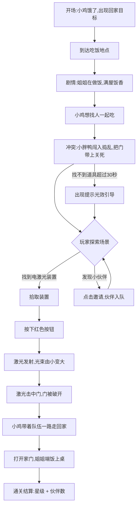

# 《小鸡回家吃饭》游戏策划文档

| 项目 | 内容 |
|---|---|
| 文档名称 | 《小鸡回家吃饭》游戏策划文档 |
| 版本 | v0.2（方向已确认） |
| 状态 | 方向已确认 · 待细化评审 |
| 日期 | 2026-10-02 |
| 来源 | 口述玩法整理 + 首轮决策确认 |
| 文档类型 | 概念 + 玩法 + 关卡策划（不含美术/程序实现方案） |

> **v0.2 更新说明**：已确认四项方向决策——①剧情走「找伙伴一起吃」的合作向；②外来者为调皮对手；③激光用于直接破门；④首版扩到 10 关。据此重写 §1、§3、§5、§7，新增伙伴收集线，并同步更新数值、埋点与里程碑。

---

## 1. 一句话概念

> 饭点到了，小鸡要回家吃饭——它还想**顺便叫上小伙伴们一起吃**。可家门被关上了，它得在场景里找到「电激光装置」，按下按钮发射激光打开门，一路走回家，把伙伴们请上桌。

**定位**：单指操作的**轻解谜闯关小游戏**，关卡短、反馈爽、零文字阅读门槛。

### 核心卖点

1. **爽点直给**：找道具 → 按按钮 → 激光「嗞——」地打出来 → 门炸开，三段式强反馈，三秒内给到满足感。
2. **零门槛**：全图形引导，不识字也能玩，适合低年龄段与休闲玩家。
3. **伙伴收集与和解结局**：每关路上藏着一位小伙伴，走到跟前就能请它一起来吃饭；最后一关全员上桌，连一路捣乱的小胖鸭也能被请进来——从「一个人回家」变成「一桌子人吃饭」。

---

## 2. 游戏概述

| 维度 | 设定 |
|---|---|
| 游戏类型 | 休闲益智 / 轻解谜闯关（Puzzle-Platform Lite） |
| 目标平台 | 手机竖屏优先（iOS / Android / 微信小游戏 / 抖音小游戏） |
| 操作方式 | 单指：点击移动、点击拾取、点击按钮、点击邀请伙伴 |
| 核心受众 | 6–12 岁儿童及其家长；泛休闲玩家 |
| 单局时长 | 单关 60–240 秒；全 10 关约 25 分钟 |
| 关卡体量 | 首版 **10 关**（第 1 关为教学关） |
| 主目标 | 打开家门、回到屋内吃饭（通关条件） |
| 副目标 | 沿途邀请伙伴（可选收集，影响结局演出与奖励，不影响通关） |
| 付费/变现 | 首版不做内购，预留激励视频（复活、提示）位置 |
| 视角 | 2D 横版侧视，镜头跟随主角 |
| 网络需求 | 纯单机可玩，预留云存档 |

---

## 3. 世界观与角色

**背景**：农场边上的小村庄，晚饭时间到了，炊烟升起，家家飘出饭香。小鸡在外面玩够了，肚子咕咕叫——今天它想多叫几个人一起吃。

### 角色表

| 角色 | 定位 | 外观要点 | 行为 |
|---|---|---|---|
| **小鸡**（主角） | 玩家控制角色 | 黄色圆身、橙色喙、短腿，跑动时身体上下弹跳；头顶有「饿」的情绪气泡 | 移动、拾取、按按钮、开门、邀请伙伴 |
| **鸡姐姐** | 友好 NPC | 稍大的母鸡，系围裙，站在灶台前 | 做饭；每关开场在厨房忙活；通关时端饭上桌，按伙伴数量加板凳 |
| **小胖鸭**（外来者） | 调皮的对手 | 圆滚滚，走路一摇一摆，头顶一撮呆毛 | 跑进小鸡地盘捣乱（占桌子 / 撞翻饭锅 / 堵路），捣完乱**把门带上关死**；不偷吃饭菜，只添乱；第 10 关在门外探头，可被邀请入席和解 |
| **小伙伴们** | 可选收集角色（团体） | 小麻雀、田鼠、小羊、小狗、小猫、小猪、小兔、小鹅——体型各异的 Q 版农场动物 | 藏在关卡各处，靠近后点击即可邀请；加入后排队跟在小鸡身后；结局一起上桌吃饭 |
| **电激光装置** | 关键道具 | 银灰色手持盒子，顶部红色按钮，前端发光镜头 | 被拾取后进入道具栏；按键后发射激光 |
| **门** | 核心障碍 | 木门 / 铁门，带门闩；被激光击中后发红、冒烟、碎裂 | 三种状态：开 / 关 / 破 |

### 情感曲线

```
期待（饿了，想回家吃饭，还想叫上伙伴一起）
  → 热闹（姐姐在做饭，满屋饭香）
  → 又好气又好笑（小胖鸭闯进来捣乱，把门带上了）
  → 受挫（门关死了，回不去）
  → 探索（找到电激光装置）
  → 爆发（按下按钮，激光发射，越来越大）
  → 释放（门被打开，顺路把伙伴叫上）
  → 满足（一桌人热热闹闹吃饭，连小胖鸭也坐下了）
```

**情绪基调**：全片无「失去」与「对抗」，小胖鸭的捣乱是喜剧性的，伙伴收集是温暖向的，结局是团圆饭。适合低龄玩家。

---

## 4. 核心玩法

### 4.1 操作

| 操作 | 手势 | 说明 |
|---|---|---|
| 移动 | 点击地面 / 按住拖动 | 小鸡自动走向目标点，遇到障碍停下 |
| 交互 | 点击可交互物 | 拾取道具、按按钮、开门 |
| 邀请伙伴 | 靠近后点击伙伴 | 伙伴加入队伍，跟在小鸡身后 |
| 取消/返回 | 点击空白处 | 取消选中状态 |

### 4.2 核心循环



### 4.3 通关与失败

| 类型 | 条件 |
|---|---|
| **通关条件** | 小鸡打开家门并进入屋内，触发吃饭演出 |
| **副目标** | 邀请本关伙伴（可选，不影响通关，影响星级奖励与结局演出） |
| **失败条件** | 首版不设硬性失败；仅设软性惩罚——激光电量耗尽需等待 3 秒回充，超时不计入三星 |
| **星级评价** | 三星 = 规定时间内完成 + 邀请到本关伙伴 + 未使用提示；二星 = 完成两项；一星 = 使用提示后完成 |

---

## 5. 关卡流程逐段拆解（第 1 关 · 教学关）

> 第 1 关即口述描述的完整流程，N3 节点按「找人一起吃」的决策改写。

| 节点 | 关卡事件 | 玩家行为 | 系统反馈 | 镜头 / 音效 | 引导提示 | 设计目的 |
|---|---|---|---|---|---|---|
| **N1 开场** | 小鸡出现在村口，肚子咕咕叫 | 点击地面，让小鸡走动 | 头顶弹出「肚子饿」气泡 + 远处家门图标闪烁 | 镜头缓慢右移，展示回家路线；轻快 BGM 起 | 手指光点提示「点这里走」 | 建立目标：回家吃饭；教学基础移动 |
| **N2 到达** | 小鸡走到吃饭地点（厨房外） | 走到指定区域 | 触发剧情：鸡姐姐在灶台前炒菜，锅内冒热气，桌上摆着大碗 | 镜头拉近厨房；炒菜「滋啦」声 | 无（剧情自动） | 奖励前置，强化「吃饭」的动机 |
| **N3 想找人一起吃** | 小鸡看着一大桌饭，冒出「想找人一起吃」的念头 | 观看（气泡提示：想找人一起吃） | 头顶出现「+?」伙伴图标；远处小胖鸭溜达登场 | 轻松口哨音 | 无 | 建立副目标，引出伙伴收集线 |
| **N4 冲突** | 小胖鸭跑进小鸡的地盘捣乱，撞翻饭锅、占了桌子，折腾完**把门带上关死** | 观看（可点击小鸭触发搞笑反应） | 小鸭一摇一摆跑走，门「砰」地关上并扣死门闩 | 俏皮音效 + 沉闷关门声，BGM 转紧张 | 门上出现问号气泡 | 制造喜剧冲突，同时设置核心障碍 |
| **N5 障碍** | 门被锁死，回不了家 | 点击门尝试打开 | 门抖动但打不开，弹出「锁住了」图标 | 门闩晃动声 | 无 | 进入解谜状态 |
| **N6 探索** | 场景角落出现电激光装置（半藏在草丛/箱子后） | 点击拾取 | 装置飞入道具栏，弹出「电激光」图示 | 拾取叮咚声 + 装置高亮 | 超时 30 秒未拾取 → 装置处出现闪烁光圈 | 教学探索与拾取 |
| **N7 发射** | 装置进入待发射状态，红色按钮脉动 | 点击按钮 | 激光射出，光束**由细变粗、由短变长**（三段充能），粒子与光晕逐级增强 | 充能声渐强 → 「嗞——」发射音；画面轻微震动 | 按钮上出现手指提示 | **核心爽点**，本关情绪最高峰 |
| **N8 破门** | 激光击中门 | 保持激光照射（或自动持续 2 秒） | 门发红 → 冒烟 → 门闩熔断 → 门碎裂倒下 | 爆裂声 + 慢镜头 0.5 秒 | 无 | 障碍解除的释放感 |
| **N9 归途** | 道路畅通，小鸡一路走回家 | 连续点击/拖动引导小鸡前进 | 沿途小彩蛋（虫子、水坑），走过有脚印 | BGM 转欢快；脚步「哒哒」声 | 路面箭头指引 | 缓冲节奏，给爽点后的平缓收束 |
| **N10 收尾** | 到了家门口，打开门，走进屋 | 点击开门 | 姐姐端来一碗饭，小鸡开心吃，屏幕飘出饭香粒子 | 温暖音效；暖色滤镜 | 无 | 情感闭环，回应开场动机 |
| **N11 结算** | 通关演出 | 点击「下一关」 | 星级结算面板：用时、伙伴数、评价（第 1 关无伙伴，仅展示教学提示） | 礼花粒子 + 胜利音效 | 无 | 留存与推进 |

> **第 1 关不设伙伴**：教学关保持流程纯净，从**第 2 关**开始开放伙伴收集。

---

## 6. 关键机制详解

### 6.1 电激光装置（核心机制）

**三段充能设计**（对应口述「激光出来很大很大的」）：

| 阶段 | 触发 | 表现 | 用途 |
|---|---|---|---|
| **一档 · 细光束** | 按下按钮后 0–0.5s | 细红线，射程 2 格 | 点亮灯笼、触发开关、烧断绳索 |
| **二档 · 粗光束** | 持续按住 0.5–1.5s | 光束变粗，射程 4 格，带粒子 | 击碎木门、烧断粗木条 |
| **三档 · 全功率** | 持续按住 1.5s+ | 光束最大化，射程 6 格，全屏光晕 + 震屏 | 破铁门、熔断大门闩（第 5 关起） |

- **电量机制**：按住消耗电量（100 → 0，约 3 秒耗尽），松开自动回充（3 秒回满）。防止无脑长按，制造节奏。
- **朝向**：光束沿装置当前朝向直线发射，可被镜子反射（第 3 关引入）。
- **安全反馈**：激光打到小鸡自己或伙伴不扣血，只触发「吓一跳」的搞笑动画，避免儿童向游戏的挫败感。

### 6.2 门的状态机

```
[开] --(小胖鸭带上/机关触发)--> [关] --(激光二档照射 2s：木门)--> [破] --> 永久通行
                                  --(激光三档照射 3s：铁门)--> [破]
```

### 6.3 移动与寻路

- 点击地面 → 小鸡自动寻路走过去，途中被障碍阻挡则停在障碍前并播放「撞到」动画。
- 行走速度恒定，不设冲刺；保证低龄玩家跟得上。
- 镜头跟随小鸡，带轻微缓动，不眩晕。

### 6.4 伙伴邀请机制（v0.2 新增）

| 环节 | 规则 |
|---|---|
| **出现** | 每关（第 2 关起）场景内藏 1 位小伙伴，位置略偏离主路线，鼓励探索 |
| **邀请** | 小鸡走到伙伴 **1.5 格**范围内 → 伙伴头顶冒出「！」气泡 → 点击即邀请成功 |
| **跟随** | 伙伴排队跟在小鸡身后，间距 **0.8 格**，走同款步态动画；不影响移动与碰撞 |
| **反馈** | 邀请瞬间：欢呼音效 + 伙伴跳起 + 队伍图标 +1 |
| **结算** | 本关结算显示「已邀请 N 位伙伴」；三星条件包含邀请到本关伙伴 |
| **结局** | 第 10 关通关，所有被邀请过的伙伴全部上桌，按人数加板凳、加菜 |

**设计意图**：伙伴收集不影响通关（不卡关、不惩罚），纯粹提供探索动机与情感回报——与「找个人一起吃」的原始动机直接呼应。

### 6.5 教学策略（第 1 关专用）

采用**「做中学」三层引导**：

1. **演示层**：手指光点动画演示点击位置。
2. **约束层**：教学阶段只开放唯一正确交互，避免误操作。
3. **消退层**：同一操作教学 2 次后，第 3 次不再提示，改由玩家自主完成。

**伙伴机制的教学**放在第 2 关开场，用一次气泡演示即可，不打断第 1 关节奏。

---

## 7. 关卡规划（首版 10 关）

| 关卡 | 名称 | 新引入机制 | 核心解法 | 本关伙伴 | 预计时长 |
|---|---|---|---|---|---|
| **第 1 关** | 回家吃饭 | 移动、拾取、按键、激光发射 | 找装置 → 按键 → 二档破木门 → 走回家 | —（教学关） | 60–90s |
| **第 2 关** | 两道门 | 电量管理 | 电量只够破一道门，先破薄门、等回充再破第二道 | 小麻雀（树上，一档光点亮灯笼引它下来） | 90–120s |
| **第 3 关** | 镜子反射 | 镜面反射 | 门不在直线上，需调整镜子角度把光引到门上 | 田鼠（草丛中，破门后自行探头） | 120–150s |
| **第 4 关** | 被卡住的伙伴 | 一档光束的「切断」用途 | 先用一档烧断绳子救下被吊住的小伙伴，再破门回家 | 小羊（被绳吊住） | 120–150s |
| **第 5 关** | 铁门与晚饭 | 三档持续照射 | 铁门需三档照满 3 秒，中途松手要重来 | 小狗 | 150–180s |
| **第 6 关** | 高处的门 | 场景高低差 / 垫箱子 | 门闩在高处，需垫箱子站上去才能把光打到位 | 小猫（屋顶） | 150–180s |
| **第 7 关** | 双装置 | 两台激光同时照射 | 两束光必须同时命中门才能破，考验电量分配与站位 | 小猪 | 150–180s |
| **第 8 关** | 光路迷宫 | 多镜接力 | 3–4 面镜子接力传导，需规划光路先后顺序 | 小兔 | 180–210s |
| **第 9 关** | 断电危机 | 回充变慢 + 沿途开关 | 电量回充速率减半，需先踩下沿途开关恢复供电再充能 | 小鹅 | 180–210s |
| **第 10 关** | 全家吃饭 | 综合关 | 反射 + 双装置 + 限时冲刺回家，破最后一道大门 | 全员上桌 + 小胖鸭和解选项 | 210–240s |

**难度曲线原则**：
- 每关只引入 **1 个新机制**，前一关机制在下一关必定复用一次后再叠加。
- 第 5 关（中段）与第 10 关（终关）为两个难度峰值，中间第 6–7 关适度回落给玩家喘息。
- 伙伴收集全程可选，**永不卡关**。

**第 10 关结局演出**：破开最后一道大门 → 姐姐端出大锅 → 所有被邀请过的伙伴依次入座（按收集数加板凳）→ 门外小胖鸭探头 → 弹出选择气泡「让它进来吗？」→ 选「进来」触发全员同桌的团圆结局；选「不要」则小胖鸭在窗外看着，仍可通关，但结局演出不同。

---

## 8. UI / UX 流程

```
启动页 → 主界面（开始游戏 / 关卡选择 / 伙伴图鉴 / 设置）
  → 关卡内 HUD（左上：返回；右上：伙伴数 / 电量条；底部：道具栏）
  → 教学气泡（按需弹出）
  → 通关结算（星级 / 用时 / 伙伴数 / 下一关 / 重玩 / 分享）
```

| 界面元素 | 说明 |
|---|---|
| 电量条 | 右上，激光充能时消耗，橙色 → 红色预警 |
| 伙伴数 | 右上电量条旁，小鸡头像 + ×N，邀请时数字跳动放大 |
| 道具栏 | 底部中央，拾取后显示电激光图标 |
| 目标提示 | 顶部常驻简图标（🏠 回家、👥 伙伴），不依赖文字 |
| 伙伴图鉴 | 主界面入口，展示已收集伙伴与未收集剪影，提供长线收集动力 |
| 暂停菜单 | 重玩 / 提示 / 返回主界面 / 音效开关 |

**无障碍与儿童友好**：
- 全程可无文字通关，关键指引用图标 + 动画。
- 无体力、无强制广告、无误触付费弹窗。
- 设置中提供「家长锁」，单次游玩 20 分钟后提醒休息。

---

## 9. 美术与音效

### 美术风格

| 项 | 设定 |
|---|---|
| 风格 | Q 版 2D 手绘，圆润轮廓，粗描边 |
| 色板 | 暖色为主（米黄、奶油、暖橙），激光部分用高饱和青蓝/品红形成强对比 |
| 场景 | 农舍厨房、石板路、草丛、木门 / 铁门、灶台、屋顶、镜子装置 |
| 特效 | 激光：光晕 + 粒子 + 屏幕泛光；破门：碎片 + 烟 + 慢镜；邀请伙伴：小星星 + 跳跃 |
| 分辨率 | 竖屏 750×1334 基准，适配 16:9 ~ 21:9 |

### 音效清单（首版 18 条）

| 类别 | 音效 |
|---|---|
| UI | 按钮点击、面板弹出 |
| 角色 | 小鸡脚步、肚子咕咕、撞到障碍 |
| 道具 | 拾取叮咚、按钮按下、激光充能（渐强）、激光发射、电量耗尽警报 |
| 场景 | 炒菜滋啦、开门、关门、门碎裂、镜子转动 |
| 伙伴（新增） | 伙伴出现提示、邀请成功欢呼、伙伴跟随脚步、图鉴解锁 |
| 结算 | 胜利小号、星级逐颗点亮、吃饭吧唧嘴、**结局大桌吃饭的欢闹环境音** |

**BGM**：轻快的手风琴 + 木琴小品，四段情绪（轻松 / 紧张 / 欢快收尾 / **团圆结局曲**），可无缝切换。

---

## 10. 数值表（首版建议值）

| 参数 | 数值 | 备注 |
|---|---|---|
| 小鸡移动速度 | 3.5 格/秒（224 px/s） | 保证低龄玩家可跟随 |
| 激光射程 | 一档 300px / 二档 500px / 三档 800px | ≈ 4.7 / 7.8 / 12.5 格 |
| 激光电量上限 | 100 | — |
| 按住消耗速率 | **20/秒（满电可连续发射 5 秒）** | 原设 33/秒会导致铁门（1.5s 充能 + 3s 照射）永远破不开，已下调 |
| 松开回充速率 | 33/秒（约 3 秒回满），第 9 关减半为 16.5/秒 | 延迟 0.5s 后开始回充 |
| 充能到二档 | 0.5s | — |
| 充能到三档 | 1.5s | — |
| 破木门所需 | 二档 + 持续 2s（实测耗电约 50） | 满电刚好够破两道木门，第 2 关需中途回充一次 |
| 破铁门所需 | 三档 + 持续 3s（实测耗电约 90） | 第 5 关起；满电仅剩约 1.5s 余量，容错低 |
| 伙伴邀请半径 | 115px（约 1.8 格） | 由 1.5 格放宽，避免玩家"站在边缘点不中" |
| 伙伴跟随间距 | 52px（0.8 格） | — |
| 引导触发超时 | 30s 无操作 | 出现闪烁光圈提示 |
| 发射前提 | 必须站稳在支撑面上 | 禁止"跳着打"，否则可绕过镜子 / 高台谜题 |

**三星时间阈值（逐关）**

| 关卡 | 三星 | 二星 | 一星 |
|---|---|---|---|
| 1 | ≤ 75s | ≤ 110s | 完成即可 |
| 2 | ≤ 105s | ≤ 150s | 完成即可 |
| 3 | ≤ 135s | ≤ 180s | 完成即可 |
| 4 | ≤ 135s | ≤ 180s | 完成即可 |
| 5 | ≤ 165s | ≤ 210s | 完成即可 |
| 6 | ≤ 165s | ≤ 210s | 完成即可 |
| 7 | ≤ 165s | ≤ 210s | 完成即可 |
| 8 | ≤ 195s | ≤ 240s | 完成即可 |
| 9 | ≤ 195s | ≤ 240s | 完成即可 |
| 10 | ≤ 225s | ≤ 280s | 完成即可 |

> 三星需同时满足：时间内完成 + 邀请到本关伙伴 + 未使用提示。上线前按实测数据校准。

---

## 11. 埋点与数据指标

| 指标 | 用途 |
|---|---|
| 关卡进入 / 通关 / 流失人数 | 计算逐关通过率，定位流失点 |
| 平均通关时长 | 校准三星阈值 |
| 卡关点分布（停留最久的场景节点） | 判断提示是否到位、障碍是否过难 |
| 激光使用次数与平均照射时长 | 验证核心爽点是否被充分使用 |
| 提示使用率 | 评估教学有效性 |
| **伙伴邀请率（各关）** | 评估收集线吸引力与伙伴藏匿位置是否合理 |
| **伙伴收集总数分布** | 判断玩家是"顺路收集"还是"刻意全收集" |
| **第 10 关和解选择占比**（让小胖鸭进来 / 不进来） | 验证结局设计的情感效果 |
| 重玩率 | 评估关卡趣味性 |
| 通关分享率 | 评估传播潜力 |

**健康线建议**：第 1 关通过率 ≥ 90%，提示使用率 ≤ 15%，平均时长 60–90s；伙伴整体邀请率 ≥ 60%（低于此值说明伙伴藏得太深或缺少提示）。

---

## 12. 开发里程碑

| 阶段 | 目标 | 交付物 | 建议周期 |
|---|---|---|---|
| **M1 原型** | 验证核心爽点：拾取 → 按键 → 激光 → 破门 | 灰盒 Demo（仅 N6–N8 段） | 1 周 |
| **M2 完整单关** | 第 1 关全链路 + 教学引导 + 结算 | 可玩第 1 关 | 2 周 |
| **M3-a 前半段** | 完成第 2–5 关 + **伙伴邀请机制与图鉴** | 5 关版本，收集线跑通 | 3 周 |
| **M3-b 后半段** | 完成第 6–10 关 + 第 10 关结局演出与和解分支 | 10 关完整版本 | 3 周 |
| **M4 打磨** | 美术音效替换、埋点接入、适配与性能优化 | 可提测版本 | 2 周 |
| **M5 上线** | 渠道包、新手引导 A/B、数据回收 | 上线版本 | 1 周 |

**M1 验证关键问题**：按下按钮发射激光那一刻，玩家是否真的觉得「爽」？若不爽，优先调激光的视觉与音效，而不是加机制。

**M3-a 验证关键问题**：伙伴邀请是否自然发生？若邀请率极低，优先把伙伴移到主路线附近，而不是加强提示弹窗。

---

## 13. 决策记录与待定事项

### 13.1 已确认决策（v0.2）

| # | 决策项 | 结论 | 落地位置 |
|---|---|---|---|
| 1 | 剧情走向 | **找个人一起吃**（合作向）——伙伴收集线，非「饭被抢光」 | §3 角色表、§5 N3、§6.4、§7 第 10 关 |
| 2 | 外来者定位 | **调皮的对手**（小胖鸭）——捣乱带上关门，但不偷吃饭菜；终关可和解 | §3 角色表、§5 N4、§7 第 10 关 |
| 3 | 激光作用 | **直接破门**——二档破木门、三档破铁门 | §6.1、§6.2 |
| 4 | 首版范围 | **10 关** | §7、§10、§12 |

### 13.2 剩余待定（首版不做，列入后续版本池）

| 待定项 | 说明 |
|---|---|
| 好友联机 / 协作解谜 | 两人各持一台激光装置协同开门；开发与联调成本高 |
| 皮肤收集系统 | 小鸡外观解锁；美术量上升 |
| 章节化长线内容 | 10 关后是否按季节/节日推出新章节 |
| 伙伴互动深化 | 伙伴是否具备各自的小技能（如小麻雀飞去高处开门闩） |

---

## 14. 开发实现说明（原型已完成）

策划文档已落地为可玩原型，位置：`/workspace/chick-game/`。

| 项 | 说明 |
|---|---|
| 技术栈 | HTML5 Canvas + 原生 JS，**零依赖、零构建**，双击 `index.html` 即可运行 |
| 分辨率 | 逻辑 750×1334（竖屏），按窗口等比缩放；同时适配桌面浏览器 |
| 美术 | 全部程序化绘制（Canvas 图形），无图片素材 |
| 音效 | WebAudio 实时合成 18 种音效，无音频文件 |
| 文件结构 | `js/levels.js` 关卡数据 · `js/render.js` 渲染 · `js/game.js` 玩法 · `js/ui.js` 界面存档 · `js/audio.js` 音效 |
| 已实现 | 10 关全部关卡、三段充能激光、镜子反射光路、高处门与平台跳跃、绳子切断、双装置协同、电闸供电、伙伴邀请与跟随、星级结算、伙伴图鉴、第 10 关和解结局、localStorage 存档 |

**实测校准的两个设计漏洞（已在实现中修正）**：

1. **铁门原本无解**：电量 3 秒 < 三档充能 1.5s + 照射 3s。已把消耗速率从 33/s 降到 20/s（满电 5 秒）。
2. **谜题可被绕过**：原设计用"矮墙挡光"制造谜题，但玩家走到墙另一侧就能直接开门；且跳跃中发射可打到高处门。已改为——挡光物改为**能量光障板**（挡光不挡人、设定自洽），高处门由**站位高度**强制，并规定**必须站稳才能发射**。
3. **第 7 关死锁**：固定装置原放在门后，玩家过不去。已改为同侧启动 + 6 秒限时窗口。

---

## 15. 附录：原始口述 → 设计映射

| 口述片段（还原后） | 对应文档章节 | 设计转化 |
|---|---|---|
| 小鸡要回去地方吃饭 | §1 一句话概念 / §5 N1 | 主目标 = 回家吃饭 |
| 看见姐姐在做饭 | §3 角色表 / §5 N2 | NPC 鸡姐姐 + 做饭场景 |
| **想找个人把它吃完** | §5 N3 / §6.4 / §7 | **伙伴邀请收集线**（v0.2 按决策改写） |
| 有人去了他地盘吃了 | §3 小胖鸭 / §5 N4 | 调皮对手闯入捣乱并带上关门 |
| 吃完后门关了 | §5 N5 / §6.2 | 核心障碍：门状态机 |
| 找个东西想打开门，发现电激光线 | §5 N6 / §6.1 | 拾取道具：电激光装置 |
| 按一下按钮，激光发射出来，出来很大很大的 | §5 N7 / §6.1 | 核心机制：三段充能发射 |
| 走呀走，走到家，打开门，回到家 | §5 N9–N10 | 归途缓冲 + 情感收尾 |
| 结束啦 | §5 N11 | 通关结算（第 10 关追加团圆结局） |
