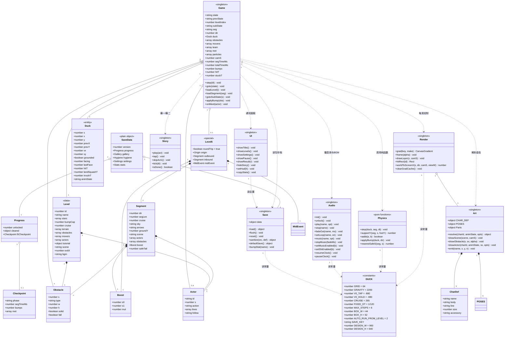
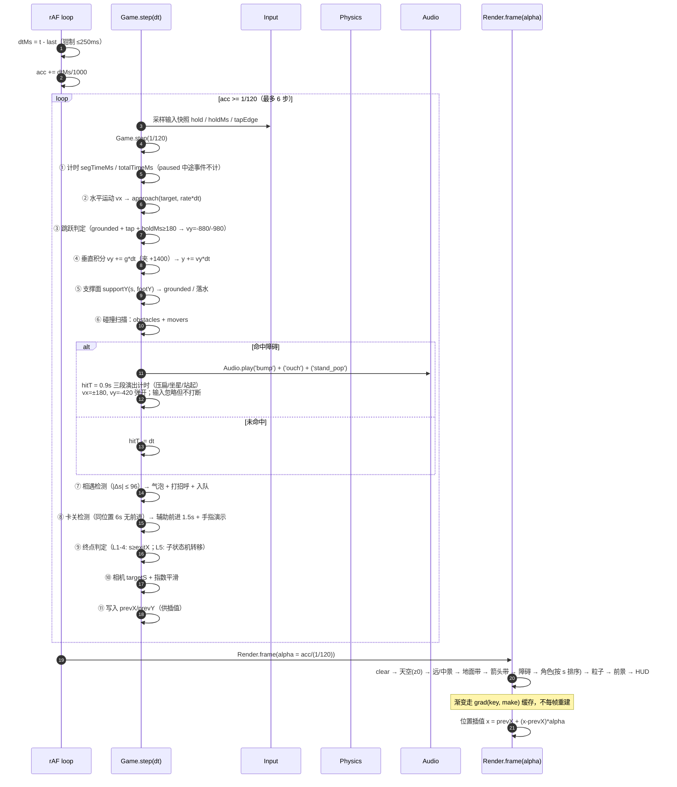
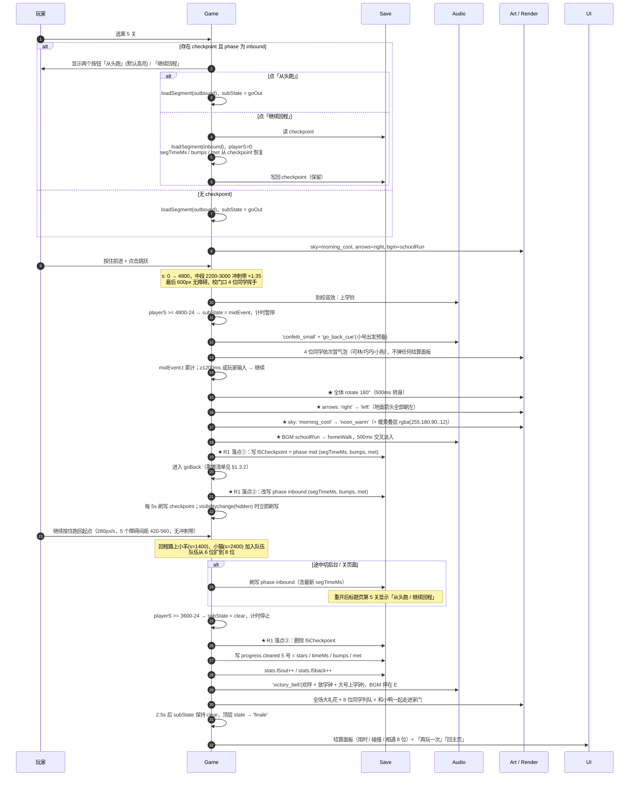
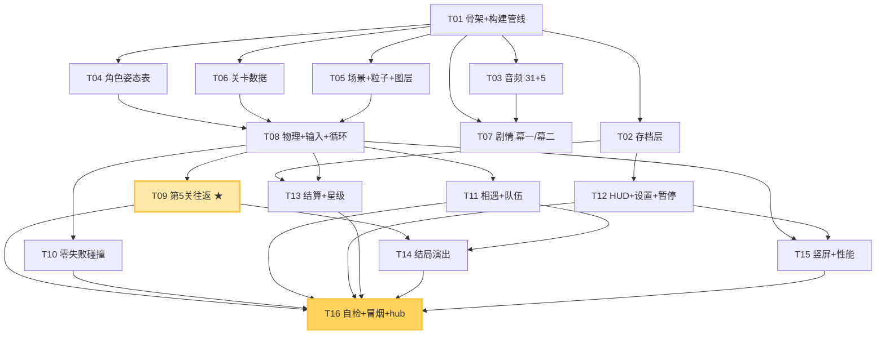

# 《小鸭上学记》架构设计与任务清单

| 项目 | 内容 |
|---|---|
| 文档名称 | 《小鸭上学记》架构设计与任务清单 |
| 版本 | v1.0 |
| 日期 | 2026-10-16 |
| 架构师 | 高见远（software-architect） |
| 唯一需求来源 | `小鸭上学记-游戏策划文档.md` v1.1（854 行） |
| 参考样板 | `chick-dinner/`（唯一多文件工程化范式）、`chick-run/index.html`（同为横版跑酷）、`chick-fan/index.html`（测试钩子 + 循环范式） |
| 交付物 | 本文档（架构决策 + 文件清单 + 调用流程 + 12+ 条任务 + 共享约定 + 踩坑清单） |
| 本文档**不含** | 任何游戏实现代码。工程师按本文档 + PRD 自行实现。 |

---

## 0. 给工程师的 30 秒摘要

| 问题 | 结论 |
|---|---|
| 单文件还是多文件？ | **源码多文件（`src/`）+ 构建脚本产出单文件 `index.html`**。发布物仍然只有一个文件，hub 只认它。 |
| 渲染？ | **Canvas 画世界层**（幕一/幕二/幕三全部）+ **DOM 覆盖层**（菜单/设置/暂停/结算/竖屏引导）。不做 SVG。 |
| 状态机？ | 顶层 7 态 + 第 5 关 4 态子状态机 + L5 专用「进度空间 s + 单点方向映射」坐标系。 |
| 物理？ | 固定步长 1/120s 累加器 + 渲染插值；所有积分写成 `v += a*dt; p += v*dt`。 |
| 存档 key？ | `chick-duck-school:save:v1`，**逐字段类型校验 + 深合并默认态 + 三层 try/catch**，绝不白屏。 |
| 测试钩子？ | `window.__duck`，26 个方法，逐个列在 §5.5。 |
| 最大风险？ | **T09 第 5 关往返赛制**（方向翻转 + 中途事件 + 存档续跑三者耦合）。详见 §6 风险登记。 |

---

# 第一部分 · 架构决策

## 1.1 单文件 vs 多文件 —— 本次最重要的决策

### 结论

> **采用「多文件源码 + 构建脚本内联」方案。**
> 源码在 `chick-duck-school/src/` 下按职责拆成 12 个文件；`build.py` 把它们内联成**唯一发布物 `chick-duck-school/index.html`**。

`chick-duck-school/index.html` 是**构建产物，不是手写源文件**。这一点必须写死，否则工程师和 QA 会在「改哪个文件」上打架。

### 理由（4 条，按权重排序）

**① 规模已经越过单文件的手写舒适区。**

| 对比项 | chick-run（现有最大单文件） | 本作预估 |
|---|---|---|
| 行数 | 1,724 行 | **≈ 4,700 行**（2.7×） |
| 内容量 | 2 关跑酷 + 1 段撞墙结局 | 3 幕 8 段剧情 + 5 关（含往返）+ 9 角色 + 31 音效 + 5 BGM |
| 音频 | 3 段 BGM 硬编码在主文件里 | 31 音效 + 5 BGM，需独立调度器 |
| 存档 | 3 个 localStorage key 的裸数值 | 嵌套 schema + 版本容错 + 损坏回退 |

在 1,700 行的文件里，工程师能靠 Cmd+G 找到任何东西；在 4,700 行、且**有 5 个人（2 个工程师 + QA）会同时读**的文件里不行。QA 要按 §4 的行号区间定位问题，工程师要按分区边界插入代码——单文件下这两个需求直接冲突。

**② 本仓库已经有一个可复用的多文件范式，不需要新发明。**

`chick-dinner/` 的 `build_standalone.py`（37 行）已经解决了「内联 CSS + 内联 JS + 校验无残留外链」这件事：

```python
html = re.sub(r'<link rel="stylesheet" href="([^"]+)">', css_repl, html)
html = re.sub(r'<script src="([^"]+)"></script>', js_repl, html)
left = re.findall(r'(?:src|href)="(?!http)([^"]+)"', html)   # 打印未内联的残留
```

我们**照抄这个脚本，只加一条规则**：JS 文件按**文件名前缀数字升序**拼接，取代 `<script>` 标签的书写顺序。这样加载顺序由文件名决定，不依赖工程师在 HTML 里排顺序（这是多文件项目最常见的低级错误来源）。

**③ 硬约束要求「零外链」，多文件源码天然逼迫我们做构建校验。**

PRD 硬约束 #1 与验收 A9 要求 `grep` 不到任何 `http://` / 外链引用。单手写文件靠自觉；多文件 + 构建脚本的「残留外链检查」是**机器强制**的。每次 build 自动打印残留列表，非空即视为构建失败。

**④ 反向成本几乎为零。**

发布物仍是**一个 HTML 文件，双击即开，断网可玩**（硬约束 #2、#6、验收 A10 全部满足）。hub 的 `<a href="./chick-duck-school/index.html">` 不用改任何东西。源码目录对玩家不可见，对部署脚本不可见。

### 两种方案的具体形态（都给出，因为工程师可能需要对比）

#### 方案 A：单文件（不推荐）

- 预估体积：**180–210 KB**（未压缩），在 A14 的 300KB 上限内，余量充足。
- 代码分区（预估行号，交付时按实际微调）：

| 分区 | 行号区间（预估） | 职责 |
|---|---|---|
| §0 CSS（`:root` token / 布局 / 覆盖层） | 1–380 | DNA token、DOM 覆盖层样式 |
| §1 常量与 token | 381–470 | `G/V0/CRUISE/GRID`、配色、圆角、缓动 |
| §2 存档层 | 471–620 | schema / 深合并 / 容错 |
| §3 音频层 | 621–840 | WebAudio 引擎 + 31 音效 + 5 BGM |
| §4 美术层（角色/场景/道具/特效） | 841–1,740 | 9 角色 × 姿态表、5 套场景、粒子 |
| §5 关卡数据 | 1,741–2,000 | 5 关（含 L5 两段） |
| §6 剧情层（幕一/幕二时间轴） | 2,001–2,380 | 8 段时间轴 |
| §7 物理与碰撞 | 2,381–2,620 | 固定步长、AABB、支撑面 |
| §8 游戏主体（循环 + 状态机 + L5 子状态机） | 2,621–3,240 | 本作最复杂的一段 |
| §9 渲染层 | 3,241–3,940 | 视口、图层、视差 |
| §10 UI 覆盖层 | 3,941–4,360 | 菜单/设置/暂停/结算 |
| §11 入口（适配 / 输入 / 钩子） | 4,361–4,700 | DPR、指针、键盘、`__duck` |

- **否决理由**：12 个分区、4,700 行、多人并行编辑。分区行号是「约定」而非「边界」——任何人加 50 行都会让后面所有行号失效，QA 的定位手段随之失效。

#### 方案 B：多文件 + 构建（**采纳**）

```
chick-duck-school/
├── index.html                    ← 【构建产物·唯一发布物】零外链，双击即开，勿手改
├── build.py                      ← 【构建脚本】照抄 chick-dinner/build_standalone.py + 数字前缀排序
├── README.md                     ← 运行/构建/测试说明（可后补）
└── src/
    ├── index.template.html       ← 页面骨架：<link> / <script src> 占位 + DOM 覆盖层结构
    ├── style.css                 ← 全部 CSS
    └── js/
        ├── 00-const.js           ← 常量与设计 token 的 JS 侧镜像
        ├── 05-save.js            ← 存档层
        ├── 10-audio.js           ← WebAudio 引擎 + 音效 + BGM
        ├── 20-art.js             ← 程序化绘图：角色 / 场景 / 道具 / 特效
        ├── 30-levels.js          ← 关卡数据（改关只动这个文件）
        ├── 40-story.js           ← 幕一 / 幕二 8 段时间轴
        ├── 50-physics.js         ← 定步长积分、AABB、支撑面、弹开
        ├── 60-game.js            ← 主循环 + 顶层状态机 + L5 子状态机 + 碰撞编排
        ├── 70-render.js          ← 视口 / 图层 / 视差 / HUD 图标
        ├── 80-ui.js              ← DOM 覆盖层：菜单 / 关卡选择 / 设置 / 暂停 / 结算 / 引导
        └── 90-main.js            ← 入口：DPR 适配、指针/键盘、钩子、启动
```

- **加载顺序由文件名前缀决定**，与 `index.template.html` 里的书写顺序无关。`90-main.js` 必须最后（它做启动）。
- 每个模块用 `(function(global){ 'use strict'; ... })(window);` IIFE 包裹（沿用 `chick-dinner/js/*.js` 的写法），**不导出一个巨型全局对象**，只挂必要的单例：

| 全局名 | 归属文件 | 说明 |
|---|---|---|
| `window.DUCK` | 00-const | 只读常量与 token |
| `window.Save` | 05-save | `Save.load() / Save.data / Save.flush() / Save.reset()` |
| `window.Audio` | 10-audio | `Audio.play(name, opt) / Audio.music(name) / Audio.setMusic(on) / ...` |
| `window.Art` | 20-art | 角色/场景/道具绘制函数表 |
| `window.Levels` | 30-levels | `Levels.LEVELS` |
| `window.Story` | 40-story | 8 段时间轴定义与播放器 |
| `window.Physics` | 50-physics | `Physics.step() / Physics.supportY() / Physics.aabb()` |
| `window.Game` | 60-game | 游戏主体（唯一有状态的对象） |
| `window.Render` | 70-render | `Render.frame(alpha)` |
| `window.UI` | 80-ui | DOM 覆盖层控制 |
| `window.__duck` | 90-main | 测试钩子 |

- **`build.py` 的改造点（相对 chick-dinner 版）**：
  1. JS 拼接顺序 = `sorted(glob('src/js/*.js'))`（文件名字典序即数字前缀序）。
  2. 拼接时插入 `/* ==== src/js/60-game.js ==== */` 分隔注释，**保留分区可定位性**（这是单文件方案丢掉的东西，这里补回来）。
  3. 保留原有的「未内联外部引用」检查，改为**构建失败条件**：非空则 `sys.exit(1)`。
  4. 输出 `index.html`，并打印体积；若 > 300KB 打印警告。

---

## 1.2 渲染架构 —— Canvas 世界层 + DOM 覆盖层（混合）

### 结论

> **双层混合，但不是「幕一用 DOM、幕三用 canvas」那种按幕切渲染器的混合。**
> 分工是**按「世界内」与「世界外」切**：

| 层 | 技术 | 承载内容 |
|---|---|---|
| **世界层**（单张 canvas，`#cv`） | Canvas 2D | 幕一卧室、幕二卧室/卫生间、幕三五关跑道、所有角色、所有气泡、粒子、地面箭头、HUD 图标类元素（星星/进度/⏩） |
| **覆盖层**（DOM，`#ui`） | HTML + CSS | 主菜单、关卡选择、设置（含家长统计）、暂停面板、结算面板、竖屏旋转引导、图鉴 |

### 为什么剧情幕也用 canvas（而不是 DOM/SVG）

1. **姿态复用是硬需求。** 小鸭的 15 个姿态（睡、呼噜、揉眼、伸懒腰、扭动、搓手、擦手、跑 4 帧、跳、落、坐地星星、挥手、挽手走）在幕一、幕二、幕三**都要出现**。如果幕二用 DOM/SVG，这 15 个姿态要写两遍（Canvas 一遍 + SVG 一遍），或者写 15 套 SVG——两倍工作量、两处不一致的 bug 源。放 canvas 里，`Art.drawDuck(pose, opts)` 一个函数走天下。
2. **视差与呼吸起伏需要连续变换。** 被子随呼吸起伏、影子晃动、泡泡从小到大、阳光从左向右扫过——这些是 canvas 里改几个数值的事，在 DOM 里要动 `@keyframes` 或 JS 定时改样式，且会和 §6 提到的 `@keyframes` 覆盖 `transform` 坑打架。
3. **零失败表演需要逐帧可控。** 碰撞三段演出（压扁 → 坐地星星 → 站起）是 0.9 秒内的连续形变，canvas 一个 `scale()` 搞定。
4. **本仓库既成事实。** chick-run、chick-fan 都是纯 canvas 跑酷，chick-ufo 也是 canvas。工程师的肌肉记忆在这里。

### 为什么 UI 面板还是要 DOM

1. **可访问性与文本渲染**：设置页、家长统计面板有真实文字（`复制统计数据（JSON）` 按钮），canvas 画文字要自己处理换行/滚动/选区，成本高收益低。
2. **CSS 过渡白拿**：面板淡入淡出、按钮按压反馈用 `--ease` / `--dur` 两个 token 即可，canvas 要自己写缓动。
3. **44px 热区用 CSS 保证**：`min-height:44px; min-width:44px` 一行搞定且可被 QA 用 DevTools 直接量；canvas 里画按钮要手算命中盒。
4. **这些面板是「世界外」的**，画在 canvas 上没有任何收益。

> **边界铁律**：canvas 内的可点元素（⏩ 跳过、暂停）**热区由逻辑坐标算出，且渲染与命中共用同一个 `hitRect()` 函数**，不允许出现「画了但点不到」或「看不见但点得到」。

### 图层与视口

**逻辑坐标系**：x 向右，y 向下，基准 `960 × 640`（PRD §2/§15）。竖屏视野改为 `960 × 900`（PRD §6.1），**视野变高而不是变窄**。

**图层顺序（从后到前）**，每层一个独立 draw 函数：

| z | 层 | 视差系数 | 内容 |
|---|---|---|---|
| 0 | 天空 | 0（不滚） | 渐变（去程冷 `#DFF0FA` / 回程暖 `#FFE9B8`，PRD §5.2.5）+ 云 + 远处上学钟/放学钟 |
| 1 | 远景 | 0.25 | 树篱 / 麦田 / 远山 / 热气球剪影 |
| 2 | 中景 | 0.55 | 树、矮墙、荷塘对岸、校门拱门 |
| 3 | 地面带 | 1.0 | 地平线带（**每场景一条可无缝循环的图案带**，用 `pattern` 横向偏移） |
| 4 | 地面箭头带 | 1.0 | **方向指示器**（去程朝右 / 回程朝左，见 §1.3 L5 设计） |
| 5 | 障碍 / 平台 | 1.0 | 台阶、南瓜、水洼、荷叶、高台 |
| 6 | 角色 | 1.0 | 小鸭 + 跟随队伍（按 `s` 排序后绘制，靠后的先画） |
| 7 | 粒子 | 1.0 | 星星、泡泡、彩带、纸屑、水花 |
| 8 | 前景 | 1.35 | 近景草叶、模糊的树（可有可无，用于纵深） |
| 9 | HUD（canvas 内） | — | 星星计数、进度条、⏩ 跳过按钮 |
| — | DOM 覆盖层 | — | 菜单 / 面板 / 引导（`#ui`，`pointer-events` 按层开关） |

**视口滚动（去程 4800px / 回程 3600px）**：

- 相机只沿 x 轴滚动，y 固定（跑酷无纵向关卡设计，竖屏时 y 方向多出的 260px 全部给天空）。
- 相机锚点用**指数平滑**（帧率无关）：`camS += (targetS - camS) * (1 - Math.exp(-8 * dt))`。
  - ❌ 不要写 `camS += (targetS - camS) * 0.15` —— 那是帧率相关的，120Hz iPad 上会快一倍。
- 相机夹紧：`camS ∈ [0, segLen]`，两端不越界（不露黑）。
- 小鸭在屏幕上的横向位置：横屏固定在 **38%** 处（左侧留出前方视野），竖屏固定在 **32%** 处（视野更高但宽度不变）。

**渐变必须缓存**：沿用 `chick-run` 的 `grad(key, make)` 模式。`createLinearGradient` 每帧重建在 iPad 上是实测可见的开销。天空有 2 套（去程冷 / 回程暖）+ 地面 5 套 + 场景若干，缓存 key 用 `'sky_out' / 'sky_in' / 'ground_village'` 这类语义串。**注意**：切换去程/回程时不要清空整个缓存，只换 key。

---

## 1.3 游戏主循环与状态机（补全 PRD §5.2.7 / §15）

### 1.3.1 顶层状态机

```
BOOT ──读存档(容错)──> TITLE ──开始──> ACT1 ──幕一结束──> ACT2
                                                      │
                          ┌───────────────────────────┘
                          v
                        ACT3 ──第5关回程跑回起点──> FINALE ──> TITLE
                          │                                  ↑
                          └──每关结算: 1-4 关 ──下一关────────┘（FINALE 后回 TITLE）

任意状态 ──visibilitychange(hidden)──> PAUSED ──恢复──> 原状态
任意状态 ──Esc / ❚❚──> PAUSED
```

**顶层状态枚举（写死，不要加别的）**：

```js
Game.state = 'boot' | 'title' | 'act1' | 'act2' | 'act3' | 'finale' | 'paused'
Game.prevState = ...   // paused 时记住来源
```

- `act1` / `act2` / `act3` / `finale` **共用同一个 rAF 循环**，只是 `update` 分派到不同的 update 函数。**不要为每个幕各起一个循环**（chick-fan 已经踩过：多处 rAF 会导致两个循环同时跑、帧率翻倍）。
- `paused` 时循环**继续跑但只渲染不更新**（或直接 `stopLoop()`，二选一，全项目统一）。推荐 `stopLoop()` + 恢复时 `last = 0` 重取时间基准（沿用 chick-fan 做法），避免后台回来瞬间补一大堆物理帧。

### 1.3.2 第 5 关子状态机（本文档对 PRD §5.2.7 的补全）

PRD 已给方向（`GO_OUT → MID_EVENT → GO_BACK → CLEAR`），以下补齐**转移条件、字段重置清单、存档落点**。

#### 坐标系决策：进度空间 `s`（本关最关键的实现决策）

**不要做世界坐标镜像。** PRD §10.2 给了两个选项（镜像 / `direction: -1`），两者都可以，但镜像方案会让重力、支撑面判定、荷叶落点判定全部要写两遍，且必然出现「回程站在荷叶上却掉水里」这类镜像 bug。

**采纳方案：进度空间 `s`（progress space）**

- 关卡数据里所有 x 一律存成 **`s`（沿行进方向的累计距离，0 → segLen）**，永远从左到右递增。
- 屏幕上 x 的映射**全项目只有一个函数**：

```js
// dir = +1 去程（向右跑） / -1 回程（向左跑）
function worldToScreenX(s, dir, camS, viewW) {
  return dir === 1 ? (s - camS) : (viewW - (s - camS));
}
```

- 相机锚点：去程 `camS = playerS - viewW * 0.38`；回程 `camS = playerS - viewW * 0.62`（因为往左跑，要让右边留出前方视野）。
- **重力恒为 `+y`，`supportY(s, footY)` 与 `direction` 无关**——荷叶、水洼、高台的支撑面判定去程回程**完全共用同一份代码**。这是本决策最大的收益：R4（回程难度反而变难）的一半风险自动消失。
- **角色朝向翻转只发生在绘制时**：`ctx.save(); ctx.scale(dir * facing, 1); Art.drawXxx(); ctx.restore();`
  - ⚠️ **禁止对整个 canvas 做 `ctx.scale(-1,1)` 全局镜像**——那会把文字（气泡台词、星星数）也镜像掉。翻转必须**逐实体**做。
  - ⚠️ 翻转后**描边宽度会被视觉缩放**，需要用 `ctx.lineWidth = 3 / Math.abs(scale)` 抵消，否则回程描边变粗。这是逐实体翻转的第二个坑。

#### 状态转移表

| # | 从 | 事件 / 条件 | 到 | 计时是否累计 |
|---|---|---|---|---|
| T1 | `GO_OUT` | `playerS ≥ 4800 - 24`（触碰校门拱线） | `MID_EVENT` | **暂停累计** |
| T2 | `MID_EVENT` | `t ≥ 1.2s` **或** 玩家点击/按住（PRD：输入可响应，不强制等） | `GO_BACK` | 恢复累计 |
| T3 | `GO_BACK` | `playerS ≥ 3600 - 24`（触碰起点旗） | `CLEAR` | **停止累计** |
| T4 | `CLEAR` | 胜利演出播完（≥2.5s） | `FINALE`（顶层） | — |
| T5 | 任意 | `Esc` | `paused` | 暂停 |
| T6 | `paused` | 恢复 | 回原状态 | 恢复 |

- **T1 的 24px 容差**：碰撞盒 44×52，`playerS + 22 ≥ 4800` 即触发。写成 `playerS >= segLen - 24` 而不是 `>= segLen`，否则会因一帧位移跨过终点而漏触发。
- **T2 的输入响应**：中途事件演出期间玩家按住不放，出演完立刻起步。手感上「没有中断」。

#### 进入 `GO_BACK` 时必须重置的字段（清单，逐项对照实现）

| 字段 | 重置为 | 为什么 |
|---|---|---|
| `seg` | `'inbound'` | 切数据源 |
| `dir` | `-1` | 方向翻转 |
| `playerS` | `0` | 回程从校门起算 |
| `player.y` | `groundY`（该段地面高度） | 校门和起点地面高度可能不同 |
| `player.vy` | `0` | 清垂直速度 |
| `player.grounded` | `true` | |
| `player.hitT` | `0` | 若去程末尾正在碰撞演出，必须清掉 |
| `player.invulnT` | `0.3` | 给 0.3s 无敌，防止转身瞬间撞上校门旁的同学 |
| `camS` | 立即 snap 到回程起点（**不要平滑**，否则开局 1 秒镜头在追） | |
| `obstacles` | 用 `seg.inbound.obstacles` **整体重建** | 去程障碍必须消失（R4） |
| `arrows.key` | `'in'` | **地面箭头全部朝左**（R2 最高优先级） |
| `sky.key` | `'in'` | 色调偏暖（冷→暖） |
| `bgm` | `D → E`，**0.5s 交叉淡入** | |
| `particles` | 清空 | |
| `met`（已相遇集合） | **保留** | 跨段跟随 |
| `team`（跟随队伍） | **保留并置为已激活** | 8 位同学跨段跟随 |
| `bumps`（碰撞计数） | **保留**（第 5 关是一个整体） | 三星按去程+回程合计 |
| `segTimeMs` | **保留**（继续累加） | 三星按合计 95s |
| `midEventT` | `0` | |
| `checkpoint` | 写 `{phase:'mid'}` → T2 完成时改写 `'inbound'` | R1 |

**明确不清的**：`bumps` / `met` / `team` / `segTimeMs` / `stats.l5out`。这四项是第 5 关「一个整体」的体现，清掉会导致三星判定和相遇统计全错。

#### `l5Checkpoint` 存档落点（R1 完整策略）

> 下表中的状态名沿用 PRD §5.2.7 的大写写法（`GO_OUT / MID_EVENT / GO_BACK / CLEAR`），代码里一律写成 lowerCamel 字符串（`goOut / midEvent / goBack / clear`，见 §5.1）。

| 时刻 | 写入内容 | 说明 |
|---|---|---|
| 进入 `MID_EVENT`（T1） | `{phase:'mid', segTimeMs, bumps, met}` | 事件本身可续，孩子不会卡在事件里 |
| `MID_EVENT` 结束（T2） | `{phase:'inbound', segTimeMs, bumps, met}` | PRD §10.4 明确要求的一步 |
| `GO_BACK` 运行中 | 每 **5 秒**刷写一次 `{phase:'inbound', segTimeMs, bumps, met}` | 覆盖「回程中途切后台/关页面」 |
| `visibilitychange → hidden` | 立即刷写 | 关页面不一定来得及等 5s |
| `CLEAR`（T3） | **删除 checkpoint**，写 `progress.cleared['5']` | PRD §10.4 |

**重开第 5 关时的询问式复用**（PRD §10.4）：标题页/关卡选择页第 5 关按钮，若存在 `phase==='inbound'` 的 checkpoint，显示**两个选项**：

- 「从头跑」（**默认高亮**，5 岁孩子不必理解续档）
- 「继续回程」（给想省事的大人）

「继续回程」的实现 = 用 `inbound` 段数据重建关卡 + 玩家置于 `s=0` + 从 checkpoint **恢复 `segTimeMs` / `bumps` / `met`**，让三星判定与不中断游玩保持可比。⚠️ 这是个**设计判断**（PRD 未明说），已列入 §7 待确认清单 Q-A。

---

### 1.3.3 固定步长物理 + 渲染插值（PRD §6.2）

```js
const FIXED_DT = 1 / 120;   // 秒
const MAX_STEPS = 6;        // 单帧最多 6 个物理步；超出则丢弃累加器余量（防死亡螺旋）

function loop(t) {
  raf = requestAnimationFrame(loop);           // 唯一的一处续帧请求
  if (!last) last = t;                        // startLoop 后第一帧重取基准
  let dtMs = t - last; last = t;
  if (dtMs > 250) dtMs = 250;                 // 后台回来/长卡顿时钳制
  acc += dtMs / 1000;

  let steps = 0;
  while (acc >= FIXED_DT && steps < MAX_STEPS) { Game.step(FIXED_DT); acc -= FIXED_DT; steps++; }
  if (steps === MAX_STEPS) acc = 0;            // 追不上就丢弃，绝不无限追帧

  Render.frame(acc / FIXED_DT);                // alpha ∈ [0,1) 用于插值
}
```

**渲染插值的落地**（PRD 说「渲染插值」但没给方法，这里定死）：

- `Game.step()` 里每次积分后，把位置写入 `prevX/prevY`（步前值）。
- 渲染时用 `x = prevX + (x - prevX) * alpha`，`y` 同理。
- 角色朝向、压扁 scale 等**非位置量不插值**（直接用当前值），否则会出现抖动。

**帧率无关的运动（这是本作最容易写错的地方）**：

```js
// ✅ 正确：显式乘 dt
duck.vy += GRAVITY * dt;
duck.y  += duck.vy * dt;
duck.s  += duck.vx * dt;

// ❌ 错误：per-frame 增量（60Hz 与 120Hz 表现不同，跳得更高）
duck.vy += GRAVITY;
duck.y  += duck.vy;
```

- 速度**不是直接赋值**：`vx` 由「目标巡航速 + 加/减速时间」逼近：

```js
// 按住：0.35s 达到巡航；松开：0.25s 停下
const target = holding ? cruise * (autoRun ? 1 : 1) : 0;
const rate = holding ? (cruise / 0.35) : (cruise / 0.25);
duck.vx = approach(duck.vx, target, rate * dt);
```

- `AUTO_RUN_FROM_LEVEL` 生效时（第 2 关起）：`target = cruise * 1.0` 恒定（松手不减到 0，而是减到 `cruise * 0.85`，保留 1.15× 加速手感差异 —— PRD §6.1 要求②）。
- 跳跃：`if (tap && duck.grounded) { duck.vy = (holdMs >= 180) ? -980 : -880; duck.grounded = false; }`
  - `holdMs` 从 `pointerdown` 记到 `pointerup`。抬手才判定跳，所以**必须允许「先按住蓄力再抬手跳」**。
  - 空中 `tap` 无效（防二段跳，PRD §6.1/§5.2 第 3 关）。
- `vy` 夹在 `+1400` 以内（PRD §6.2 防穿地）。

**为什么必须固定步长**：PRD 要求 iPad 120Hz 与 60Hz 手感与跳跃高度完全一致。用 per-frame 增量的话，120Hz 上跳跃高度会变成 2 倍——这是**验收 A14「稳定 60fps」背后真正的杀手**，而且只在 120Hz 设备上复现，极难排查。

---

## 2. 数据模型

### 2.1 关卡数据（`src/js/30-levels.js`）

**设计原则**：5 关共用同一套运行逻辑，关卡文件里**只有数据，没有分支**。改数值只动这一个文件（沿用 `chick-dinner/js/levels.js` 的约定）。

```js
window.Levels = { LEVELS: [ /* 关 1..5，第 5 关是特例 */ ] };
```

#### 第 1–4 关结构（统一 schema）

```js
{
  id: 1,
  name: '跳一跳，跳上学',
  stars: [30, 42],            // [3星秒数, 2星秒数]；第 5 关是 [95, 125]
  bumpCap: 12,               // 超出不扣星，仅统计
  cruise: 265,               // 巡航速
  groundY: 520,              // 地面 y（逻辑坐标）
  // —— 地形：连续的路段，运行时按 s 求支撑面 ——
  terrain: [
    { s: 0,    len: 2400, y: 520, kind: 'road'  },
  ],
  // —— 障碍：全部用 s 坐标 ——
  obstacles: [
    { s: 700,  type: 'step',  w: 96, h: 32,  solid: true  },  // solid=撞到要弹开
    { s: 1080, type: 'step',  w: 96, h: 32,  solid: true  },
    { s: 1460, type: 'step',  w: 96, h: 32,  solid: true  },
  ],
  // —— 移动障碍：dir 为自身滚动方向，与关卡方向无关 ——
  movers: [],                 // 第 2 关：{ s0:600, s1:3200, y:groundY-28, w:56,h:56, type:'pumpkin', speed:90 }
  // —— 剧情角色站位 ——
  actors: [
    { id:'sheep', s:1440, action:'jumpWait', lines:['早安，小鸭！','上学去呀？'], follow:'lead' },
  ],
  // —— 教学 ——
  tutorial: {                 // 第 1 关：手指光点动画脚本
    steps: [
      { kind:'holdDemo', sFrom: 200, sTo: 600, durMs: 2000 },
      { kind:'tapDemo',  sFrom: 600, sTo: 900, durMs: 2000, times: 2 },
    ]
  },
  scene: 'village_start',
  exitX: 2400,                // 出口箭头
  bgm: 'schoolMarch',        // 第 1-4 关都是 C
}
```

**各关差异只在数据，不在代码**：

| 关 | scene | 关键数据 |
|---|---|---|
| 1 跳一跳 | `village_start` | 3 个 `step`（s 间距 380）；`tutorial` 存在 |
| 2 跑一跑 | `wheat_road` | 5 个 `pumpkin` 间距 420–520，`movers` 里；`actors:[qiaoqiao@s600]` |
| 3 再跳跳 | `mud_puddles` | 4 个 `puddle`（w96）间距 260 + 1 个 `high`（h56）；`actors:[cat@s...]`，节拍脚本 |
| 4 荷叶小路 | `lotus_pond` | 3 个 `lotus`（w160/128/112）间距 210，`solid:false, fall:true`；`actors:[kelin@对岸]` |
| 5 往返 | `school_road` | 见下 |

#### 第 5 关结构（PRD §5.2.7 要求的 `{outbound, inbound}`）

```js
{
  id: 5,
  name: '跑到学校，再跑回家！',
  stars: [95, 125],
  bumpCap: 26,                 // 去程+回程合计上限
  roundTrip: true,
  // —— 起点集合点（第 5 关专属）——
  origin: { s: 60,  y: 520, flag: true },      // 去程出生点 & 回程胜利点
  // —— 去程 ——
  outbound: {
    dir: 1,
    segLen: 4800,
    cruise: 265,
    sky: 'morning_cool',       // #DFF0FA 冷
    arrows: 'right',
    groundY: 520,
    scene: 'school_road',
    actors: [ {id:'dog'|'pig'|'rabbit'|'goose', s:4560, action:'wave', lines:[...]}, ... ],
    obstacles: [ /* 8 个混合：pumpkin / hobby_horse / pinwheel，间距 320-400 */ ],
    // 冲刺带：s0..s1 之间 cruise ×1.35
    boost: { s0: 2200, s1: 3000, mul: 1.35 },  // 800px
    safeTail: 600,             // 最后 600px 无障碍
  },
  // —— 回程 ——
  inbound: {
    dir: -1,
    segLen: 3600,
    cruise: 280,
    sky: 'noon_warm',          // #FFE9B8 暖
    arrows: 'left',            // ★ R2 最高优先级：全部朝左
    groundY: 520,
    scene: 'school_road_in',   // 同一条路，另一套配色
    actors: [ {id:'sheep', s:1400, action:'join', lines:['我们也回家啦！']},
              {id:'cat',   s:2400, action:'join', lines:['等等我们！']} ],
    obstacles: [ /* 5 个同类型，间距 420-560 */ ],
    boost: null,               // ★ R4：取消冲刺带
    safeTail: 500,             // 最后 500px 无障碍
  },
  midEvent: {
    durMs: 1200,
    lines: [ {id:'kelin',   text:'再跑回来呀！'},
             {id:'qiaoqiao',text:'我们一起回家！'},
             {id:'dog',     text:'等你哦！'} ],
    turnMs: 500,               // 全体转身 180°
    confetti: 'small',         // 小规模彩带（非通关大礼花）
  },
  bgm: { outbound: 'schoolRun', inbound: 'homeWalk', crossfadeMs: 500 },
}
```

**关键设计点**：

- **方向只存在于 `outbound.dir` / `inbound.dir` 两个数字**。所有物理、支撑面、落点判定代码**完全不知道有方向这回事**（方向只被 `worldToScreenX` 和角色绘制翻转消费）。
- **角色站位 `s` 在两段里都是「该段内的进度」**，所以回程的小羊在 `s=1400` 表示「从校门出发 1400px 处」，不是世界坐标 1400。
- **`safeTail` 是数据不是逻辑**：`obstacles` 生成时就不在最后 `safeTail` 范围内放障碍，运行时不做特判。
- **队伍跨段**：回程 `actors` 里的 `action:'join'` 是「从路边加入队伍」，去程遇到的 6 位 + 中途全员 = 8 位。队伍数据结构见 §2.3。

---

### 2.2 存档结构与损坏回退（补全 PRD §10.4）

#### 完整 schema

```js
window.DUCK.SAVE_KEY = 'chick-duck-school:save:v1';
window.DUCK.SAVE_VERSION = 1;

function defaultSave() {
  return {
    version: 1,
    progress: {
      unlocked: 1,                                  // 1..5
      cleared: {},                                  // { "1": {stars,timeMs,bumps,met:[]} , ... }
      l5Checkpoint: null,                           // null | {phase,segTimeMs,bumps,met}
    },
    gallery: { sheep:false, cat:false, dog:false, pig:false, rabbit:false,
               goose:false, qiaoqiao:false, kelin:false },   // 8 位（D7：首版不打通，但字段先留）
    hygiene: { potty:false, wash:false, wipe:false, bag:false },  // 四枚勾
    settings: { music:true, sfx:true, rotTipShown:false },
    stats: {
      totalRuns:0, totalBumps:0,
      firstPlayAt:null, lastPlayAt:null,
      l5out:0, l5back:0,              // 去程/回程完成率（PRD §11.1）
      inboundStuck:0,                 // 回程方向困惑率
      act1Skip:0,                     // 幕一跳过率
      stuckCount:0, autoRun:0,        // 卡关检测 / 辅助前进
      orientation:'unknown'           // 'portrait' | 'landscape'
    }
  };
}
```

#### 损坏回退策略（本节是硬约束 #7 的落地，QA 验收 A8 的依据）

**核心思想：存档的任何异常都不允许冒泡到启动流程。**

```js
function load() {
  var DEFAULT = defaultSave();
  var raw;
  try { raw = localStorage.getItem(SAVE_KEY); }
  catch (e) { return DEFAULT; }                    // ← 第 1 层：隐私模式 / 禁用存储
  if (raw == null) return DEFAULT;                 // 新玩家

  var parsed;
  try { parsed = JSON.parse(raw); }
  catch (e) { return DEFAULT; }                    // ← 第 2 层：JSON 损坏（QA 手改测试的主力路径）
  if (parsed === null || typeof parsed !== 'object' || Array.isArray(parsed)) return DEFAULT;  // ← 第 3 层：类型错

  // 第 4 层：逐字段类型校验 + 深合并。**只接受类型匹配的字段，其余一律回默认**。
  return sanitize(parsed, DEFAULT);
}
```

**`sanitize(src, def)` 的规则（逐条实现，不许偷懒用 `Object.assign`）**：

| 情况 | 处理 |
|---|---|
| `def` 是普通对象、`src` 同键存在且也是普通对象 | 递归 sanitize |
| `def` 是 number | `typeof src === 'number' && isFinite(src)` 才取，否则取默认；**并做区间钳制**（如 `unlocked` 钳到 `[1,5]`、`bumps` 钳到 `[0,9999]`） |
| `def` 是 boolean | `typeof src === 'boolean'` 才取 |
| `def` 是 string | `typeof src === 'string'` 才取；**且做枚举白名单校验**（`orientation` 只认 `'portrait'/'landscape'`，其他回默认） |
| `def` 是 null | 显式检查 null；`l5Checkpoint` 还要校验 `phase ∈ {'mid','inbound'}` 且 `segTimeMs` 是有限正数，否则置 null |
| `def` 是数组 | `Array.isArray(src)` 才取，并**过滤非法元素**（`met` 只留 8 位同学 id 白名单内的字符串） |
| `src` 有 `def` 没有的键 | **丢弃**（不 merge 未知键，防止旧版/恶意数据渗入） |
| `src.version > SAVE_VERSION`（未来版本） | 整体回 `DEFAULT`（前向不兼容，宁可重置也不乱读） |

**写入也必须包 try/catch**：

```js
function flush() {
  try { localStorage.setItem(SAVE_KEY, JSON.stringify(data)); }
  catch (e) { /* 配额满 / Safari 隐私模式：静默失败，游戏继续 */ }
}
```

**兜底再兜底**：整个 `boot()` 体外层再包一层 try/catch，catch 里走一条「**无存档最小启动路径**」（能进标题页、能玩，只是不保存）。这样即使 `load()` 里有你没预料到的 bug，也只是丢存档而不是白屏。

**QA 可验证的三个断言**（对应 A8）：

1. `localStorage.setItem(KEY, '{{{')` → 刷新 → 正常进标题页
2. `localStorage.setItem(KEY, '{"progress":{"unlocked":"abc"}}')` → 刷新 → `unlocked === 1`（不是 NaN）
3. `localStorage.setItem(KEY, '[]')` → 刷新 → 正常进标题页

---

### 2.3 角色数据：9 位 × 多姿态，如何不做成 if-else 泥潭

**问题**：9 位角色（主角 + 8 位同学），主角 15 个姿态、同学各 2–4 个，加起来约 **40+ 个姿态**。如果写成
`if (id==='duck' && pose==='sleep') drawSleep(); else if (id==='sheep' && pose==='walk') ...`
—— 40 个分支两两嵌套，会变成 800 行且**加一个姿态要改 5 个地方**。

**方案：三层数据驱动 —— 「角色描述 + 姿态构件 + 姿态表」**

#### 第 1 层：角色描述（`CHAR_DEF`，纯数据）

```js
CHAR_DEF = {
  duck: {
    name:'小鸭', body:'#FFE9A8', line:'#F7C948', beak:'#FF9A3C',
    size: 56,                       // 视觉直径（碰撞盒 44×52，比视觉小 20%）
    shadow:'rgba(74,55,34,.16)',
    accessory:'bag',               // 书包（第 2 幕之后）
  },
  kelin: { name:'可林', body:'#F5D08A', line:'#D9A05B', ear:'flop', hat:'#7FB2E5', size:48, accessory:'ball' },
  // … 共 9 条，配色沿用 chick-dinner（PRD §3.2）
}
```

#### 第 2 层：姿态构件（可复用的绘制积木，约 12 个）

这些是**跨角色复用**的原子绘制函数，全部定义在 `Art.Parts`：

| 构件 | 说明 | 谁用 |
|---|---|---|
| `Parts.body(ctx, def, opt)` | 圆身 + 3px 描边 + 椭圆软影 | 全部 |
| `Parts.earUp / earFlop / earPoint` | 长耳(垂/竖) / 尖耳 | 可林·巧巧·小兔 / 小猫 |
| `Parts.wool / curl` | 卷毛 | 小羊 |
| `Parts.hornTuft` | 头顶呆毛 | 鸭子类 |
| `Parts.beakFlat / beakLong` | 扁喙 / 长喙 | 小鸭 / 小鹅 |
| `Parts.legPair(t, phase)` | 两条小短脚，`phase` = 跑动帧号 | 全部 |
| `Parts.face(expr, blinkT)` | 5 种表情：`normal / happy / sleepy / ouch >_< / @_@` + 眨眼 | 全部 |
| `Parts.bag / ball / hat / carrotBag` | 道具 | 对应角色 |
| `Parts.tailUp / tailCurl` | 翘尾 / 卷尾 | 小猫 / 小猪 |
| `Parts.tongue` | 舌头 | 小狗 |

#### 第 3 层：姿态表（`POSES[id][poseName] = drawFn`）

```js
Art.POSES.duck = {
  sleep:    (c,d,o) => { /* 闭眼 + 口微张 + 侧躺（整体 rotate -8°） */ },
  snore:    (c,d,o) => { /* sleep + 张口 + 鼻孔气泡锚点 */ },
  rubEye:   (c,d,o) => { /* sleepy + 手揉眼，o.t 驱动 */ },
  stretch:  (c,d,o) => { /* 身体 scaleY 1.15 + 双臂高举，o.t 驱动 */ },
  fidget:   (c,d,o) => { /* 原地扭，o.t 驱动 */ },
  wash:     (c,d,o) => { /* 搓手 + 泡泡 */ },
  wipe:     (c,d,o) => { /* 纸巾 */ },
  standBag: (c,d,o) => { /* 站立 + 书包 */ },
  run:      (c,d,o) => { /* o.frame ∈ 0..3 四帧循环 */ },
  jump:     (c,d,o) => { /* 拉伸 scaleY 1.12 */ },
  fall:     (c,d,o) => { /* 压扁 scaleY 0.88 */ },
  land:     (c,d,o) => { /* 压扁 scaleY 0.7，o.t 衰减回弹 */ },
  sitStars: (c,d,o) => { /* ★ 坐地 + 头顶 3 星绕圈 + @_@ */ },
  wave:     (c,d,o) => { /* 开心挥手 */ },
  walkArm:  (c,d,o) => { /* 挽手走，o.partner 决定挽哪边 */ },
};
// 同学同理，每个 2-4 条
```

#### 姿态解析：一个函数，不是 40 个分支

```js
// 返回 { def, drawFn, extra } —— 渲染层只跟这一个函数打交道
Art.resolve(charId, animState, opts) {
  // animState 是由 Game 计算出的语义字符串：'run' | 'jump' | 'fall' | 'land'
  // | 'sitStars' | 'stand' | 'wave' | 'jumpWait' | 'join' | 'walk'
  const P = Art.POSES[charId] || Art.POSES.sheep;
  const name = P[animState] ? animState : P.default;
  return { def: CHAR_DEF[charId], draw: P[name], pose: name };
}
```

**加一个新姿态的成本**：在 `Parts` 加构件（若有）+ 在对应角色的 `POSES` 加一条函数。**其它 8 个角色一行不动。** 这就是数据驱动的全部价值。

#### `animState` 的计算规则（写在 `Game`，不写在 `Art`）

| 条件（优先级从上到下） | animState |
|---|---|
| `hitT > 0` | `sitStars`（>0.55s 后转 `land`） |
| `!grounded && vy > 0` | `fall` |
| `!grounded && vy <= 0` | `jump` |
| `landSquashT > 0` | `land` |
| `Math.abs(vx) > 30` | `run`（`frame = floor(t * vx / 28 / 2) % 4`，PRD §6.2 步频 = 速度/28） |
| 其余 | `stand` / 剧情指定姿态 |

**跑动帧号公式直接对应 PRD 的步频**：`frame = floor(bobT * (vx/28) / 2) % 4`，`bobT` 是累计时间。这样速度变化时步频自动跟随（PRD §6.2 要求），且**帧号与渲染帧率无关**（用累计时间而非帧计数）。

**朝向**：`faceScale = dir * (vx === 0 ? lastFace : Math.sign(vx))`，只在 `vx` 跨零时更新 `lastFace`，避免抖动。逐实体 `ctx.scale(faceScale, 1)` 后调用 `draw`，并用 `ctx.lineWidth = 3 / Math.abs(faceScale)` 抵消描边缩放。

### 2.4 数据结构与接口总览（classDiagram）

> 这张图是 §2.1 / §2.2 / §2.3 三节的收敛视图，也是工程师写代码时的**接口契约**。
> 关系已明确标注：`1 *` = 一对多，`1` = 一对一，`o *` = 组合（生命周期绑定）。



**图例**：`<<constants>>` 常量命名空间 · `<<singleton>>` 全局唯一实例 · `<<pure functions>>` 无状态纯函数（可单测） · `<<data>>` / `<<plain object>>` 纯数据 · `<<entity>>` 运行时实体。

> **Mermaid 类图约定**：属性统一写 `类型 名称`（不带可见性符号，避免部分渲染器对 `+`/`-` 支持不一致）；类之间只标 5 种关系（组合/聚合/依赖），不画方法参数。**方法签名以 §2 各节的代码块为准，本图只表达「有什么、谁拥有谁」。**

---

## 3. 程序调用流程

### 3.1 启动 → 读存档 → 幕一 → 幕二 → 幕三 → 结局

```mermaid
sequenceDiagram
    autonumber
    participant U as 玩家
    participant M as 90-main.js
    participant S as 05-save.js
    participant G as 60-game.js
    participant A as 10-audio.js
    participant St as 40-story.js
    participant UI as 80-ui.js

    U->>M: 双击 index.html / 从 hub 点进来
    M->>M: applyDpr + fit() 布局适配
    M->>S: Save.load()
    alt localStorage 不可用 / JSON 损坏 / 类型错 / 版本超前
        S-->>M: 返回 defaultSave()（静默，不报错不白屏）
    else 正常
        S-->>M: 返回 sanitize 后的存档
    end
    M->>A: Audio.init()（懒创建 AudioContext，不 resume）
    M->>UI: UI.showTitle(save)
    M->>G: Game.state = 'title'
    M->>M: startLoop()

    U->>UI: 点「开始上学」
    UI->>G: Game.goto('act1')
    G->>A: Audio.play('sunlight'); Audio.music('nightLullaby')
    G->>St: Story.play('act1')
    Note over St: 幕一约 25s：呼吸起伏 → 呼噜 3 段递进<br/>→ 6s 渐弱（底线 3.2s）→ 静默 1s → 金光扫过

    alt 玩家未操作
        St-->>G: t >= 25000ms
    else 玩家点击画面或 ⏩ 按钮
        U->>St: pointerdown
        St->>A: Audio.fadeOut('snore', 300) + Audio.stopMusic(300)
        Note over St: 从当前进度平滑续演渐弱尾段，不重新开始；<br/>渐弱演出仍需播满剩余的 3.2s 底线
    end
    St-->>G: act1 done
    G->>A: Audio.music('schoolMarch', fadeMs 500)
    G->>St: Story.play('act2')

    loop 幕二 6 段，每段一次点击
        U->>St: pointerdown
        St->>G: Save.data.hygiene 置位（如 wash=true）→ Save.flush()
        G->>UI: 四个勾点亮进度
    end
    St-->>G: act2 done（上学铃响）
    G->>G: Game.goto('act3'); Game.loadLevel(1)
    G->>UI: UI.hideStory()

    loop 关 1 → 2 → 3 → 4
        G->>G: 本关跑完 → 结算面板（星星/用时/碰撞/相遇）
        U->>UI: 点「下一关」
        G->>G: Game.loadLevel(n+1)
    end

    G->>G: Game.loadLevel(5) → 子状态 goOut
    G->>G: 跑回起点 → clear → 胜利演出 → 顶层 finale
    G->>UI: UI.showResult(总评) + 「再玩一次 / 回主页」
    U->>UI: 点「回主页」
    UI->>G: Game.goto('title'); Save.flush()
```

### 3.2 一帧的完整循环



### 3.3 第 5 关：去程 → 中途事件 → 回程 → 回起点结算（含 R1 存档落点）



---

## 4. 文件清单

采纳方案 B。`index.html` 为构建产物，下表不含它。

| # | 路径 | 单一职责 | 行数预估 | 关键导出 / 全局 |
|---|---|---|---|---|
| 1 | `chick-duck-school/index.html` | **【构建产物】**唯一发布物，零外链，双击即开 | ≈4,800 | — |
| 2 | `chick-duck-school/build.py` | 内联 CSS/JS → index.html；按文件名前缀排序；残留外链即构建失败 | 70 | — |
| 3 | `chick-duck-school/src/index.template.html` | 页面骨架：viewport-fit=cover、`#stage > #app > (#cv + #ui)`、`<link>`/`<script src>` 占位、DOM 覆盖层全部面板结构 | 220 | — |
| 4 | `chick-duck-school/src/style.css` | `:root` DNA token、布局、DOM 覆盖层、竖屏引导、safe-area、dvh | 400 | — |
| 5 | `chick-duck-school/src/js/00-const.js` | JS 侧常量镜像：`GRID/G/V0/CRUISE/BOX/FIXED_DT/AUTO_RUN_FROM_LEVEL/SAVE_KEY/TOKENS` | 100 | `window.DUCK` |
| 6 | `chick-duck-school/src/js/05-save.js` | `defaultSave / sanitize / load / flush / reset`；统计打点 | 160 | `window.Save` |
| 7 | `chick-duck-school/src/js/10-audio.js` | WebAudio 引擎（tone/noise/包络/总线）+ 31 音效 + 5 BGM 调度 + 音乐/音效双开关 | 220 | `window.Audio` |
| 8 | `chick-duck-school/src/js/20-art.js` | `CHAR_DEF`（9）+ `Art.Parts`（12 构件）+ `Art.POSES`（40+ 姿态）+ 5 场景 + 道具 + 粒子 + `Art.resolve` | 900 | `window.Art` |
| 9 | `chick-duck-school/src/js/30-levels.js` | 5 关数据（第 5 关 `{outbound, inbound, midEvent}`） | 260 | `window.Levels` |
| 10 | `chick-duck-school/src/js/40-story.js` | 幕一/幕二 8 段时间轴；幕一 25s 演出 + 可跳过 + 0.3s 淡出 + 3.2s 底线 | 380 | `window.Story` |
| 11 | `chick-duck-school/src/js/50-physics.js` | `supportY / step / aabb / applyBump`；方向无关的纯函数 | 240 | `window.Physics` |
| 12 | `chick-duck-school/src/js/60-game.js` | 主循环 + 顶层状态机 + L5 子状态机 + 碰撞编排 + 相机 + 相遇 + 卡关兜底 | 640 | `window.Game` |
| 13 | `chick-duck-school/src/js/70-render.js` | 10 层绘制 + `grad()` 缓存 + 视口 + 插值 + canvas 内 HUD + `hitRect` | 700 | `window.Render` |
| 14 | `chick-duck-school/src/js/80-ui.js` | DOM 覆盖层：标题/关卡选择/设置/暂停/结算/图鉴/竖屏引导 | 420 | `window.UI` |
| 15 | `chick-duck-school/src/js/90-main.js` | 入口：DPR 适配、指针/键盘、visibilitychange、钩子 `__duck`、启动 | 270 | `window.__duck` |
| | | **合计** | **≈4,760** | |

> 行数预估含注释。超出预估 20% 以内可接受；超出 30% 说明某个任务范围过大，拆开（见 §4 任务清单的可拆分标记）。

---

## 5. 共享知识（跨任务一次性约定）

> **这一节是工程师写第 8 个任务时唯一需要回看的内容。**

### 5.1 命名约定

| 类别 | 约定 | 正例 | 反例 |
|---|---|---|---|
| 全局单例 | **PascalCase**，只挂 11 个（见 §1.1 表） | `Game`, `Audio`, `Save` | ~~`game`, `gAudio`~~ |
| 纯函数 | **camelCase**，模块内不重复 `模块名` 前缀 | `supportY(s, footY)` | ~~`physicsSupportY()~~ |
| 常量 | **SCREAMING_SNAKE**，集中在 `00-const.js` | `GRAVITY`, `CRUISE`, `FIXED_DT` | ~~`gravity`~~ |
| 状态枚举值 | **lowerCamel 字符串字面量** | `'goOut' 'midEvent' 'goBack' 'clear'` | ~~`'GO_OUT'~~ |
| 私有成员 | 前缀 `_` | `Game._acc`, `_prevX` | ~~`Game.acc`~~ |
| 关节/姿态名 | **lowerCamel，与 `Art.POSES` 键一一对应** | `'sitStars'`, `'wash'` | ~~`'SIT_STARS'~~ |
| 角色 id | **lowerCamel，8 位同学 + duck，共 9** | `duck qiaoqiao kelin sheep cat dog pig rabbit goose` | ~~`xiaoYang`~~ |
| 音效名 | **lowerCamel，与 `Audio.play()` 参数一致** | `play('jump') play('ouch') play('schoolBell')` | ~~`play(' Jump ')~~ |
| BGM 名 | **lowerCamel + `_` 结尾标识** | `nightLullaby schoolMarch schoolRun homeWalk` | — |
| 临时循环变量 | 一律 **`i`**，不写 `idx / index / k`（沿用本仓库既有风格） | `for (var i = 0; i < n; i++)` | — |
| DOM id | **kebab-case**，画布用 `#cv`，覆盖层 `#ui` | `#screen-pause`, `#btn-resume` | — |
| 文件名 | **两位数字前缀 + kebab-case** | `60-game.js`, `70-render.js` | — |

**JS 语言级别**：全项目 **ES5 + `var`**（不写 `let/const/箭头函数/class`）。理由：chick-dinner 与 chick-run 全部是 ES5，单文件内联无需转译；混用 ES5/ES6 会让内联顺序与作用域判断变难。若工程师坚持用部分 ES6，**必须在 PR 说明里声明改了哪几处**，不允许静默混用。

### 5.2 配色 token 全表（与现有 5 个游戏完全一致）

```css
:root{
  /* —— 小鸡 DNA 8 色（硬约束 #8，禁止新增色系）—— */
  --bg:        #FFFBEC;   /* 背景    */
  --bg-soft:   #FFF6E0;   /* 浅底    */
  --chick:     #FFD35C;   /* 主黄（留给 UI：按钮/进度条/星星）*/
  --chick-br:  #F7C948;   /* 深黄    */
  --beak:      #FF9A3C;   /* 橙（喙/脚）*/
  --comb:      #E4453A;   /* 红（点缀/强调）*/
  --ink:       #4A3722;   /* 深棕（描边/文字）*/
  --ink-soft:  #8A7250;   /* 浅棕（次要文字）*/

  /* —— 本作新增 1 色：小鸭主角（D6 已定）—— */
  --duck-body: #FFE9A8;   /* 小鸭淡黄身 */
  --duck-line: #F7C948;   /* 小鸭深黄描边（复用 --chick-br，不新增）*/

  /* —— 场景派生色（同色系延展，允许）—— */
  --sky-out-a:#DFF0FA; --sky-out-b:#FFF3D0;   /* 第5关去程 晨光偏冷 */
  --sky-in-a: #FFE9B8; --sky-in-b:#FFCF8A;    /* 第5关回程 午后偏暖 */
  --warm-veil:rgba(255,180,90,.12);            /* 回程暖黄叠层 */
  --shadow:   rgba(74,55,34,.16);              /* 全角色统一椭圆软影 */
  --line-w:   3px;                             /* 全角色统一描边宽 */
}
```

**9 位角色配色表**（沿用 chick-dinner，`cat` 需注意：PRD §3.2 写 `#8E8B96 小猫` 是**灰**猫，但 §3.2 外观要点写「奶油橘色」——**矛盾，已列入 §7 待确认 Q-B**，实现时先按 `#8E8B96`，因为 PRD §3.2 的复用理由里明确列了这个色值）：

| id | name | body | line | 特征件 | PRD 出处 |
|---|---|---|---|---|---|
| `duck` | 小鸭 | `#FFE9A8` | `#F7C948` | 扁喙 `#FF9A3C` + 呆毛 + 书包 | §3.2 / §9.4 |
| `qiaoqiao` | 巧巧（小兔） | `#F2EDE4` | `#D9C9B4` | 长耳 + 小揪揪 + 书包 | §3.2（淡粉白圆身） |
| `kelin` | 可林（小狗） | `#F5D08A` | `#D9A05B` | 垂耳 + 小蓝帽 `#7FB2E5` + 皮球 | §3.2（奶黄） |
| `sheep` | 小羊 | `#F2EDE4` | `#D9C9B4` | 卷毛 | §3.2 明确给色值 |
| `cat` | 小猫 | `#8E8B96` | `#6E6B76` | 尖耳 + 翘尾 | §3.2 明确给色值 |
| `dog` | 小狗 | `#D9A05B` | `#B07C3E` | 垂耳 + 舌头 | §3.2 明确给色值 |
| `pig` | 小猪 | `#F0A7B4` | `#D4838F` | 卷尾 | §3.2 明确给色值 |
| `rabbit` | 小兔 | `#EFE6DA` | `#D2C6B4` | 长耳 + 胡萝卜包 | §3.2 明确给色值 |
| `goose` | 小鹅 | `#F5F2E8` | `#D8D2C0` | 扁脖 + 长喙 | §3.2 明确给色值 |

**A12 验收自查**：`grep -oE '#[0-9A-Fa-f]{6}' index.html | sort -u`，逐个对照：上表 + 8 色 token 之外，只允许出现 `--sky-*` / `--warm-veil` / `--shadow` 三个派生组。出现任何冷色新色系（如 `#4A90D9`）即判不通过。

### 5.3 圆角 / 缓动 / 字号 三档值

```css
:root{
  --r-sm:14px;  --r-md:18px;  --r-lg:22px;                    /* 三档圆角，全站唯一来源 */
  --ease:cubic-bezier(.22,.61,.36,1);  --dur:.22s;             /* 统一缓动 */
  --dur-fast:.18s;  --dur-slow:.26s;                          /* 仅这两档扩展，不许自定义 */
}
```

| 字号 | 值 | 用途 |
|---|---|---|
| 小 | 12–14px | 次要标签、统计数字 |
| 中 | 15–18px | 按钮文字、关卡名 |
| 大 | 22–34px | 标题、结算主数字 |

- **圆角只有 14/18/22 三个值**，不出现 `10px` / `16px` / `999px`（进度条胶囊除外）。
- **canvas 内绘制的圆角 UI**（星星、进度胶囊）也用同三档的等比值：`7 / 9 / 11`（逻辑坐标按 960/750 缩放）。
- **canvas 内不写 `@keyframes`**，所有动画由 JS 驱动（见 §6 踩坑 #5）。
- **字体栈**：`"PingFang SC","Microsoft YaHei",-apple-system,BlinkMacSystemFont,"Segoe UI",sans-serif`。**禁止 `Comic Sans MS`**（iOS 无此字体，会退化成衬线体，儿童向页面观感灾难）。
- **canvas 字体**：`ctx.font = '600 22px "PingFang SC", sans-serif'`，字号与 CSS 同尺度。

### 5.4 音频模块 API（`window.Audio`）

**调用约定：`Audio.play(name, opt)` / `Audio.music(name, opt)`，全部 try/catch 包在内部，永不抛。**

```js
Audio.init()                          // 启动时调用：只准备，不 resume（等首次手势）
Audio.unlock()                        // 首次 pointerdown 时调用：resume AudioContext
Audio.play(name, opt)                 // 音效。opt: {vol, rate, delay, pan}
Audio.stop(name)                      // 停掉具名持续音（snore / water_flow 等）
Audio.fadeOut(name, ms)               // ★ 幕一跳过用：ms=300 线性淡出到 0 再停
Audio.setLoop(name, on)               // 呼噜等循环音开关
Audio.music(name, opt)                // 切 BGM。opt: {fadeMs} 交叉淡入淡出
Audio.stopMusic(fadeMs)               // 渐弱 BGM A（幕一「安静了」必须真静音）
Audio.setMusicEnabled(bool)           // 家长开关
Audio.setSfxEnabled(bool)             // 家长开关
Audio.isMusicEnabled() / isSfxEnabled()
Audio.resumeClock() / pauseClock()    // 切后台停调度时钟，回来重设 timebase（防积压音符）
```

**30 条音效 + 4 条通用 UI 音效的命名表**（`Audio.play()` 的合法参数，**必须全部实现，不许留占位**）：

| 类别 | 名称 | 对应 PRD # |
|---|---|---|
| 幕一 | `snore` `zzz` `snore_fade` `sunlight` | 1 2 3 4 |
| 幕二 | `birdcall` `yawn` `belly_rumble` `door_close` `toilet_moan` `flush` `tap_water` `scrub` `bubble_pop` `wipe` `water_fling` `schoolBell` | 5–16 |
| 玩法 | `run_step` `jump` `land` `jump_high` `ouch` `sit_stars` `lotus_dunk` | 17–23 |
| 剧情 | `greet_hi` | 24 |
| 结算 | `star_ding` `cheer_win` | 25 26 |
| 第 5 关 | `go_back_cue` `victory_bell`（BGM D/E 由 `Audio.music('schoolRun'/'homeWalk')` 调，不走 `play()`） | 27–30 |
| 通用 | `ui_tap` `ui_back` `ui_pause` `confetti_small` `confetti_big` | 补充 |

**硬规则**：
1. **同名音效 60ms 内重复触发忽略**（防连续跳跃爆音，PRD §8.3）。
2. **同时发声数 ≤ 3**，超出丢弃最旧的。
3. 音量分层：`master = 0.5`；`sfxBus = 0.9`；`musicBus = 0.9`；`snoreBus` 独立（幕一渐弱只动它）。
4. 所有包络用 `setValueAtTime` + `exponentialRampToValueAtTime`，**gain 不能线性到 0**（指数到 0 会得到 NaN），最小值用 `0.0001`。
5. BGM 用**前瞻调度时钟**（`setInterval(25ms)` + 预排 0.1s），不用 `setTimeout` 连打（会漂移）。

### 5.5 测试钩子约定（`window.__duck`）

QA 的自动化冒烟测试**只依赖**这一个对象。**新增功能必须同步新增或更新钩子。**

| 方法 | 返回 | 自动化用途 |
|---|---|---|
| `__duck.version` | `string` | 构建版本标识 |
| `__duck.state()` | `'boot'\|'title'\|'act1'\|'act2'\|'act3'\|'finale'\|'paused'` | 顶层状态断言 |
| `__duck.subState()` | L5：`'goOut'\|'midEvent'\|'goBack'\|'clear'`；其余关：`'-'` | **A7b ①③⑤ 的核心断言** |
| `__duck.level()` | `0`–`5`（0=未进关） | |
| `__duck.duck()` | `{s, x, y, vy, vx, grounded, facing, dir, pose}` | 物理断言 |
| `__duck.cam()` | `{s}` | 相机断言 |
| `__duck.progress()` | `{segLen, s, pct}` | |
| `__duck.obstacles()` | 视口内 `[{s,type,w,h,solid}]` | |
| `__duck.team()` | `[{id, s}]` | §7.1 相遇核对 |
| `__duck.met()` | `string[]`（8 位白名单内 id） | A6 |
| `__duck.stats()` | `{bumps, segTimeMs, totalTimeMs, assistCount, stuckCount, level}` | B2/B3/R2 |
| `__duck.save()` | 当前内存存档对象（**活引用**，可直接改） | |
| `__duck.saveRaw()` | `localStorage` 里的原始字符串 | A8 |
| `__duck.resetSave()` | 写回默认存档并 `flush()` | |
| `__duck.corruptSave(kind)` | 写坏存档：`'json'\|'type'\|'array'\|'null'` | **A8 三种损坏路径一键复现** |
| `__duck.jump(holdMs)` | 触发一次跳跃（可选蓄力 ms） | **A16 / 物理验证** |
| `__duck.hold(on)` | 模拟按住 / 松开 | 手势自动化 |
| `__duck.tap()` | 模拟一次点击（走完整 pointer 事件链） | |
| `__duck.goto(where)` | `'title'\|'act1'\|'act2'\|'level1'..'level5'\|'finale'` | 快进，跳过 25s 幕一 |
| `__duck.skipAct1()` | 触发幕一跳过 | **A2b** |
| `__duck.snoreGain()` | 当前呼噜音量 `0`–`1` | **A2b ③：断言 0.3s 淡出且不突变** |
| `__duck.l5checkpoint(write)` | 写/读/删 `l5Checkpoint` | **R1 / A8** |
| `__duck.loopInfo()` | `{running, fps, stepsLastFrame, accMs}` | A14 性能 |
| `__duck.gradCount()` | 渐变缓存条目数 | 性能回归（不应随时间增长） |
| `__duck.hitTest(x, y)` | 命中哪个可点元素或 `null` | 44px 热区验证 |
| `__duck.arrowDir()` | `'right'\|'left'\|'-'` | **A7b ③：断言回程箭头朝左** |

**约定**：
- 所有方法**同步返回**，不做 Promise（自动化脚本要 `await page.evaluate(() => __duck.state())`，Promise 会让断言变脆）。
- 所有方法**不得抛异常**；异常路径返回 `null`。
- `__duck` 在 `90-main.js` 末尾挂载，且**必须在 `startLoop()` 之前**（自动化脚本一进页面就要能用）。
- 配套提供 `window.__duck.ready = true`，供脚本等待。

### 5.6 坐标换算约定（与 DPR 无关，本仓库既定做法）

```js
// 屏幕(clientX) → 逻辑坐标。rect 是 CSS 像素，DESIGN_W 是逻辑像素，与 devicePixelRatio 无关。
function toLogical(clientX, clientY) {
  return {
    x: (clientX - rect.left) / rect.width  * DESIGN_W,
    y: (clientY - rect.top)  / rect.height * DESIGN_H
  };
}
```

- **绝对不要直接用 `clientX`**。canvas 的 `width/height` 属性被 DPR 放大了，但 `getBoundingClientRect()` 返回的是 CSS 像素，两者差 `dpr` 倍。
- `getBoundingClientRect()` **不允许在 `pointermove` / rAF 里调用**（每次触发强制布局，iPad 上直接掉帧）。用 `measure()` 缓存，**只在 resize / fit 之后测一次**（沿用 chick-dinner/main.js 的做法）。
- canvas 画的是 `camS` 处的视口，所以**世界坐标还需叠加相机**：

```js
function clientToWorld(clientX, clientY) {
  const p = toLogical(clientX, clientY);
  const dir = Game.dir || 1;
  // 屏幕 x → 进度 s（与 worldToScreenX 互逆）
  const s = dir === 1 ? p.x + Game.camS : (DESIGN_W - p.x) + Game.camS;
  return { s, y: p.y };
}
```

- **往返一致性必须自测**：在 `s` 处点一下，再 `__duck.duck().s` 读回来，误差 < 2px。

### 5.7 其它跨任务约定

- **提交格式**：每个任务一条 git 提交，message `T0X: <标题>`。任务号出现在 commit message 里，便于回溯。
- **构建校验**：每个任务结束前必须跑 `python3 build.py` 并确认无「未内联的外部引用」。
- **代码分区注释**：每个 `src/js/*.js` 顶部保留 `/* ===== 文件名 · 职责 · 依赖 ===== */` 三行块注释。
- **禁止**：`http://` / `https://` / `cdn` / `fetch` / `XMLHttpRequest` / `import` / `require` / 外链字体 / 图片文件 / 音频文件。验收用 `grep -nE 'https?://|cdn|fetch\(|XMLHttpRequest|]*href="http' src/` 判定。
- **单文件体积**：`build.py` 输出体积，> 300KB 报警。
- **调试日志**：统一 `window.__log = []` 环形缓冲（上限 200 条），`console.log` 一律改走它，避免 iPad Safari 的 console 开销拖慢帧率。

---

## 6. 任务清单（16 条，按实现顺序）

> **并行分组**：A 组串行起步 → B/C/D/E 组可并行 → F 组集成。每条任务给出**可执行的验收判定**与**最易踩的坑**。

---

### T01 · 项目骨架 + 构建管线
- **产出**：`build.py`、`src/index.template.html`、`src/style.css`（token + 布局 + DOM 覆盖层空面板）、`src/js/00-const.js`、`src/js/90-main.js`（仅适配 + 空循环 + `__duck` 骨架）
- **依赖**：无（**必须第一个做**）
- **工作量**：≈ 1,050 行 ｜ **优先级 P0**
- **验收**：
  1. `python3 build.py` 生成 `index.html`，打印体积且**「未内联的外部引用：无」**。
  2. 双击 `index.html` 能看到一个 960×640 的深色画布 + 标题面板，无 JS 报错。
  3. `__duck.state() === 'title'`，`__duck.loopInfo().running === true`。
  4. iPad 横屏 / 手机竖屏切换，画布等比缩放不裁切、不变形；`__duck.gradCount()` 可读。
  5. 切后台再回来，**没有瞬间补一大段物理帧**（`loopInfo().stepsLastFrame ≤ 6`）。
- **⚠️ 最易踩**：① 多处 `requestAnimationFrame` 导致两个循环同时跑（帧率翻倍）——全项目只允许一处续帧请求；② `pointermove` 里调 `getBoundingClientRect()` 导致每帧强制布局；③ `canvas.width` 每次 resize 都重设会清屏+重分配显存——必须只在 `fit` 真的变了（`Math.abs(fit - lastFit) > 0.002`）时才改。
- **可拆分**：否（T01 是其余任务的地基）

---

### T02 · 存档层 + 损坏回退
- **产出**：`src/js/05-save.js`
- **依赖**：T01
- **工作量**：≈ 160 行 ｜ **P0**
- **验收**：
  1. `__duck.corruptSave('json')` 后刷新 → 正常进标题页，`unlocked === 1`。
  2. `corruptSave('type')`（`unlocked:"abc"`）→ 刷新 → `unlocked === 1`，**不是 NaN**。
  3. `corruptSave('array')` / `corruptSave('null')` → 刷新 → 正常进标题页。
  4. 未来版本 `{"version":999}` → 整体重置为默认。
  5. `progress.cleared['1'] = {stars:99, timeMs:'x'}` → 刷新后 `stars` 钳到 `[1,3]`、`timeMs` 回默认数字。
  6. `met` 数组含非法 id `"hacker"` → 刷新后被过滤掉。
  7. 隐私模式（`localStorage.setItem` 抛异常）下游戏**仍可玩**，只是不保存。
- **⚠️ 最易踩**：用 `Object.assign(DEFAULT, parsed)` 一把梭——旧存档里的脏字段会直接污染内存，后续读到 `undefined` 到处炸。必须逐字段 `sanitize`。

---

### T03 · WebAudio 引擎 + 30 音效 + 5 BGM
- **产出**：`src/js/10-audio.js`
- **依赖**：T01
- **工作量**：≈ 220 行 ｜ **P0**
- **验收**：
  1. 首次 `pointerdown` 前 `AudioContext` 未创建（浏览器自动播放策略），`unlock()` 后为 `running`。
  2. `Audio.play(name)` 对 §5.4 命名表**全部 34 个名称**（30 PRD + 4 通用）逐一调用不抛异常（写一个 for 循环自测）。
  3. 同名音效 60ms 内触发 10 次 → 实际发声 ≤ 2 次。
  4. `Audio.fadeOut('snore', 300)` 后 350ms 采样 `__duck.snoreGain()` → `< 0.001`，且**增益曲线无断崖**（相邻两帧差值 < 0.15）。
  5. `Audio.music('schoolRun', {fadeMs:500})` → 500ms 内旧曲淡出新曲淡入，无爆音（无 `NaN`）。
  6. 切后台 `pauseClock()` → 回来 `resumeClock()` 后**不积压**（不会一次性响 dozens 个音）。
  7. 音乐/音效两个开关独立：关掉音效后 BGM 仍在。
- **⚠️ 最易踩**：① `exponentialRampToValueAtTime` 目标值写 `0` → `NaN` → 整个音频图静音，必须用 `0.0001`；② 用 `setTimeout` 连打 BGM 音符会永久漂移，必须用前瞻调度时钟；③ 幕一「安静了」必须 `Audio.stopMusic(3200)` 把 BGM A 一起降下去，否则**不静音就不算真·安静**（PRD A2）。
- **备注**：PRD §8 写「总代码体积控制在 150 行内」——**31 音效 + 5 BGM 塞进 150 行极紧**（平均每条 3.4 行）。见 §7 Q-C。

---

### T04 · 美术层：角色描述 + 姿态构件 + 姿态表
- **产出**：`src/js/20-art.js`（角色部分）
- **依赖**：T01
- **工作量**：≈ 560 行 ｜ **P0**
- **验收**：
  1. `Art.POSES` 覆盖：`duck` 15 个姿态 + 8 位同学各 2–4 个，**共 ≥ 40 条**，键名与 §5.1 一致。
  2. `Art.resolve(id, animState)` 对**任意** id × animState 组合不返回 `undefined`（写循环自测 9 × 10 组合）。
  3. 一个临时调试页把 9 角色 × 全部姿态画成网格，肉眼核对：比例协调、描边 3px、软影存在、**小鸭是淡黄 `#FFE9A8` + 深黄描边**。
  4. `facing = -1` 时角色左右翻转，**描边宽度仍为 3px**（不被拉伸），**表情与眼白不镜像错位**。
  5. `run` 姿态的 `frame` 参数取 `floor(t * vx / 28 / 2) % 4`，vx=265 → 帧号每秒变化 ≈ 4.7 次（PRD 步频 = 速度/28）。
- **⚠️ 最易踩**：把姿态写成 `if/else` 链——40 个分支会失控，务必 `POSES[id][name] = fn` 表 + `resolve()` 兜底。这是 T04 唯一的架构红线。

---

### T05 · 美术层：场景 + 道具 + 特效粒子
- **产出**：`src/js/20-art.js`（场景/道具/粒子部分）、`src/js/70-render.js`（图层框架 + `grad()` 缓存）
- **依赖**：T01（可与 T04 **并行**：建议同一人顺序做，两人可并行，因为文件不同段落——**注意：都在 `20-art.js`，并行会冲突。建议 T04/T05 同一人串行，或先约定好分段边界**）
- **工作量**：≈ 700 行 ｜ **P0**
- **验收**：
  1. 5 套场景（村路起点 / 麦田主道 / 泥地水洼 / 荷塘 / 校门大道）+ 卧室夜 / 卧室晨 / 卫生间 = **8 套**，各含天空渐变 + 3 层视差。
  2. 第 5 关去程天空 `#DFF0FA`、回程 `#FFE9B8`，切换后肉眼可辨冷暖差异，且**未引入 8 色 token 之外的新色系**。
  3. 地面带可**无缝循环**（横向偏移任意值处无接缝）。
  4. **地面箭头带**：传入 `'right'` 全部朝右、传入 `'left'` 全部朝左（**A7b ③ 的实现处**）。
  5. 粒子：星星（绕圈）、泡泡（从小到大飘升）、彩带（小/大两档）、纸屑、水花，各 1 个发射器。
  6. `gradCount()` 跑 60 秒不增长（渐变确实被缓存）。
- **⚠️ 最易踩**：① 天空/地面渐变每帧 `createLinearGradient` → iPad 上肉眼可见掉帧，必须 `grad()` 缓存；② 地面带循环的接缝——图案宽度必须是整数且偏移用 `% 图案宽`，用 `fract` 会抖。

---

### T06 · 关卡数据（5 关 + 第 5 关两段）
- **产出**：`src/js/30-levels.js`
- **依赖**：T01
- **工作量**：≈ 260 行 ｜ **P0**
- **验收**：
  1. 5 关的 `length` 分别为 2400 / 3200 / 3600 / 4000 / `{4800, 3600}`，与 PRD §10.1 **逐一对齐**。
  2. 障碍数 3 / 5 / 4 / 3 / `{8, 5}`；间距区间逐条对齐 PRD §10.1。
  3. 第 5 关 `outbound.boost = {s0:2200, s1:3000, mul:1.35}` 共 800px；`outbound.safeTail=600`、`inbound.safeTail=500`，**且障碍数组里确实没有落在 tail 范围内的项**（写断言自测）。
  4. `inbound.boost === null`（R4：取消冲刺带）。
  5. `inbound.cruise === 280`，其余关 `265`。
  6. `inbound.arrows === 'left'`。
  7. `clear()` 串行两次后，**两次的 `segLen` 与 `obstacles.length` 不同**（防止把去程数据浅拷贝复用 —— R4 的核心防御）。
  8. 星级阈值 `[30,42] [42,56] [40,55] [48,64] [95,125]`，碰撞上限 `12/14/16/18/26`。
- **⚠️ 最易踩**：回程用 `JSON.parse(JSON.stringify(outbound))` 改几个数字——这正是 PRD §12.2 R4 描述的失败模式。**两段数据必须完全独立书写**，并在注释里标注「勿从 outbound 复制」。

---

### T07 · 剧情层：幕一（呼噜 25s + 可跳过）+ 幕二（6 段卫生流程）
- **产出**：`src/js/40-story.js`
- **依赖**：T01
- **工作量**：≈ 380 行 ｜ **P0**
- **验收**：
  1. 幕一完整播放 25s：呼吸起伏（2.8s 周期）→ 呼噜 3 段递进 → **6s 内渐弱到 0** → 静默 1s → 金光左→右扫过。
  2. `__duck.skipAct1()` 在 t=3s / 12s / 20s 三个时刻调用，**都**能进入「安静了→天亮」，且**不重播已过的呼噜段**（从当前进度续演）。
  3. 跳过时 `snore` 增益在 **300ms** 内线性降到 0（采样无断崖）；**无论是否跳过，渐弱演出总时长 ≥ 3.2s**。
  4. 右上角「⏩ 跳过」按钮存在，`hitTest()` 返回其矩形，**宽高均 ≥ 44px**。
  5. 幕二 6 段逐段点击推进；M2-4 洗手搓泡泡**时长 ≥ 3s**。
  6. 四枚勾在 M2-2/M2-3/M2-4/M2-5 完成后依次点亮，全亮撒一次彩带；`save.hygiene` 四项全为 `true`。
  7. **逐帧审图**：厕所段只有影子 + 圆圈，**无任何排泄物、无马桶内部、无身体**（硬约束 #9、A3）。
  8. 幕二结尾播上学铃，BGM 切到 `schoolMarch`。
- **⚠️ 最易踩**：**「跳过」不能实现成 `clearTimeout` 直接跳到下一幕**——必须走「把剩余时间压缩到 0.3s 淡出后继续播放渐弱尾段」，否则违反 PRD 渐弱底线 ≥3.2s（验收 A2b ④ 会挂）。另外 `⏩` 按钮的点击**不能同时冒泡成「跳过幕一」的画布点击**，会双触发。

---

### T08 · 物理层 + 输入层 + 主循环接线
- **产出**：`src/js/50-physics.js`、`src/js/60-game.js`（循环 + 状态机 + 基础移动跳跃）、`src/js/90-main.js`（指针/键盘补全）
- **依赖**：T01、T02、T04（需要角色才能跑）、T06
- **工作量**：≈ 700 行 ｜ **P0**
- **验收**：
  1. **固定步长**：120Hz 设备与 60Hz 设备上，同样的 `jump(0)` 跳跃高度差 < 2px（可用 `__duck` 采样 `y` 最小值对比）。
  2. `jump(0)` → 峰高 **176±4px**；`jump(300)`（长按）→ **218±4px**。
  3. 点击后 **100ms 内 `y` 坐标开始下降**（可被 `__duck` 以 10ms 轮询采样验证）。
  4. 滞空时间 0.80±0.02s（长按 0.89±0.02s）。
  5. **空中点击不触发二段跳**：`jump()` 后 200ms 再 `jump()`，`vy` 不被重置。
  6. 按住 0.35s 后 `vx === 265`；松开 0.25s 后 `vx === 0`。
  7. 键盘：`→/D/空格` 跑、`↑/W/空格` 跳、`Esc` 暂停、`R` 重开本关，全部生效（A13）。
  8. `visibilitychange` 隐藏时 `loopInfo().running === false`，回来后 `stepsLastFrame ≤ 6`。
  9. **帧率无关性**：手动把 `dt` 放大 2 倍跑 1 秒，位移与正常跑 1 秒相同（误差 < 3px）。
- **⚠️ 最易踩**：① 写成 per-frame 增量 `y += vy`（不带 `dt`）——只在 120Hz 设备上复现，**这是最难查的 bug 之一**；② `vx` 用 `vx = target` 直接赋值 → 没有加减速手感，且冲刺带切换会瞬时跳变；③ `touch-action` 没设 → iOS 上双击缩放 / 滚动打断 pointer 事件。

---

### T09 · 第 5 关往返赛制 ★风险最高★
- **产出**：`src/js/60-game.js`（子状态机 + L5 专属逻辑）、`src/js/70-render.js`（方向映射 + 箭头带切换）
- **依赖**：T06、T08
- **工作量**：≈ 320 行 ｜ **P0**
- **验收（逐条对应 R1–R5 与 A7b）**：
  1. `subState()` 依次为 `goOut` → `midEvent` → `goBack` → `clear`。
  2. **A7b ①**：到达校门触发 `midEvent`，**不弹结算面板**（`state()` 仍是 `'act3'`，DOM 上无 `.screen-result`）。
  3. **A7b ③**：`__duck.arrowDir()` 在 `goOut` 为 `'right'`，`goBack` 为 `'left'`。
  4. **A7b ④**：进入 `goBack` 时天空色温肉眼可辨转暖（可用截图对比），BGM 500ms 交叉淡入到 `homeWalk`。
  5. **A7b ⑤**：只有 `goBack` 中 `s ≥ 3576` 才触发胜利礼花 + 结算。
  6. **A7b ⑥ / R3**：跑完去程**不写** `progress.cleared['5']`、**不显示星星**。
  7. **R1**：`goOut → midEvent` 时写入 `l5Checkpoint={phase:'mid'}`；进入 `goBack` 改为 `{phase:'inbound'}`；`clear` 时删除并写 `cleared['5']`。
  8. **R1**：`goBack` 中途 `visibilitychange(hidden)` → 刷新后标题页第 5 关显示「从头跑 / 继续回程」，**「从头跑」为默认高亮**。
  9. **R2**：中途事件中地面箭头在 **500ms 内**完成反向；角色全部转身 180°（`turnMs`）。
  10. **R4**：`goBack` 中障碍数 **5**、间距 ≥ 420、无冲刺带、`vx` 上限 280。
  11. **R5**：`segTimeMs` 从 `goOut` 一直累计到 `goBack`（中途事件 1.2s **不计入**）；三星按合计 95s 判定。
  12. **方向无关性**：把 `inbound.dir` 强行改成 `1`（临时改代码），荷叶/水洼落点判定与支撑面仍然正确（证明物理层不含方向分支）。
- **⚠️ 最易踩**（按危险度排序）：
  1. **全局 `ctx.scale(-1,1)` 镜像 canvas** → 气泡文字、星星数全被镜像。必须**逐实体**翻转。
  2. **进入回程时忘了清 `player.hitT`** → 若去程末尾正好在碰撞演出，回程会以「坐地」姿态开跑。
  3. **忘了清 `obstacles`** → 去程障碍留在回程路上，R4 直接失败。
  4. **`team` / `met` / `bumps` 被误清** → 队伍消失、三星算错。
  5. **相机 `camS` 用平滑过渡而非 snap** → 回程开局 1 秒镜头在追，晕。
  6. **中途事件写成弹结算面板** → R3，最伤。
- **可拆分**：可拆为 T09a（子状态机 + 转移）与 T09b（方向映射 + 箭头/色调/BGM 切换），若进度紧张。

---

### T10 · 零失败碰撞处理 + 卡关兜底辅助前进
- **产出**：`src/js/60-game.js`（碰撞演出 + 复位 + 落水 + 卡关检测）
- **依赖**：T08
- **工作量**：≈ 180 行 ｜ **P0** · **可与 T09 并行**（不同函数，但**同文件，建议串行或提前约定边界**）
- **验收**：
  1. 撞障碍后 **0.90±0.03s** 恢复可操作；三段演出时序 0–0.15 / 0.15–0.55 / 0.55–0.9（可用 `__duck.duck().pose` 采样）。
  2. 期间**输入被忽略但不打断**：持续按住 → 0.9s 后自动继续跑。
  3. 复位位置 = 障碍前 **40px**（仅在卡住时回退）。
  4. 碰撞音效严格是「咚 → 哎呀 → 噗」三声，**全作只有这一种失败音效**。
  5. 掉水里（第 3/4 关）：不下沉、不溺水，弹起 + 甩水 + 星星头，**0.9s 后落在最近安全平台 / 上一张荷叶**。
  6. 连撞 **50 次**（A4）：无 Game Over、无生命值减少、无倒计时、无关卡重置，`state()` 始终 `'act3'`。
  7. 同位置 **6s 无前进** → 自动前进 1.5s + 高亮下一个可跳位置 + 手指光点演示；`stats.stuckCount++`、`stats.autoRun++`；**不扣分、不中断**。
  8. `AUTO_RUN_FROM_LEVEL = 2` 时第 1 关仍是双手势；改成 `1` 后第 2 关起自动前进且按住变为 1.15× 加速（**A16**）。
- **⚠️ 最易踩**：碰撞期间用 `return` 直接跳出整个 update → 相机、粒子、计时全停；正确做法是只跳过**移动/输入**分支。落水的「最近安全平台」搜索若不设搜索半径，落水后会横跨半个关卡瞬移。

---

### T11 · 相遇剧情系统（8 位同学 + 跨段队伍）
- **产出**：`src/js/60-game.js`（相遇检测 + 队伍）、`src/js/20-art.js`（气泡绘制）
- **依赖**：T04、T08
- **工作量**：≈ 220 行 ｜ **P0**
- **验收**：
  1. 进入 **96px（1.5 格）** 范围自动触发，**不需要点击**。
  2. 气泡停留 1.6s，最多排队 2 条；台词与 PRD §7.1 **逐字一致**（8 位 + 中途 3 句 + 回程 2 句）。
  3. 台词全部 **≤ 6 字**（写断言自测 `lines.every(t => t.length <= 6)`）。
  4. 相遇后同学跟在侧后方 **60px**，不参与碰撞、无掉队惩罚。
  5. **相遇永不卡关**：冲太快跑过去后，结算面板仍显示「路上遇到了 N 位同学」，`bumps`/`stars` 不受影响。
  6. **第 5 关跨段跟随**：`goBack` 中 `team().length` 从 6 增长到 8（小羊 `s=1400`、小猫 `s=2400` 加入）。
  7. `met()` 返回的 id 全在 8 位白名单内；`save.gallery` 同步点亮。
  8. A6 逐关核对：关 1 羊 / 关 2 巧巧 / 关 3 猫 / 关 4 可林 / 关 5 去程 4 位 + 回程 2 位。
- **⚠️ 最易踩**：相遇演出用 `setTimeout` 而非状态计时 → 切后台回来后一堆气泡同时冒出来。全部演出计时走游戏内 `t`，不脱离主循环。

---

### T12 · HUD + 设置页 + 暂停 + 家长统计
- **产出**：`src/js/70-render.js`（canvas HUD）、`src/js/80-ui.js`、`src/style.css`（补充）
- **依赖**：T01、T02
- **工作量**：≈ 480 行 ｜ **P1** · **可与 T04/T05/T06/T07 并行开工**
- **验收**：
  1. HUD：星星数、进度条、⏩ 跳过、❚❚ 暂停，全部热区 **≥ 44×44px**（`hitTest()` 实测）。
  2. 设置页：音乐开关、音效开关**互相独立**；「给家长看的统计」展示总游玩次数、各关最好成绩、总碰撞数、图鉴收集度。
  3. 「复制统计数据（JSON）」按钮：点击后 1s 内提示成功，且 `navigator.clipboard` 失败时降级为「选中文本手动复制」而不是报错。
  4. 暂停面板：继续 / 重玩本关 / 回主页；`Esc` 等价。
  5. **首屏可交互 < 1.5s**（A14）：从 `DOMContentLoaded` 到标题面板可点，实测计时。
  6. **竖屏旋转引导**：首次进入竖屏弹出，`save.settings.rotTipShown = true` 后不再出现（A11）。
  7. 竖屏视野 `960×900`，天空/HUD 占上 38%、操作区占下 62%，跑道宽度不变。
  8. iOS 安全区：`env(safe-area-inset-*)` 四个方向都接上，刘海/灵动岛不遮按钮。
- **⚠️ 最易踩**：① DOM 覆盖层的 `pointer-events` 没分层 → 面板隐藏了但仍然吃掉点击；② 竖屏引导用 `localStorage` 存而不用 `Save`，两套状态会不一致；③ 用 `100vh` 而非 `100dvh` → iOS Safari 地址栏展开时底部被裁。

---

### T13 · 结算面板 + 星级判定 + 剧情衔接
- **产出**：`src/js/80-ui.js`、`src/js/60-game.js`
- **依赖**：T02、T08、T10
- **工作量**：≈ 200 行 ｜ **P1**
- **验收**：
  1. 星级判定严格按 §10.3：3 星需「通关 + `timeMs ≤ 三星阈值` + `bumps ≤ 阈值`」，2 星按二星阈值，1 星通关即得。
  2. 星星逐颗点亮，每颗一颗音效（`star_ding`）。
  3. 结算面板显示：用时 / 碰撞数 / 相遇同学数；相遇 < 全部时出现「再跑一次看看还有谁」。
  4. **第 5 关结算只在 `clear` 后出现**，且 `timeMs` 为去程 + 回程合计（中途事件 1.2s 已剔除）。
  5. 1–4 关结算后「下一关」推进到下一关；第 5 关结算后进 `finale`。
  6. 关卡 1–4 通关后 `progress.unlocked` 正确 +1（上限 5）；重玩旧关**不回退** unlocked。
  7. `stats.totalRuns++`、`lastPlayAt` 更新、`firstPlayAt` 仅首次写入。
- **⚠️ 最易踩**：星级用「碰撞 ≤ 上限（bumpCap）」判定——PRD §10.3 明确「碰撞上限（超出不扣星，只影响家长看到的统计）」，**bumpCap 不是三星门槛**，两个阈值别搞混。

---

### T14 · 幕三→结局：胜利演出 + 8 位列队回家
- **产出**：`src/js/40-story.js`（结局段）、`src/js/70-render.js`
- **依赖**：T09、T11
- **工作量**：≈ 180 行 ｜ **P1**
- **验收**：
  1. 胜利序列：触碰起点旗 → 定格 → **大礼花**（规模明显大于中途事件）→ 8 位同学欢呼 → 放学钟 + 上学钟胜利变奏 → 8 位列队和小鸭**一起走进家门**。
  2. 全员气泡「回家咯——！」。
  3. 顺序为 `CLEAR`（≥2.5s）→ 顶层 `finale`，**期间输入被忽略**。
  4. 队伍完整呈现 8 位（去程 4 + 巧巧/可林 + 回程 2）。
  5. 「再玩一次」回到标题且不清存档；「回主页」同上。
- **⚠️ 最易踩**：列队走位用 `setTimeout` 逐个错开 → 切后台后全部同时出现。用累计时间 `t` 驱动每人 `delay`。

---

### T15 · 竖屏适配 + 触控健壮性 + 性能压测
- **产出**：`src/js/90-main.js`、`src/style.css`、`src/js/70-render.js`
- **依赖**：T08、T12
- **工作量**：≈ 160 行 ｜ **P1** · **可与 T13/T14 并行**
- **验收**：
  1. iPad 横屏（1024×768 / 1180×820）与手机竖屏（390×844）均**不裁切、不拉伸变形**。
  2. 竖屏下小鸭及**前方 1.5 个身位**始终在视野内。
  3. `touch-action: none` + `user-select: none` + `-webkit-tap-highlight-color: transparent` 全部设置；iOS 上无双击缩放、不长按选中、不触发橡皮筋滚动。
  4. 多点触摸只取第一个 pointer（PRD §15）。
  5. **60fps 稳定**：iPad Air / iPhone 12 级别设备连续跑第 5 关去程 60s，`loopInfo().fps` ≥ 55。
  6. `gradCount()` 60s 内不增长；粒子数上限生效（连续撞击 50 次后粒子总数 < 200）。
  7. 首屏可交互 < 1.5s；`index.html` 体积 < 300KB。
- **⚠️ 最易踩**：粒子/气泡数组**只 push 不回收** → 玩 3 分钟后掉帧。必须有硬上限 + 最老淘汰。

---

### T16 · 全流程自检 + 自动化冒烟脚本 + hub 接入
- **产出**：`chick-duck-school/smoke.js`（playwright 脚本）、`../index.html`（hub 第 6 张卡）
- **依赖**：T01–T15 全部
- **工作量**：≈ 260 行 ｜ **P0**（收尾）
- **验收**：
  1. **A9 零外链**：`grep -rnE 'https?://|cdn|fetch\(|XMLHttpRequest|]*href="http' index.html` **无输出**。
  2. **A10 单文件**：`cp index.html /tmp/ && open /tmp/index.html`（脱离整个目录）可玩。
  3. **A8 破坏测试**：`corruptSave('json')` / `('type')` / `('array')` 三种情形刷新后均正常进标题页（脚本自动执行）。
  4. **A7b 六项**逐条断言（`subState` / `arrowDir` / 无结算面板 / 色调 / 胜利触发点 / 去程不给星）。
  5. **A2b 四项**逐条断言（可跳过 / 按钮 ≥44px / 0.3s 淡出 / 不重播）。
  6. **A16**：`AUTO_RUN_FROM_LEVEL` 改 1 → 重建 → 第 2 关起自动前进、第 1 关仍双手势。
  7. **A13 键盘**：`→/↑/空格/WASD/Esc/R` 全通。
  8. **hub 接入**：在 `../index.html` 加第 6 张卡片，链接 `./chick-duck-school/index.html`，配色沿用 hub token；**同时更新 hub 上原有的 5 张卡片区域布局为 6 张（3×2）**。
  9. **B1 全流程计时**：`goto('act1')` 起跑到 `finale`，实测落在 4–5 分钟。
  10. **构建干净**：`python3 build.py` 输出「未内联的外部引用: 无」。
- **⚠️ 最易踩**：自动化脚本用 `file://` 协议打开时 `localStorage` 在某些浏览器上按 origin 隔离为空 → 存档测试失效。用 `python3 -m http.server` 起本地服务再跑。
- **脚本运行方式**（本机已踩过的坑，见 §7）：
  ```bash
  env -u NODE_OPTIONS \
    NODE_PATH=/Users/a1/.workbuddy/binaries/node/workspace/node_modules \
    node chick-duck-school/smoke.js
  ```

---

### 任务依赖图



**并行分组建议**：

| 组 | 任务 | 说明 |
|---|---|---|
| **A（串行起步）** | T01 | 所有人等它 |
| **B（可 4 人并行）** | T02 · T03 · T04 · T06 · T07 | 文件互不重叠，**接口已在 §5 写死**，可独立开工 |
| **C（T04 完成后）** | T05 | ⚠️ 与 T04 同文件 `20-art.js`，**建议同一人做**；若两人并行，须先约定行号分界 |
| **D（T08 完成后）** | T09 · T10 · T11 | 三者都在 `60-game.js`，**建议同一人串行**；若必须并行，按函数边界切分并各自声明不越界 |
| **E（可并行）** | T12 · T13 · T15 | 文件 `80-ui.js` / `70-render.js` / `90-main.js`，冲突较少 |
| **F（串行收尾）** | T14 → T16 | T16 必须最后 |

---

## 7. PRD 矛盾与缺口清单（**需 PM 拍板，我不自行改需求**）

| # | 位置 | 问题 | 我的技术建议（仅供决策参考） |
|---|---|---|---|
| **Q-A** | §10.4 / §12.2 R1 | **`l5Checkpoint.phase` 枚举含 `"outbound"`，但全文没有任何地方规定何时写入 `outbound`。** 是不写（枚举冗余），还是漏了触发点？ | 写三态：`'mid'`（T1 时）+ `'inbound'`（T2 时）→ 回程中每 5s 刷新。**`outbound` 不写**（去程随时可重跑，存它没意义）。请确认枚举改为 `mid \| inbound`。 |
| **Q-B** | §3.2 | **角色表写「小猫：奶油橘色」，同一节的复用理由里写「`#8E8B96` 小猫」（灰）。** 同一角色两个颜色。 | PRD §3.2 的复用清单里明确给了色值，且 §9.4 说「同学角色沿用 chick-dinner 既有配色」——**用 `#8E8B96` 灰猫**，与 chick-dinner 视觉统一。请确认「奶油橘色」是笔误还是新决定。 |
| **Q-C** | §8 技术要求 | **「总代码体积控制在 150 行内」+ 31 条音效 + 5 段 BGM。** 平均每条 3.4 行，含 BGM 调度器、总线、淡出、淡入、时钟。这在工程上不可实现（勉强写出来会是一坨不可维护的压缩代码，与「模块化」目标冲突）。 | 放宽到 **≤ 240 行**。总文件仍远低于 300KB 体积红线，不违反任何硬约束。 |
| **Q-D** | §8.1 | **标题写「音效清单（31 条，v1.1 新增 #27–#31）」，但表里最大编号是 #30，且没有 #31。实际只有 30 条。** | 二选一：① 改标题为「30 条」；② 补一条 #31。我的 §5.4 命名表暂按 **30 条 + 4 条通用 UI 音效** 落地（通用音效不在 PRD 清单内，是我为 UI 需要补的）。请确认。 |
| **Q-E** | §3.2 vs §9.1 | **§3.2 角色表写小鸭「全程 8 种姿态」，§9.1 美术清单写「15 个状态（P0）」。** | 按 **15 个**实现（§9.1 标 P0 且更细，是可施工的清单）；§3.2 的「8 种」应理解为「8 段剧情阶段」。请确认。 |
| **Q-F** | §7.2 vs §3.2 | **§7.2 相遇机制写「主界面有『同学图鉴』：6 只剪影 + 已遇到的亮色」，但 §3.2/§7.1 共有 8 位同学；§10.4 的 gallery 字段数也不一致。** | 图鉴做 **8 位**（与 §3.2 一致）。D7 说「首版不打通」但 UI 语言要与 chick-dinner 一致——请确认首版图鉴是否要出 UI。 |
| **Q-G** | §2 / §4 / §5.1 / §10.1 | **时长口径不自洽**：§10.1 说「纯跑动约 82 秒」，§5.1 逐关时长合计 170–240s，§2 说全 5 关 4–5 分钟（含剧情）。反推：82s 纯跑 + 28 障碍全撞 ×0.9s = 25s + 相遇演出 8×1.6s = 13s + 幕一 25s + 幕二 30s ≈ **175s**，落在区间**下沿**。若孩子碰撞率 30%（真实值），总时长会显著**短于** 4 分钟，B1 达不到。 | 确认 B1「4–5 分钟」是**目标区间而非硬验收**，或同意把幕一/幕二演出时长上调。若幕一必须 25s（方案 A 已定），建议把回程长度从 3600 提到 4000px（§12.2 提到的调节旋钮反向使用）。 |
| **Q-H** | §2 vs §5.3 | **§2 说碰撞处理「不倒退」，§5.3 ④ 说「位置自动回退到该障碍前方 40px」。** | 按 §5.3 实现（40px 是防卡死的最小回退，不算「倒退」）。请确认 §2 的「不倒退」指的是「不回退关卡进度」。 |
| **Q-I** | §5.2.7 / §10.2 | **回程 `direction: -1` 与「物理引擎不因方向改变」的实现方式，PRD 给了两个互斥选项（x 轴镜像 vs direction 字段）但没定。** 两个都可行但会导出完全不同的代码结构。 | 选**进度空间 s + 单点方向映射**（本文档 §1.3.2），而不是世界坐标镜像。理由：镜像要让支撑面/落点判定写两遍，必然出「回程站在荷叶上却掉水里」的 bug。请确认这个技术选型。 |
| **Q-J** | §6.1 | **竖屏「操作区占下 62%」+ §15「天空/HUD 占上 38%」= 100%，但同时又说「整个可交互画面（竖屏下为下方 62% 区域）均为操作热区」——那上方 38% 的 HUD/气泡点击会怎样？** | 理解为：62% 是**游戏操作热区**，上方 38% 只响应 `⏩ 跳过` 等显式按钮，不响应画布点击推进。请确认幕二剧情幕在竖屏下是否允许点上方 38% 推进（建议允许，否则 5 岁孩子够不到）。 |
| **Q-K** | §10.4 | **「继续回程」时三星判定的公平性**：续跑恢复了 `segTimeMs`，那**去程的 45s 也算进 95s 门槛**，等于「继续回程」比「从头跑」更容易拿三星（三星是鼓励性记录，但门槛应当可比）。 | 建议保持现在的设计（续跑恢复 `segTimeMs`，门槛可比）。若认为不公平，可改为续跑时 `segTimeMs` 保留但**碰撞数 `bumps` 归零**。请确认取哪种。 |

---

## 8. 工程实现要点速查（踩坑清单）

> 以下每一条都是**本仓库已经踩过或已知的坑**，不是通用鸡汤。

### 8.1 环境与测试

1. **系统 Chrome headless 在本机起不来**（SIGTERM / exit 137）。测试必须用 `playwright-core` + 已缓存的 chromium：
   ```bash
   env -u NODE_OPTIONS \
     NODE_PATH=/Users/a1/.workbuddy/binaries/node/workspace/node_modules \
     node smoke.js
   # chromium 在 ~/Library/Caches/ms-playwright/（已缓存 chromium-1134/1208/1234/1243）
   ```
   **不要**用 `npx playwright install`（会尝试联网下载）。

2. **跑 node 脚本必须清 `NODE_OPTIONS`**。WorkBuddy 托管的 node 带了预置的 `--require`，会注入别的 hook。必须 `env -u NODE_OPTIONS NODE_PATH=... <managed node>`。

3. **`curl` 必须加 `--noproxy '*'`**。本机有代理环境变量，不加会让 `curl` 去连代理然后超时，误判成「服务没起来」。

4. **`file://` 协议下 `localStorage` 行为不可靠**。存档相关的自动化测试一律起 `python3 -m http.server` 再跑，不要双击打开。

### 8.2 Canvas / 渲染

5. **canvas 坐标换算不能直接用 `clientX`**。必须 `(clientX - rect.left) / rect.width * DESIGN_W`。因为 `canvas.width` 被 DPR 放大了，而 `getBoundingClientRect()` 是 CSS 像素，差一个 `dpr` 倍。直接用 `clientX` 的后果是**点击位置整体偏移**，在 iPad 上偏移量最大。

6. **`getBoundingClientRect()` 不能在 `pointermove` / rAF 里调**。每次调用强制同步布局，iPad 上直接掉到 20fps。用 `measure()` 缓存，**只在 `fit()` 之后测一次**（chick-dinner/main.js 的既有做法，本项目必须照做）。

7. **渐变必须缓存**。`createLinearGradient` / `createRadialGradient` 每帧重建是隐蔽的性能开销，肉眼在 iPad 上才看得出来。用 chick-run 的 `grad(key, make)` 模式，`__duck.gradCount()` 可用来回归验证。

8. **不要对整个 canvas 做 `ctx.scale(-1,1)` 做回程镜像**。会把气泡文字、HUD 数字全部镜像。必须**逐实体** `ctx.save(); ctx.scale(dir*facing,1); draw(); ctx.restore()`。并且翻转后 `ctx.lineWidth` 要除以 `|scale|` 抵消，否则描边变粗。

9. **`canvas.width = ...` 会清空画布并重置 transform**。改尺寸后必须立刻 `ctx.setTransform(...)`。且只在 `fit` 真的变了（`Math.abs(fit - lastFit) > 0.002`）时才改，否则 resize 抖动会持续重分配显存。

10. **多层 rAF 是帧率翻倍的头号原因**。全项目只允许**一处** `requestAnimationFrame(loop)` 续帧（chick-fan 的注释已经写明这一点）。`startLoop()` / `stopLoop()` 成对提供，`visibilitychange` 时成对调用。

### 8.3 CSS / DOM

11. **`@keyframes` 里写 `transform` 会覆盖元素自身的 `transform` 定位**。想做「呼吸起伏」又想做「定位到某坐标」，`transform` 会被动画吃掉，元素飞到 (0,0)。解法：定位用 `left/top` 或外层包一层，动画改用**独立的 `scale:` / `translate:` 属性**（Chrome/Safari 16+ 支持），或干脆**把动画交给 canvas/JS**（本作 canvas 内的动画一律 JS 驱动，不用 CSS）。

12. **iOS Safari 的 `100vh` 不等于可视高度**（地址栏展开/收起会变）。必须 `min-height:100vh; min-height:100dvh;`。同时 `viewport-fit=cover` + 四个方向的 `env(safe-area-inset-*)`（`--sat/--sar/--sab/--sal`，chick-fan 的 `:root` 已有现成写法，直接抄）。

13. **不要用 `Comic Sans MS`**。iOS 没有这个字体，会退化成衬线体，儿童向页面观感立刻垮掉。用 `"PingFang SC","Microsoft YaHei",-apple-system,BlinkMacSystemFont,"Segoe UI",sans-serif`。

14. **DOM 覆盖层必须分层 `pointer-events`**。隐藏的面板如果还吃 `pointer-events: auto`，会静默吃掉画布点击——表现为「点了没反应」，极难查。

### 8.4 音频 / 语音

15. **`exponentialRampToValueAtTime` 的目标值不能是 `0`**（会得到 `NaN`，整个音频图静音）。用 `0.0001`。

16. **AudioContext 必须在首次用户手势后 `resume()`**。启动时只 `init()` 不 `resume()`，否则 iOS Safari 永远 suspended。`pointerdown` 里调 `unlock()`。

17. **音乐用前瞻调度时钟（`setInterval(25ms)` 预排 0.1s），不要用 `setTimeout` 连打**。后者会永久漂移。切后台要 `pauseClock()`，回来 `resumeClock()` 时**重设 `nextT = max(nextT, currentTime + 0.08)`**，否则会一次性响几十个积压音符（chick-run 的既有做法）。

18. **`speechSynthesis` 每次 `speak()` 前先 `cancel()`**。不 cancel 会排队，且 iOS 上偶尔不播。切后台也要 `cancel()`（chick-fan 的 `visibilitychange` 里已经这么做）。

### 8.5 触摸输入

19. **iOS 上必须设 `touch-action: none`**（或 `manipulation`），否则双击缩放、长按选中、橡皮筋滚动会打断 pointer 事件流。同时 `-webkit-tap-highlight-color: transparent` 去掉点击蓝块，`user-select: none` 禁长按选中。

20. **多点触摸只取第一个 pointer**（PRD §15）。用一个 `activePointerId` 记录，忽略其余。

21. **「点击」与「按住」必须用阈值区分**：位移 `< 12px` 且时长 `< 220ms` 才算点击（PRD §6.1）。但**跳跃的 `holdMs` 要从 `pointerdown` 记到 `pointerup`**——也就是「按住蓄力再抬手跳」必须支持，否则长按跳加成（-980）永远触发不了。

### 8.6 状态与循环

22. **切后台回来会积压一大段 `dt`**。必须在 `visibilitychange → visible` 时把 `last = 0` 重取时间基准，或把 `dt` 钳在 250ms 以内。否则 iPad 切回来瞬间补 100 个物理帧，角色瞬移。

23. **物理用 `v += a*dt; p += v*dt`，绝不写 per-frame 增量**。per-frame 增量在 120Hz iPad 上跳跃高度会翻倍——只在部分设备复现，是最难查的一类 bug。PRD 要求 1/120s 固定步长不是性能优化，是**正确性要求**。

24. **相机平滑用指数插值 `camS += (target-camS) * (1 - Math.exp(-8*dt))`**，不要用 `* 0.15` 这种固定系数——后者是帧率相关的。

25. **`visibilitychange` 隐藏时要主动停持续音**（`snore`、水流、脚步循环），否则后台继续发声耗电且回来时状态错乱。chick-dinner 的做法是先 `setFiring(false)` 再 `stop()`。

---

## 9. 交付自检清单（PM / QA 用）

架构层面我承诺交付的，逐条自查：

- [x] 单文件 vs 多文件的决策已给出明确结论与理由（§1.1），且两种方案的完整形态都写了
- [x] 渲染架构决策已给出（canvas 世界层 + DOM 覆盖层），含 10 层分层表与视口滚动方案（§1.2）
- [x] 顶层状态机 7 态 + L5 子状态机 4 态，含完整转移条件表（§1.3.1 / §1.3.2）
- [x] 固定步长物理 + 渲染插值的**具体代码形态**（§1.3.3）
- [x] 关卡数据 schema（含第 5 关 `{outbound, inbound}`）（§2.1）
- [x] 完整存档 schema + **5 层损坏回退策略**（§2.2）
- [x] 角色 9×多姿态的**三层数据驱动方案**，明确禁止 if-else（§2.3）
- [x] 文件清单（15 个源文件，含职责/行数/导出）（§4）
- [x] 3 张 mermaid 时序图（启动流程 / 一帧循环 / L5 往返含存档落点）（§3）
- [x] **16 条任务**（要求 ≥12），每条含依赖、工作量、可执行验收、风险提示（§6）
- [x] 并行分组 + 任务依赖图（§6）
- [x] 命名约定 / 配色 token 全表 / 圆角缓动字号三档 / 音频 API / **测试钩子 26 个** / 坐标换算（§5）
- [x] **25 条踩坑清单**（要求 ≥8）（§8）
- [x] **PRD 矛盾与缺口 11 条**（§7，未自行拍板）
