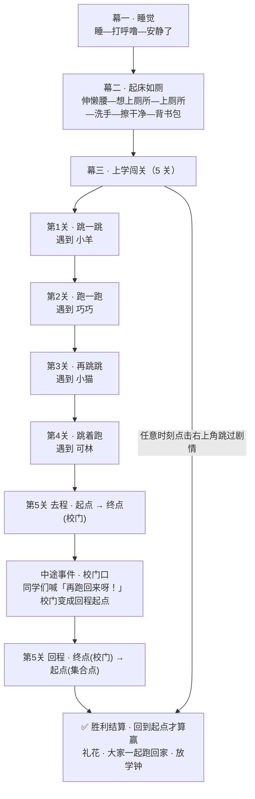

# 《小鸭上学记》游戏策划文档

| 项目 | 内容 |
|---|---|
| 文档名称 | 《小鸭上学记》游戏策划文档 |
| 版本 | **v1.1**（已并入用户拍板决策） |
| 状态 | 主体已确认 · 幕一演出取向已定 · 第 5 关赛制已定 |
| 日期 | 2026-10-16 |
| 来源 | 家长口述玩法整理 + 产品经理专业化补全 |
| 文档类型 | 概念 + 玩法 + 关卡策划（不含代码实现） |
| 落地位置 | `chick-duck-school/index.html`（单文件，CSS/JS 全内联），hub 增加第 6 张卡片 |
| 目标年龄 | 5–6 岁（同时兼容 3–8 岁） |
| 所属系列 | 小鸡游戏集（第 6 个游戏），与前 5 个共享同一世界观与配色 DNA |

> **本档的定位**：这是给工程师（前端/游戏）的**实现依据**，不是给玩家的宣传文案。所有数值、状态、演出均需可被逐条实现与验收。

> **v1.1 更新说明（并入用户拍板的两项决策）**：
> 1. **幕一「睡觉打呼噜」采用方案 A**——保留完整呼噜渐弱演出（约 25s，渐弱 ≥3.2s），但**任意时刻可点击跳过剩余等待**，跳过时呼噜声用 0.3s 淡出再切场（不戛然而止），并提供「⏩ 跳过」图标按钮（热区 ≥44px）。详见 §4 幕一、§8.1 #3、§9.3、§14.2 E。
> 2. **第 5 关改为往返赛制**——口述「到起点就赢了」经用户澄清为**「跑到终点，再跑回起点」**。第 5 关拆为**去程（起点→校门）+ 中途事件 + 回程（校门→起点）**，**只有跑回起点才触发胜利结算**。回程在视觉/图形/音效三方面与去程明确区分，且难度低于去程。详见 §5.2 第 5 关、§8、§9、§10.1、§14.3。
>
> 同时确认落地的次要决策：Q1 小鸭/小胖鸭维持同族不同角色方案；Q2 如厕尺度维持便意图标化；**Q3 手势增加 `AUTO_RUN_FROM_LEVEL` 开关**（见 §6.1）；Q5 小鸭配色改用淡黄 `#FFE9A8` + 深黄描边，主黄 `#FFD35C` 留给 UI；Q6 图鉴首版不打通。

---

## 1. 一句话概念 + 核心卖点

### 一句话概念

> 睡着打着小呼噜的小鸭，第二天早上一骨碌爬起来去上厕所、认认真真洗了手，然后背上书包一路跑跑跳跳去上学——路上遇见巧巧、可林和一群小伙伴，**先跑到校门口，再和大伙儿一起跑回起点，这才算赢**。

**定位**：单指操作的**零失败横版跑酷闯关小游戏**（Endless-runner Lite + 关卡制），用「一夜到一天」的生活流串起 5 个短关卡。终关是**往返赛制**（去程 + 回程），呼应口述「到终点，跑回起点」。

### 核心卖点（3 条）

1. **一个完整的生活故事，而不是一堆小游戏拼盘**：睡 → 起 → 上厕所洗手 → 上学 → 到校 → 和小伙伴们一起跑回家。5–6 岁小朋友能完整看懂并复述，这个「讲完一个故事」的完整性本身就是家长最认可的价值——它同时是**生活习惯教育**（按时起床、上厕所洗手、认真上学）和**安全意识**（路上不要跑太快、不要撞到东西）。

2. **零失败 = 零挫败**：没有 Game Over、没有生命值、没有倒计时惩罚。碰到东西只会「哎呀」一声被弹开、坐地上、冒个小星星，然后自己站起来继续跑。低龄孩子可以反复试、放心试，家长不用担心孩子因为失败哭闹或拒绝再玩。

3. **打呼噜幕的「安静感」是一次高级的情绪设计**：这是 5–6 岁孩子生活里真实体验过的「睡得好沉」和「突然安静下来」的那种安静。本作用**声音由响到无**的一次演出，把玩家从「吵闹」带到「静谧」，再被闹钟和阳光叫醒——这条情绪曲线让游戏在众多同类跑酷里有了辨识度，也是家长最容易被打动的 30 秒。**（方案 A：演出完整保留，同时任意时刻可点击跳过，不让孩子干等）**

---

## 2. 游戏概述表

| 维度 | 设定 |
|---|---|
| 游戏类型 | 横版跑酷 / 闯关跑酷（Side-scrolling Runner，Zero-fail） |
| 目标年龄 | **5–6 岁**为主（3–8 岁可玩，无需读字） |
| 目标平台 | 手机竖屏优先 + iPad 横屏自适应（同一份代码，纯 CSS transform 缩放） |
| 操作方式 | **单指单手势**：屏幕任意处**按住 = 前进**，**点击 = 跳跃**；剧情幕点击 = 推进对话 |
| 单局时长 | 单关 20–45 秒；**全 5 关约 4–5 分钟**（含剧情演出；终关为往返赛制，单独占约 70–95 秒） |
| 关卡体量 | **5 关**（第 1 关为教学关；第 5 关内含去程 + 回程两段） |
| **主目标** | **跑到学校大门口（终点），再跑回起点（集合点）才算赢**——终点是中途事件，**只有回到起点才触发胜利结算**（对应口述「到终点，跑回起点」，用户已确认） |
| 副目标 | 每一关在路上遇到 1–3 位小伙伴并打招呼（影响结算与结局演出，**永不卡关**）；回程中已相遇的同学全程跟随一起跑回家 |
| 失败 | **不存在**。碰到障碍 = 搞笑弹开 + 原地复位 |
| 视角 | 2D 横版侧视，镜头左右跟随主角，带缓动 |
| 网络需求 | **完全离线**，纯单机，无任何请求 |
| 存档 | localStorage，key = `chick-duck-school:save:v1` |
| 分辨率 | 逻辑坐标 960×640（横版基准），按窗口等比 contain 缩放，绝不裁切、绝不拉伸变形 |

---

## 3. 世界观与角色表

### 3.1 世界观设定（与前 5 个游戏统一）

**同一个世界**：「小鸡游戏集」里的动物村庄，住着一群 Q 版小动物好朋友。村口有一所**小学**，每天早上孩子们各自从家里出发去上学。

- 前作《小鸡回家吃饭》里的**小伙伴们，就是这所小学里的同班同学**。
- 本作是**同一个世界观的第 6 个故事**：主角换成了一只刚睡醒的小鸭，从自己家出发上学。
- 结论：**本作不是新世界，是老世界的另一个视角**。这样 hub 站点从「5 个独立小游戏」升级为「一个儿童世界观」，跨游戏的角色认知可以互相沉淀，这是这套 IP 最大的长期资产。

### 3.2 角色表

| 角色 | 身份 | 外观要点 | 行为 / 剧情 |
|---|---|---|---|
| **小鸭**（主角） | 玩家控制角色 | 淡黄色圆身、橙色扁喙、扁头上一撮呆毛、两只小短脚；**不是**小胖鸭（见 §3.3 角色冲突说明） | 睡觉打呼噜 → 起床伸懒腰 → 上厕所洗手 → 一路跑跳上学；全程 8 种姿态 |
| **巧巧**（有名字） | 同班同学 · 小兔 | 淡粉白圆身、长耳朵、扎一个小揪揪、背上小书包 | **第 2 关（跑步关）**开场。她在路边一路小跑，回头招手。第 5 关在校门口迎接 |
| **可林**（有名字） | 同班同学 · 小狗 | 奶黄色圆身、垂耳、戴一顶小蓝帽、抱一个皮球 | **第 4 关（跳跑复合关）**。他站在荷塘对岸，隔着水面指挥小鸭跳荷叶过来 |
| **小羊** | 同班同学 | 奶白卷毛、圆脸、小短腿 | 第 1 关（跳关）路上一边跳一边等小鸭 |
| **小猫** | 同班同学 | 奶油橘色、尖耳朵、尾巴翘着 | 第 3 关（跳关）走在矮墙上，替小鸭数「一二三」 |
| **小狗** | 同班同学 | 奶棕圆身、垂耳、舌头伸出来 | 第 5 关校门口挥手 |
| **小猪** | 同班同学 | 淡粉色、圆滚滚、小卷尾 | 第 5 关校门口挥手 |
| **小兔** | 同班同学 | 奶白、长耳朵、抱一个胡萝卜小书包 | 第 5 关校门口挥手 |
| **小鹅** | 同班同学 | 纯白、扁脖子、长喙、走路一摇一摆 | 第 5 关校门口挥手 |

> **角色命名决策（重要，工程师不必再纠结）**
>
> 团队给的两个选项是「复用 chick-dinner 的 8 位伙伴」或「另起一套新名字」。**我选复用**，理由：
> 1. **世界观统一收益最大**：hub 已经是一个「小鸡游戏集」，同一批角色在不同游戏里出现，能形成跨游戏记忆，是免费的品牌资产；
> 2. **美术可复用**：6 位同学的外观可沿用 chick-dinner 已有的 Q 版配色（`#F2EDE4 小羊` / `#D9A05B 小狗` / `#8E8B96 小猫` / `#F0A7B4 小猪` / `#EFE6DA 小兔` / `#F5F2E8 小鹅`），零新增美术成本；
> 3. **认知无负担**：5–6 岁孩子玩完《小鸡回家吃饭》再玩《小鸭上学记》，看到熟悉的小猫小狗小羊会觉得「我认识它们」，而不是重新建立一套陌生角色库。
>
> **但只复用「适合当同学」的 6 位**，chick-dinner 里的**田鼠、小麻雀不出场**——它们是田野/鸟类生物，不合「背书包去上学」的设定，硬塞会让世界观失真。**其余 2 个位置由有名字的巧巧、可林补上**，共 8 位同学（6 位复用 + 2 位新增），与 chick-dinner 的 8 位伙伴数量一致，是刻意的对称。

### 3.3 ⚠️ 角色冲突说明（必须由工程师知晓）

| 项 | 说明 |
|---|---|
| 冲突 | chick-dinner 里的**「小胖鸭」是小鸡的捣蛋邻居**；本作主角叫**「小鸭」**，是可爱的好孩子 |
| 风险 | 同站出现两个"鸭"，5 岁孩子可能混淆 |
| **处理方案（已定）** | **当作两个不同角色，全站不做任何解释性文字**。区分靠三点：① 外观不同（小胖鸭 = 圆胖、橙黄、走路摇摇摆摆、头顶呆毛；小鸭 = 淡黄、清秀、有书包）；② 性格与小鸭在同班名单里而不是捣蛋名单里；③ 视觉上主角永远居中且最大，摄像机规则上把小鸭作为「玩家角色」渲染 |
| **明确不做** | 不在任何界面写「小胖鸭不是小鸭」这类解释文字——违反「无文字依赖」约束，且会让孩子更困惑 |
| 待确认 | 见 §12 Q1，请家长确认是否接受「同族不同角色」的处理方式 |

---

## 4. 分幕结构

全片分 **3 幕 8 段**。幕与幕之间用**纯点击推进的剧情幕**（无操作、无倒计时、可随时点击跳过）。



> **流程图变更说明（v1.1）**：第 5 关不再是「冲到终点就赢」的单程线，而是**去程 → 中途事件 → 回程 → 回到起点才结算**的往返结构。口述原话「到起点就赢了」经用户澄清为「**到终点，跑回起点**」，因此终点是中途事件而非胜利点。

### 幕一 · 睡觉（小鸭睡觉 → 打呼噜 → 安静了）

> **✅ 方案 A（用户已拍板）**：**保留完整演出 + 允许点击加速/跳过**。既保留「安静仪式感」，也不让孩子干等。

| 项 | 设定 |
|---|---|
| 幕目标 | 建立「小鸭睡着了」的日常感，并让玩家体验一次**呼噜声从响到无**的声音演出 |
| 时长 | **完整演出约 25 秒**；**玩家任意时刻可点击跳过剩余等待**，直接进入「安静了」→ 天亮 |
| 操作 | 点击「进入」开始 → 之后为**纯演出**，但**任意时刻点击画面 = 跳过剩余等待** |
| 情绪曲线 | 安静温暖 → 滑稽可爱（呼噜）→ 更滑稽（呼噜变大）→ **静谧**（突然安静）→ 好奇（怎么没声了） |
| 关键演出 | ① 小鸭侧躺小床，被子随呼吸起伏（2.8 秒一个呼吸周期）② 鼻孔冒出「zzZ」气泡，气泡从小到大飘上去（3 段递进）③ **呼噜声由响到无**：音频音量在 6 秒内从 100% 渐弱到 0，同时画面所有气泡慢慢消失 ④ 全静后，画面中央出现一圈柔和光晕扩散（视觉替代音效表达「安静」）⑤ 停 1 秒 → 窗帘缝透进金光，光晕从左向右扫过全屏 |
| **跳过规则（方案 A 核心）** | **幕一任意时刻点击/触摸画面**（含「⏩ 跳过」按钮）即跳过剩余等待，直接进入第 ④⑤ 步的「安静了 → 天亮」。**跳过时呼噜声不得戛然而止**：先把当前呼噜音量用 **0.3 秒淡出到 0**，再切场，**避免突兀** |
| 跳过按钮 | 右上角常驻「**⏩**」图标按钮（图标即可，可配文字「跳过」），**热区 ≥ 44×44px**，让家长一眼知道可以点。全幕常驻，不自动消失 |
| 渐弱底线 | **无论是否跳过，呼噜渐弱演出必须完整播放满 3.2 秒**才允许进入「安静了」——这是本幕的灵魂，不可压缩。跳过后从当前进度**平滑续演**渐弱尾段，不重新开始 |
| 需求强度 | **本幕是本作的差异化灵魂，美术与音频投入优先级最高**。呼噜气泡和渐弱音频必须在真机上验证好不好笑、好不好听 |

> **方案 A 的设计意图**：低龄孩子注意力短，25 秒无操作有流失风险；但「安静了」这份静谧是全作的情绪高点，直接砍掉会损失灵魂。方案 A 两者兼顾——**完整演出保留给愿意等的孩子和愿意停下观看的家长，点击跳过留给想快点玩的孩子**，两种需求都被满足。

### 幕二 · 起床如厕（第二天早上 → 想拉屎 → 上厕所 → 洗手 → 出发）

| 项 | 设定 |
|---|---|
| 幕目标 | **卫生习惯教育**：把「早上起床要上厕所、要洗手、要擦干净」变成一段可爱的小演出；并用「背书包」完成从家到学校的场景切换 |
| 时段 | **第二天早上**（幕一结尾的金光就是第二天的太阳） |
| 时长 | **约 30 秒** |
| 操作 | 逐段点击推进（每段一次点击，共 6 次） |
| 情绪曲线 | 迷糊起床 → 憋不住（急）→ 解决（舒服、爽）→ 讲卫生（认真）→ 精神抖擞（出发） |
| 关键演出 | 见下方 §4.1 逐段拆解 |

#### §4.1 幕二逐段拆解（**卫生习惯段落的处理方式，重点段落**）

> **处理原则**：面向 5–6 岁小朋友和家长，用**卫生习惯教育**的方式表达；**全程不画排泄物、不画任何不雅画面**；上厕所这件事用「关门 + 音效 + 完成后的舒服表情」三段式表达，重点全部放在「讲卫生、心情好」上。

| 段 | 画面 | 音效 | 气泡（**短，≤6 字**） | 设计意图 |
|---|---|---|---|---|
| M2-1 **伸懒腰起床** | 金光扫过，小鸭睁眼、揉眼、打一个大大的哈欠、双手高举伸懒腰，身体拉长回弹 | 鸟叫 2 声 + 哈欠声 + 伸懒腰「嗯——」 | **「唔…起床啦」** | 从睡意过渡到清醒；呼噜的静谧在这里被"叫醒"打破 |
| M2-2 **想上厕所** | 小鸭刚要下床，肚子位置亮起一个**黄色小铃铛+水滴形便意图标**（图标化，不写文字、不画排泄物），小鸭原地扭了扭、眼神看向卫生间方向，脚步变急 | 肚子「咕噜噜」一声（小鼓声） | **「我想上厕所」** | **把"拉屎"翻译成孩子能说的词「上厕所」**；用图标而非文字，符合无文字依赖 |
| M2-3 **进卫生间** | 小鸭小跑进卫生间，**门关上**。门外只显示：小鸭的影子在门后晃动 + 头顶冒出几个小圆圈（表示在使劲，**完全抽象化**） | 关门声 + 门后传来两声闷闷的「嘿——嘿——」（拟声，不写实）+ **冲水「哗啦」声** | **（无台词）** | **完全不画身体、不画排泄物**。用影子 + 圆圈 + 拟声表达「在上厕所」，所有注意力都在声音上 |
| M2-4 **洗手** | 门开，小鸭走出来，走到洗手台。**双手搓搓 → 泡泡从小变大 → 泡泡噗地消散 → 水龙头冲一下 → 甩三下水**。手上依次亮起 4 个勾 | 水龙头哗啦 + 搓手「搓搓搓」+ 泡泡啵 + 甩水「哗啦」 | **「要洗手」** | **本幕的教育核心**。搓手泡泡必须做够时长（≥3 秒），因为 5–6 岁孩子真的会在这个动作上模仿 |
| M2-5 **擦干净** | 小鸭用一张小纸巾擦一下（**只画小鸭擦手的动作和纸巾，不画任何其他内容**），纸巾揉成团扔进垃圾桶 | 轻柔「擦一下」声 | **「擦干净」** | 完成「擦干净」这一步，与洗手并列成两个勾 |
| M2-6 **背书包出发** | 小鸭背上小书包，走到家门口，回头看一眼床（打个哈欠的床还凹着），推开门，**上学铃声从远处响起**，小鸭耳朵一竖、眼睛发亮、加速跑出门 | **上学铃「叮铃铃——」（关键音效）** + BGM 由安静早晨曲切入上学进行曲 | **「上学去啦！」** | 用**上学铃**作为「幕二→幕三」的转场信号，一听就知道要上学了；同时把孩子的情绪从家切换到学校 |

> **四个勾的结算演出**：M2-4 / M2-5 完成后，左上角依次点亮 4 枚小勾（想上厕所 ✓ · 上厕所 ✓ · 洗手 ✓ · 擦干净 ✓），全部点亮时撒一次彩带。这是给家长看的「教育闭环」，也是孩子能理解的成就反馈。

### 幕三 · 上学闯关（5 关跑酷）

| 项 | 设定 |
|---|---|
| 幕目标 | 用 5 个短关卡讲「上学路上遇到不同同学」的故事；每关一个操作/难度教学点；**终关以「跑到终点再跑回起点」的往返赛制收束** |
| 时长 | **5 关共约 170–240 秒**（第 5 关往返占 70–95 秒） |
| 操作 | 按住 = 前进，点击 = 跳跃（见 §6.1） |
| 情绪曲线 | 出发（兴奋）→ 顺利（轻松）→ 有点小忙（紧张但好笑）→ 遇到可林（合作、温暖）→ 去程冲刺（高燃）→ **中途「再跑回来呀！」（加油鼓劲）** → 回程轻快（熟路轻车）→ 回到起点（欢呼、圆满） |
| 失败 | 永不存在。碰到障碍 = 弹开 + 复位 |
| **终点（v1.1 修订）** | 第 5 关含**两个目标点**：**去程终点 = 学校大门（中途事件，不是胜利）**；**回程终点 = 起点集合点（这里才是胜利结算）** |

---

## 5. 关卡逐关拆解（5 关）

### 5.1 总表

| 关卡 | 关卡名 | 玩法机制 | 通过条件 | 遇到的同学 | 教学点 | 难度 | 预计时长 | 关卡长度 |
|---|---|---|---|---|---|---|---|---|
| **1** | 跳一跳，跳上学 | **跳跃**（点击 = 原地起跳，障碍间距大） | 跑过 3 个矮台阶，触碰小羊 | **小羊** | 「按住 = 前进」「点击 = 跳跃」两个手势的唯一教学关 | ★☆☆ | 25–35s | 2400px |
| **2** | 跑起来，上学要迟到了 | **跑步**（长距离持续前进 + 躲避滚球） | 一路跑到底，途中追上**巧巧** | **巧巧** | 教「不用频繁点，按住一直跑」；教「障碍躲不掉就跳过去」 | ★★☆ | 35–45s | 3200px |
| **3** | 一二一，一二三，跳！ | **连续跳跃**（密集小水洼 + 高低差，呼应口述「还有一关还是跳」） | 跳过 4 连水洼，触碰小猫 | **小猫** | 教「节奏感」与「长按跳得更高」；教「空中一次只能跳一次」 | ★★★ | 35–45s | 3600px |
| **4** | 荷叶小路，跳着跑 | **跳 + 跑复合**（水面荷叶，需要精准落点） | 连续踩 3 张荷叶到对岸，**可林**在对岸指挥 | **可林** | 教「跑动中点跳」的组合操作（本作核心技巧）；教「落点」概念 | ★★★ | 40–50s | 4000px |
| **5** | **跑到学校，再跑回家！**<br/>（往返赛制） | **去程：冲刺跑**（长距离 + 移动障碍 + 加速带）<br/>**回程：轻快跑**（障碍更稀疏、跑速略高、有记忆） | **去程**：跑到学校大门 → 触发**中途事件**（不是结算）<br/>**回程**：从校门**跑回起点集合点 = 赢**（唯一胜利点） | 去程校门：**小狗、小猪、小兔、小鹅**<br/>回程：**巧巧、可林 + 全体跟随一起跑回家** | 综合复习；引入**往返方向切换**；情绪最高点；无新操作机制 | 去程 ★★★★<br/>回程 ★★☆ | 去程 40–50s<br/>回程 30–45s<br/>**合计 70–95s** | 去程 4800px<br/>回程 3600px<br/>**合计 8400px** |

> **难度曲线校验（硬约束）**：跳跃关 = 第 1、3、4 关（共 3 关，满足「至少 2 个跳跃关」）；跑步关 = 第 2、5 关（共 2 关，满足「1 个跑步关」）。口述的「一关跳、一关跑步、还有一关还是跳」被完整保留并映射为 **第 1 关跳 → 第 2 关跑 → 第 3 关还是跳**，第 4、5 关是我追加的复合与收束。难度曲线为 **1★ → 2★ → 3★ → 3★ → 4★**，第 4 关不升星（与第 3 关平齐）作为难度峰值前的缓冲。
>
> **v1.1 往返赛制对难度曲线的影响**：终关内部拆为 **去程 4★ → 回程 2★** 的**锯齿曲线**（先冲高、再回落）。这是有意为之：回程降难度让孩子在最后一段**体验「熟路轻车」的轻松感**，而不是把全程难度一路拉满。回程虽降难度但**仍是跑酷**（障碍类型不变、只是更稀疏），不会变成纯粹的走路过场。

### 5.2 逐关详细设计

#### 第 1 关 · 跳一跳，跳上学

| 项 | 设定 |
|---|---|
| **背景** | 小鸭家门前 → 村路起点。木栅栏、土路、一排小树 |
| **教学设计** | 关卡开场有**手指光点动画**演示：① 手指按住屏幕 → 小鸭前进（演示 2 秒）② 手指点击 → 小鸭跳（演示 2 次）。演示结束后手指消失，全程不再提示 |
| **障碍布置** | 3 个**矮台阶**（高 32px，小鸭跳高 169px，一跳轻松越过），间距 **380px**。第 3 个台阶后是小羊 |
| **新引入** | 前进（按住）、跳跃（点击）、**碰到障碍的零失败处理**（这一关就必须让玩家亲自撞一次） |
| **通过条件** | 跑过最后一个台阶 → 触碰小羊 → 小羊气泡「早安，小鸭！」 → 跑向右侧出口箭头 |
| **失败处理（零失败）** | 撞到台阶侧面 → 小鸭被弹开、原地坐地上、头顶转 3 颗小星星、发出「哎呀」声 → **0.9 秒后自己站起来继续**。**不扣血、不倒退、不重置关卡** |
| **时长 / 长度** | 25–35 秒 / 2400px |
| **三星条件** | 通关 + 用时 ≤ 30s + 碰撞 ≤ 4 次 |

#### 第 2 关 · 跑起来，上学要迟到了

| 项 | 设定 |
|---|---|
| **背景** | 村路主道，两侧是麦田和矮树，远处有一座小桥 |
| **新引入** | **长距离持续奔跑** + **移动障碍**（从左边滚过来的大南瓜 / 落叶团，慢速滚动，可跳过也可让它滚过去） |
| **教学设计** | 开场手指动画演示一次「一直按住不放」，随后小鸭子自动加速到巡航速度。**移动障碍不强制躲**，滚过去也行——降低 5–6 岁玩家的紧张感 |
| **障碍布置** | 5 个南瓜，滚动速度 90px/s，间距 **420–520px**，宽 56px |
| **相遇** | **巧巧**（小兔）在开场 600px 处迎面跑过，回头招手，减速等小鸭；小鸭追上她后她并排跑一段，气泡 **「小鸭，等等我！」** → 追上后气泡 **「我们一起跑！」** → 两人一起跑向终点 |
| **通过条件** | 与巧巧一起跑过终点箭头 |
| **失败处理** | 同 §5.2 第 1 关统一处理。撞到南瓜 = 南瓜被撞得原地转圈，小鸭弹开 |
| **时长 / 长度** | 35–45 秒 / 3200px |
| **三星条件** | 通关 + 用时 ≤ 42s + 碰撞 ≤ 5 次 |

#### 第 3 关 · 一二一，一二三，跳！

| 项 | 设定 |
|---|---|
| **背景** | 村路遇到一段**低洼的泥地**，一串小水洼；旁边有道矮墙 |
| **新引入** | **连续跳跃**（4 连水洼，间距压到 260px）+ **高低差**（两段不同高度的草地）+ **空中不可二段跳** |
| **教学设计** | 小猫在矮墙上一边走一边**大声数拍**（气泡轮流显示 **「一」「二」「三」「跳！」**，配合节拍音），这是给孩子的节奏提示，比文字有效得多。第 4 连水洼前，小猫喊「跳！」并做一个夸张的示范跳 |
| **障碍布置** | 4 个水洼（宽 96px = 1.5 格），间距 **260px**；第 2 与第 3 之间有一块高 24px 的高台 |
| **相遇** | **小猫**在第 2 个水洼旁的矮墙上，全程跟着小鸭走 |
| **通过条件** | 跳过 4 连水洼 → 触碰小猫 → 跑向出口 |
| **失败处理** | 掉进水里 → **不淹死、不失败**！小鸭「噗」地弹起来，浑身甩两下水（像小狗），头顶冒小星星，落到最近的安全平台上，0.9 秒后继续。全程笑点，不出现任何下沉/溺水画面 |
| **时长 / 长度** | 35–45 秒 / 3600px |
| **三星条件** | 通关 + 用时 ≤ 40s + 碰撞 ≤ 6 次 |

#### 第 4 关 · 荷叶小路，跳着跑

| 项 | 设定 |
|---|---|
| **背景** | **荷塘**：水面、睡莲叶、荷花、水中锦鲤游动。这是全作画面最美的一关，用来奖励坚持到第 4 关的玩家 |
| **新引入** | **跳 + 跑复合**（本作核心技巧）：必须「跑动中点击」才能跳上荷叶；同时引入**落点判定**（跳到荷叶中心才算稳） |
| **教学设计** | 开场前 **可林**在对岸喊 **「小鸭，快跳过来！」** 并做示范跳；第 1 张荷叶刻意做**超大**（160px 宽，必中），从第 2 张起缩到 112px |
| **障碍布置** | 3 张荷叶，宽 **160 → 128 → 112px**，间距 **210px**；每张荷叶有轻微下沉动画（踩上去会「咚」地沉一下再回弹，增加触感） |
| **相遇** | **可林**（小狗）在对岸，来回蹦跳指挥；小鸭跳到对岸后，可林气泡 **「我们一起上学！」**，然后转身领跑 |
| **通过条件** | 踩完 3 张荷叶到对岸 → 触碰可林 → 一起跑向出口 |
| **失败处理** | 掉水里 → 与第 3 关同一套「噗地弹起 + 甩水 + 星星头」处理，自动送回上一张荷叶 |
| **时长 / 长度** | 40–50 秒 / 4000px |
| **三星条件** | 通关 + 用时 ≤ 48s + 碰撞 ≤ 7 次 |

#### 第 5 关 · 跑到学校，再跑回家！（**v1.1 往返赛制 · 重点关**）

> **用户已确认**：口述「到起点就赢了」= **「跑到终点，再跑回起点」**。因此本关是**往返赛制**——终点是中途事件，**跑回起点才是胜利**。
>
> **为什么要这样设计**：① 忠实还原用户口述；② 孩子跑完去程后会产生「我到学校了！」的成就感，回程是「和好朋友一起跑回家」的温暖收束，**比单程冲线多一层完整的归家情绪**；③ 回程降难度，让全程在高难度冲刺后回落，**避免 5–6 岁孩子到最后一段崩溃**。

##### 5.2.1 第 5 关结构总览

```
【起点集合点】════════ 去程 ════════▶【学校大门】═══════ 回程 ════════▶【起点集合点】✅ 赢
   出发点                    终点=中途事件              返程起点          回到起点=胜利结算
                                              （"再跑回来呀！"）
```

##### 5.2.2 去程（起点 → 学校大门）· ★★★★

| 项 | 设定 |
|---|---|
| **背景** | 村口大道 → 学校大门。终点是**用书本+铅笔+铃铛图形表示学校的拱门**（**不出现文字**） |
| **新引入** | **冲刺带**（中段 800px 内跑速 ×1.35，地面出现速度线）+ **移动障碍组合**（南瓜 + 摇摇木马 + 小风车） |
| **教学设计** | 不教新操作。此关开场巧巧/可林从后方追上，三小只并排跑 2 秒再一起冲（**同伴陪伴是「冲」的勇气来源**） |
| **障碍布置** | 8 个障碍混合 3 种；冲刺带后集中 4 个；**校门前最后 600px 完全无障碍**，留出干净的抵达体验 |
| **相遇** | 校门口 **小狗、小猪、小兔、小鹅** 四位排成一排挥手；巧巧、可林从后方跑到 |
| **通过条件** | **跑到学校大门触碰拱线 = 触发中途事件（不是结算！）** |
| **时长 / 长度** | 40–50 秒 / **4800px** |

##### 5.2.3 中途事件（到达学校大门时触发）· **正向鼓励，绝不制造挫败**

> **设计红线**：这一段**绝对不能做成「你失败了」「还差一步」「Game Over」的感觉**，必须是**「加油！再跑回来呀！」的正向鼓励**，完全符合零失败基调。

| 环节 | 表现 |
|---|---|
| ① 到达 | 小鸭触碰校门拱线 → 定格 0.4 秒 → 彩带小喷泉（**小规模，不是通关级别的大礼花**） |
| ② 喊话 | 校门口 4 位同学 + 巧巧/可林一起喊，气泡依次冒出：**「再跑回来呀！」**（可林）· **「我们一起回家！」**（巧巧）· **「等你哦！」**（小狗） |
| ③ 转身 | 全部角色**原地转身 180°**（0.5 秒转身动画 + 「唰」一声），面向回程方向 |
| ④ 标识切换 | **校门从「终点拱门」切换为「回程起点」**（视觉标识见 §5.2.5）；地面箭头**全部反向**；天空色调偏移（见下） |
| ⑤ 出发 | 一个小小的 **「出发！」** 气泡 + BGM 切到回程曲 → 玩家继续按住前进即开始回程 |

**关键**：中途事件**不消耗时间惩罚、不结束关卡、不弹结算面板**，玩家站在原地 1.2 秒看完演出后，继续按住就能跑，没有任何中断感。

##### 5.2.4 回程（学校大门 → 起点集合点）· ★★☆

| 项 | 设定 |
|---|---|
| **背景** | **同一条路，但视觉与氛围明确不同**（见 §5.2.5 三重区分）。语义上是「放学回家」 |
| **难度设计** | **低于去程**：障碍数 8 → **5 个**，间距 320–400 → **420–560px**（更稀疏），**取消冲刺带**，跑速略提（280px/s，比去程巡航稍快，营造「轻快的归家感」） |
| **障碍布置** | 5 个障碍，仍用去程同款类型（南瓜 / 摇摇木马 / 小风车），但**间距明显更宽**；**回程最后 500px 完全无障碍**，留出干净的到家体验 |
| **相遇与跟随** | **巧巧、可林、以及校门口那 4 位同学全程跟着跑**（侧后方跟随），形成一个「大家一起跑回家」的队伍 |
| **新增相遇彩蛋** | 回程路上**追加两位同学**（**小羊**、**小猫**）从路边加入队伍，气泡 **「我们也回家啦！」**，让队伍从 6 位扩充到 8 位（刚好凑齐一个热闹的回家队伍） |
| **通过条件** | **跑回起点集合点，触碰起点旗/集合点 = 赢**（唯一胜利结算点） |
| **时长 / 长度** | 30–45 秒 / **3600px** |

##### 5.2.5 回程 vs 去程的三重区分（**必做，否则 5 岁孩子会懵**）

这是本关最关键的实现要求。5–6 岁孩子分不清「现在该往哪跑」，必须从**视觉、图形、音效**三个层面同时给出强信号。

| 维度 | 去程 | 回程 | 具体做法 |
|---|---|---|---|
| **① 视觉色调** | **晨光偏冷**（天空 `#DFF0FA` 淡蓝 → 米黄地平线，冷暖交界） | **午后偏暖**（天空 `#FFE9B8` 暖黄 → 金橙地平线） | 用 `#FFFBEC / #FFF6E0` 主色盘内做暖度偏移，**不引入新色系**；整体叠加一层极淡暖黄 `rgba(255,180,90,.12)` |
| **② 地面箭头** | 箭头**朝右**（前进方向） | 箭头**全部反向朝左** | 切换发生在中途事件④，回程全程箭头朝左 |
| **③ 天空/背景元素** | 去程：晨光、少云、**上学钟**在远处 | 回程：**多云转晴、蝴蝶、气球、热气球剪影**，钟变成**放学钟** | 见 §9.2 / §9.3 美术清单 |
| **④ 路面小元素** | 去程：落叶（秋意） | 回程：**蝴蝶 + 气球**（活泼归家） | 去程落叶保留一部分，回程以蝴蝶气球为主 |
| **⑤ 角色朝向** | 全角色朝右 | 全角色**转身朝左** | 中途事件③统一转身 |
| **⑥ BGM** | 去程：上学进行曲（120 BPM 欢快） | 回程：**放学归家曲**（与去程明显不同的另一段） | 见 §8.2 BGM D |
| **⑦ 音效标识** | 到校：上学铃 | 回程起点：放学钟（不同音色） | 见 §8.1 #16 #27 #28 |
| **⑧ 队伍跟随** | 顺路遇见，跟到本关 | **8 位同学已成队，一起跑回家** | 队伍感 = 收束情绪 |

> **三重区分的实现优先级**：**② 地面箭头反向（最重要）> ① 色调偏移 > ⑤ 角色转身 > ⑥ BGM 切换 > 其余**。箭头反向是 5 岁孩子最直接能懂的信号，必须 100% 做到；色调与 BGM 是加分项。

##### 5.2.6 胜利演出（**只在回到起点时触发**）

| 环节 | 表现 |
|---|---|
| ① 触碰起点 | 小鸭跑回起点集合点，触碰起点旗 → 定格 |
| ② 大礼花 | **全场大礼花**（比中途事件规模大得多）+ 8 位同学一起欢呼 |
| ③ 钟声 | **放学钟大号响起**（同时叠加上学铃的胜利变奏） |
| ④ 归家 | 8 位同学排成一列，**和 小鸭 一起走进家门**，队伍完整呈现「大家一起回家」的收束感 |
| ⑤ 结算 | **星星结算面板**（用时 / 碰撞数 / 相遇同学数）+「再玩一次」「回主页」按钮 |

##### 5.2.7 状态机与实现要点

| 项 | 要求 |
|---|---|
| **关卡内子状态** | `GO_OUT`（去程）→ `MID_EVENT`（中途事件）→ `GO_BACK`（回程）→ `CLEAR`（结算）。四态在同一关卡内切换 |
| **数据驱动** | 第 5 关在关卡数据中存为**两段**：`{ outbound: {...}, inbound: {...} }`，共用同一套运行逻辑，只是障碍数组 + 场景 + 方向不同 |
| **方向参数** | 建议关卡数据统一用「内部坐标」，回程段整体**x 轴镜像**；或加一个 `direction: -1` 字段。**物理引擎不因方向改变**（重力恒向下），只是出生 x 与移动方向翻转 |
| **中途事件期间** | 玩家输入可响应（点击「开始回程」立即出发，不强制等演出播完），**不计入通关用时** |
| **三星判定** | **必须跑完回程才算三星**（跑完去程只到中途，不结算、不给星） |
| **零失败（回程）** | 回程沿用 §5.3 统一碰撞处理，**仍是搞笑弹开 + 复位，无死亡无惩罚** |
| **回程中途退出** | 若孩子在回程中退出（切后台/关页面）：**去程已完成的进度不保存为通关**，重开第 5 关从**去程重新开始**（零失败，不惩罚，但也不给中途奖励），详见 §12 新增风险 R1 |

### 5.3 「零失败」碰撞处理规范（全局统一，5 关通用）

碰到任何障碍时，按**固定顺序**执行以下演出，总时长 **0.9 秒**，期间**玩家输入被忽略但不打断**（0.9 秒后恢复，若此时仍在按住则自动继续跑）：

| 阶段 | 时间 | 表现 |
|---|---|---|
| ① 撞击 | 0–0.15s | 小鸭身体压扁成椭圆（`scaleY 0.7 / scaleX 1.25`），沿撞击法线**弹开 60px** |
| ② 落地坐 | 0.15–0.55s | 坐在地上，头顶 **3 颗小星星绕圈转**，眼睛变成 `>_<` 或 `@_@`，「哎呀」一声 |
| ③ 站起 | 0.55–0.9s | 拍一下屁股站直，星星消散，挤压回弹动画，恢复可操作 |
| ④ 复位 | 0.9s | 位置**自动回退到该障碍前方 40px**（只在被卡住时回退；第 3/4 关落水则送回上一平台）。**永不重置关卡、永不扣分、永不 Game Over** |

**音效**：撞击「咚」→ 「哎呀」（可爱的短促叫声）→ 站起「噗」。**全作只有这一种失败音效**，做到听觉一致 = 孩子知道「撞了也没事」。

---

## 6. 核心玩法与技术要点

### 6.1 操作方式（本作最关键的实现约束）

**统一单手势，绝不增加第二个手势：**

| 手势 | 行为 | 判定 |
|---|---|---|
| **按住** | 小鸭持续向前跑（松开则减速停下） | `pointerdown` → 加速到巡航速度 |
| **点击**（按下后抬起，位移 < 12px 且时长 < 220ms） | 跳跃 | 空中也可点击，但**无效**（防二段跳） |
| 剧情幕点击 | 推进对话 | 任意位置 |
| **幕一任意点击** | **跳过剩余等待**（方案 A），呼噜声 0.3s 淡出后切场 | 任意位置 |
| 暂停 / 跳过 | 右上角按钮（「⏩ 跳过」热区 ≥44px） | 独立热区 |

> **⚙️ 必须预留的手势开关（用户已拍板 Q3）**
>
> 代码中必须定义常量 **`AUTO_RUN_FROM_LEVEL = 2`**（含义：**从第 2 关起，默认「自动前进」，玩家只需点击跳跃**），用于在真人盲测证明「按住跑」手势对 5–6 岁孩子太难时，一键切换为单手势模式。
>
> ```js
> // ============================================================
> // AUTO_RUN_FROM_LEVEL —— 手势难度开关（Q3 决策预留）
> // ============================================================
> // 含义：从第 N 关起，小鸭自动向前跑，玩家只需「点击 = 跳跃」。
> // 现状：设为 2，即「第 1 关用『按住跑 + 点击跳』做教学，第 2 关起可切成
> //       『默认自动跑 + 点击跳』的单手势模式」。
> // 为什么预留：5–6 岁孩子能否学会「按住跑」尚未真人验证。若盲测（验收 B4）
> //       显示学不会，把这个值改成 1（或在第 2 关开场自动切换）即可，
> //       无需改动任何其他逻辑。
> // 验收 B4 的真人盲测结果应回填到此常量。
> // ============================================================
> const AUTO_RUN_FROM_LEVEL = 2;
> ```
>
> 实现要求：① 该常量被实际读取于关卡初始化逻辑，不是死代码；② 切换后「按住」手势降级为**加速/减速**而非唯一前进方式（保留 1.15× 加速的差异化手感）；③ 第 1 关**无论如何都保持双手势**（教学关必须教会「按住」）。

**热区设计**：**整个可交互画面（横屏下为下方 78% 区域，竖屏下为下方 62% 区域）均为操作热区**，远大于 44px 硬性下限。不存在"需要点准"的小按钮。

**竖屏适配（必须有引导）**：
- 竖屏时画面上下分屏：上方 38% 为天空 / HUD / 剧情气泡，下方 62% 为跑道与操作区。
- **首次进入竖屏**（检测 `portrait` 方向）弹出一次**可关闭的图示引导**：一个手机旋转图标 + 一个手指点击动画，文字仅「横过来更好玩」（可点「×」关闭，不再出现），存档记录已看过（`save.v1.rotTipShown`）。
- 竖屏下逻辑画面从 960×640 改为 960×900 视野（**视野更高 = 看得更远**，不是拉窄），跑道宽度不变。

**键盘支持（桌面调试 / 大屏）**：`→` / `D` / `空格` = 按住跑 + `↑` / `W` / `空格` = 跳，`Esc` = 暂停，`R` = 重开本关。

**容错兜底（5 岁孩子的现实需要）**：若玩家在同一个位置 **6 秒无任何有效前进**（说明卡住了/不会操作），自动触发**辅助前进**：小鸭自动前进 1.5 秒并高亮下一个可跳位置，同时上方出现一只**手指光点动画**自动演示一次点击。不扣分、不提示文字、不中断游戏。

### 6.2 物理参数建议值（逻辑坐标 960×640 基准，1 格 = 64px）

| 参数 | 建议值 | 说明 |
|---|---|---|
| 重力加速度 `g` | **2200 px/s²** | 偏轻快，符合「弹跳」的可爱感；过大会显得沉重 |
| 起跳初速度 `v0` | **-880 px/s** | 由此推出跳跃高度 `h = v0²/2g ≈ 176px`（约小鸭身高的 2 倍，刚好能越过最高障碍） |
| 滞空时间 | `2·v0/g ≈ 0.80s` | 0.8 秒足够 5–6 岁玩家判断与反应，又不至于拖沓 |
| **长按跳加成** | 按住 ≥ 180ms 时 `v0` 提升至 **-980px/s**（高 ≈ 218px） | 教学点：让「按住久一点跳更高」成为可发现的技巧 |
| 巡航跑速 | **265 px/s** | 略快于 chick-dinner 的 224px/s，因为跑酷需要节奏感 |
| 加速时间 | 按下后 0.35s 达到巡航速 | 避免瞬间启动的突兀感 |
| 减速时间 | 松开后 0.25s 停下 | 短，确保低龄玩家不失去控制感 |
| 第 5 关冲刺带速度 | **360 px/s**（×1.35） | 冲刺段，用速度线视觉强化 |
| 跑动身体起伏 | 幅度 6px，频率 = 速度/28（步频） | 与速度联动，速度变化时步频自动变化 |
| 重力上限 | `vy` 夹在 `+1400 px/s` 以内 | 防止穿地 |
| 固定时间步 | **物理固定步 1/120s，渲染插值** | 保证不同刷新率（60/120Hz iPad）下手感与跳跃高度完全一致 |

**跳跃高度与障碍的对应关系（工程硬约束）**：

| 障碍类型 | 高度/宽度 | 对应跳跃能力 |
|---|---|---|
| 矮台阶 | 高 32px | 轻点即过 |
| 高台 | 高 56–72px | 正常跳 |
| 小水洼 | 宽 96px | 巡航速下轻松越过（水平距离 ≈ 212px） |
| 荷叶 1/2/3 | 宽 160 / 128 / 112px | 第 4 张（112px）需要正常速度 + 精准点击 |
| **碰撞判定** | 主角碰撞盒 **宽 44 × 高 52**，比视觉**小 20%**（宽容判定） | 让"看起来擦边"的一律算过 |

---

## 7. 角色相遇剧情（巧巧 / 可林出场表 + 台词）

### 7.1 相遇总表

| 关卡 | 角色 | 出现位置 | 相遇方式 | 台词（气泡，**全部 ≤ 6 字**） | 后续行为 |
|---|---|---|---|---|---|
| 1 | **小羊** | 关卡 60% 处 | 站在路边一跳一跳 | **「早安，小鸭！」** → 小鸭靠近后「上学去呀？」 | 跳着跑在前面带路，末尾出画 |
| 2 | **巧巧** | 开场 600px 处 | 从对面跑来、回头招手 | **「小鸭，等等我！」** → 被追上后 **「我们一起跑！」** | 并排跑完全关，末尾一起出画 |
| 3 | **小猫** | 矮墙上，全程跟随 | 走着数拍子 | 交替气泡 **「一」「二」「三」「跳！」**（节拍音同步） | 演示一次夸张的示范跳 |
| 4 | **可林** | 荷塘对岸 | 蹦跳着指挥 | **「小鸭，快跳过来！」** → 到对岸后 **「我们一起上学！」** | 转身领跑，带小鸭进入第 5 关 |
| 5 去程 | **小狗 / 小猪 / 小兔 / 小鹅** | 校门口两侧 | 排成一排挥手 | 小狗 **「小鸭，这边！」** · 小兔 **「我们等你啦！」** · 小猪 **「快点快点！」** · 小鹅 **「上学咯——」** | 原地等小鸭，成为回程队伍首批成员 |
| 5 中途 | **可林 / 巧巧 + 4 位同学** | 校门口 | 全体转身面向回程方向 | 可林 **「再跑回来呀！」** · 巧巧 **「我们一起回家！」** · 小狗 **「等你哦！」** | **正向鼓励**，催促小鸭跑回起点 |
| 5 回程 | **小羊 / 小猫**（追加） | 回程路边 | 从路边加入队伍 | 小羊 **「我们也回家啦！」** · 小猫 **「等等我们！」** | 队伍从 6 位扩到 **8 位**，形成热闹的回家队伍 |
| 结局 | **全部 8 位** | 起点集合点 → 家门 | 列队和小鸭一起走进家门 | 全员 **「回家咯——！」** | 大礼花 + 放学钟，故事完整收束 |

### 7.2 相遇机制的统一规则

| 项 | 规则 |
|---|---|
| 触发 | **不需要点击**。角色进入小鸭 **1.5 格（96px）** 范围即自动触发演出——5–6 岁孩子可能还不会主动点角色 |
| 演出 | 角色头顶冒出气泡（停留 **1.6 秒**，最多排队 2 条），小鸭做一个开心的小跳，播放打招呼音效，「嗨」字小星星粒子飘出 |
| 队伍 | 相遇的同学会**跟在侧后方跑**（不是排队，跟在侧后方 60px），一起跑向本关终点，**不参与碰撞、无掉队惩罚**。**第 5 关例外：相遇的同学会跨段跟随（去程遇到的 + 中途的 + 回程追加的，队伍一路带回到家）** |
| 不卡关 | 相遇**不影响**任何通关判定。玩家冲得太快跑过去了？没关系，结算面板会显示「路上遇到了 2 位同学」，并提供**「再跑一次看看还有谁」**的按钮 |
| 图鉴 | 主界面有「**同学图鉴**」：6 只剪影 + 已遇到的亮色，收集动机（与 chick-dinner 的伙伴图鉴一致的交互语言） |

---

## 8. 音频需求清单

**技术要求（硬约束）**：**全部用 WebAudio 实时合成，零音频文件**，与 chick-dinner 的 `audio.js` 同一技术路线；总代码体积控制在 **150 行内**；首次用户手势后才能启动 AudioContext。

### 8.1 音效清单（31 条，v1.1 新增 #27–#31）

| # | 类别 | 音效 | 合成要点 | 优先级 |
|---|---|---|---|---|
| 1 | 幕一 | **打呼噜声（核心 · 3 段递进）** | 低频锯齿波 90Hz + 6Hz LFO 颤音 + 低通滤波截止 400Hz，做 3 个力度档（轻/中/响），第 2 段加 15Hz 抖动模拟「破音」，第 3 段加一层 60Hz 谐波 | **P0** |
| 2 | 幕一 | 呼噜气泡「zzZ」 | 短促正弦上滑音（520→900Hz），60ms，带轻微混响尾巴 | P0 |
| 3 | 幕一 | **渐弱至无声（3.2 秒）** | 对 #1 #2 做 `gain.linearRampToValueAtTime(0, t+3.2)`，模拟「安静了」。**方案 A 要求：跳过时先把当前呼噜音量用 0.3s 淡出到 0 再切场，不得戛然而止** | **P0** |
| 4 | 幕一 | 阳光照进来 | 一声柔和的高音铃（C6）+ 极慢的空气感噪声上扬 | P1 |
| 5 | 幕二 | 起床鸟叫 | 2 声上行鸟鸣（三角波，滑音 800→1400Hz） | P1 |
| 6 | 幕二 | 哈欠 / 伸懒腰 | 长噪声 + 下行滑音「嗯——」，1.2s | P1 |
| 7 | 幕二 | 肚子咕噜噜 | 低频鼓点三连，60Hz，每次间隔 0.18s | P1 |
| 8 | 幕二 | 关门 | 短促木质「咚」+ 门轴吱呀 | P1 |
| 9 | 幕二 | 上厕所闷声（拟声） | **2 声低闷「嘿——嘿——」，140Hz 方波包络，不写实、不夸张** | **P0** |
| 10 | 幕二 | **冲水哗啦** | 白噪声 + 高通 800Hz + 快速衰减包络，1.2s | **P0** |
| 11 | 幕二 | **水龙头哗啦** | 白噪声 + 带通扫频（中→高频） | **P0** |
| 12 | 幕二 | **搓手「搓搓搓」** | 三次短促噪声摩擦音，间隔 0.25s | **P0** |
| 13 | 幕二 | 泡泡啵 | 正弦快速上滑 300→1100Hz，40ms | P1 |
| 14 | 幕二 | 擦干净 | 极轻的纸张摩擦噪声，0.3s | P1 |
| 15 | 幕二 | 甩水 | 三声递减水花噪声 | P1 |
| 16 | 幕二 | **上学铃「叮铃铃——」（核心）** | 铃铛音色 = 两个不谐和正弦（880 + 1320Hz）+ 快速衰减，**连响 3 下**，**这是幕二→幕三的转场信号，音质必须干净悦耳** | **P0** |
| 17 | 玩法 | 跑步「哒哒哒」 | 方波短音，频率与步频联动（速度/28），音量随速度 | P0 |
| 18 | 玩法 | **跳跃「啵」** | 正弦上滑 400→1000Hz，80ms | **P0** |
| 19 | 玩法 | 落地「噗」 | 低频闷响 120Hz + 短噪声，80ms | P1 |
| 20 | 玩法 | 长按跳加成音 | 在 #18 基础上叠一层更亮的高频，提示「跳得更高」 | P1 |
| 21 | 玩法 | **撞到「哎呀」** | 上行滑音（哭腔）200→500Hz 后快速收，**全作唯一的失败音** | **P0** |
| 22 | 玩法 | 坐地小星星转圈 | 3 个三角波短音环绕（铃铛感），营造「晕乎乎」而非「痛」 | P1 |
| 23 | 玩法 | 荷叶下沉「咚」 | 低频正弦 + 快速衰减，带一点弹性 | P1 |
| 24 | 剧情 | 打招呼「嗨～」 | 两个音上行的欢快短旋律（每人可换音高区分） | P1 |
| 25 | 结算 | 星星逐颗点亮 | 三音上行叮咚（每颗一颗） | P0 |
| 26 | 结算 | 终点欢呼 + 大号上学铃 | 欢呼 = 多声部随机化「哇～」合成音；叠加 #16 铃铛 | **P0** |
| **27** | **第5关去程** | **奔跑主题 BGM（上学进行曲）** | 120 BPM 轻快木琴 + 手风琴，圆场感。去程全程循环；**冲刺带时叠加一层加速的鼓点** | **P0** |
| **28** | **第5关中途** | **回程出发提示音** | 一声轻快上行铃 + 小号「出发啦！」，标志方向切换 | **P0** |
| **29** | **第5关回程** | **奔跑主题 BGM（放学归家曲，v1.1 新增）** | **必须与 #27 明显不同**：降为 100 BPM、旋律更平缓温暖、加竖琴/长音铺底，去掉圆场感鼓点，营造「轻松回家」氛围 | **P0** |
| **30** | **第5关胜利** | **放学钟 + 欢呼 + 大号上学钟** | 胜利时刻比中途事件更盛大：欢呼 + 明亮铃铛 + 回家队伍脚步声 | **P0** |

### 8.2 BGM（5 段，可无缝切换）

| 段落 | 使用时机 | 风格 | 合成要点 |
|---|---|---|---|
| **A · 安静夜** | 幕一前 6 秒 | 极简，3 个音符的摇篮曲，几乎无声 | 单音 + 极慢包络，总音量 20% |
| **B · 呼噜曲** | 幕一打呼噜期间 | 无旋律，只有打呼噜循环 + 低音嗡鸣 | 打呼噜音效本身循环，音量随「渐弱」同步下降；**跳过时 0.3s 淡出** |
| **C · 早晨 / 上学进行曲** | 幕二后半 → 幕三第 1–4 关 | 轻快木琴 + 手风琴，**120 BPM，圆场音乐的感觉**（明确传达「要上学了」的兴奋） | 木琴 = 三角波快速衰减；手风琴 = 锯齿 + 轻失真 |
| **D · 上学奔跑曲（去程）** | 第 5 关**去程** | 120 BPM，比 C 更紧凑有推进感，冲线欲强 | 复用 C 的音色，加持续八分音符鼓点；**冲刺带时叠加速层** |
| **E · 放学归家曲（回程，v1.1 新增）** | 第 5 关**回程 + 胜利结算 + 结局** | **100 BPM，旋律平缓温暖**，明显区别于去程；「跑回家」的松弛感 | 三角波旋律 + 竖琴/长音铺底；**去掉圆场鼓点**；与 D 的转场 0.5s 交叉淡入 |

> **D 与 E 必须能被孩子听出区别**：这是回程/去程区分的听觉信号。建议 D 用「哒哒哒」密集鼓点推进，E 用柔和长音，二者 BGM 主题（音阶 + 节奏型）也要不同，而非仅是 BPM 不同。

**关键要求**：**BGM C / D 必须循环无缝**，且在第 1–5 关去程全程不中断（低龄孩子需要连续的「上学进行曲」来维持兴奋感）。回程切到 E 后同样无缝循环到胜利结算。

### 8.3 音频全局规则

- 设置页提供**音乐开关**与**音效开关**（两个独立开关，家长可只关音效保留音乐，反之亦然）。
- 首次点击才创建 AudioContext（浏览器自动播放策略）。
- **音效永不叠超过 3 个**；同一音效 60ms 内重复触发则忽略（防止连续跳跃时的爆音）。
- 幕一「渐弱至无声」时，**同时把 BGM A 的音量降到 0**，确保是真·安静（这是本幕的灵魂）。**若玩家中途跳过，呼噜与 BGM B 同样走 0.3s 淡出，不得硬切**。
- 第 5 关中途事件切换 BGM（D → E）用 **0.5s 交叉淡入**；胜利瞬间在 E 上叠 #30 欢呼与放学钟。

---

## 9. 美术需求清单

### 9.1 角色

| 角色 | 需要的姿态/状态 | 数量 | 优先级 |
|---|---|---|---|
| **小鸭** | ① 侧躺睡觉（含呼吸起伏、被子）② 熟睡打呼噜（鼻子冒气泡、嘴微张）③ 睡眼惺忪揉眼 ④ 伸懒腰（身体拉长） ⑤ 憋不住扭动 ⑥ 洗手搓泡泡 ⑦ 擦手 ⑧ 背书包站立 ⑨ 跑动（**4 帧循环**）⑩ 跳跃（拉伸）⑪ 下落（压扁）⑫ 落地压扁 ⑬ **坐地晕乎星星（关键表情）** ⑭ 开心挥手 ⑮ 结尾挽着同学走 | **15 个状态**（主角投入最高） | **P0** |
| **巧巧（小兔）** | 跑动 2 帧 + 招手 + 招手回头 + 跑动带书包 | 4 | P0 |
| **可林（小狗）** | 蹦跳 2 帧 + 指挥跳姿 + 跑动 2 帧 | 4 | P0 |
| 小羊 | 跳姿 2 帧 + 挥手 | 3 | P1 |
| 小猫 | 走姿 2 帧 + 数拍手势 + 示范跳 | 4 | P1 |
| 小狗 / 小猪 / 小兔 / 小鹅（校门口） | 招手 1 帧 + 站立 1 帧 | 各 2，共 8 | P1 |
| **影子（第 2 幕厕所段）** | 门后晃动的抽象剪影（**只有轮廓，无细节，故意看不出在做什么**） | 1 | **P0** |
| 纸团 / 泡泡 / 星星 / 彩带 | 通用特效粒子 | 各 1 | P0 |

### 9.2 场景与背景

| 场景 | 内容 | 关卡 | 优先级 |
|---|---|---|---|
| **小鸭卧室（夜）** | 小床、被子、床头闹钟、窗户（深蓝夜色 → 结尾透金色）、简单家具剪影 | 幕一 | **P0** |
| **小鸭卧室（晨）** | 同场景换光照：金色阳光斜射、床头闹钟 | 幕二 | **P0** |
| **卫生间** | 门（关/开两态）、门内纯色剪影、洗手台 + 水龙头 + 镜子、纸巾盒、垃圾桶 | 幕二 | **P0** |
| **村路起点** | 木栅栏、土路、树篱 | 第 1 关 | P0 |
| **麦田主道** | 麦田、矮树、小石桥 | 第 2 关 | P1 |
| **泥地水洼** | 低洼泥地、4 个水洼（带反光）、矮墙 | 第 3 关 | P1 |
| **荷塘** | 水面波纹、睡莲叶（3 种尺寸）、荷花、锦鲤、水中倒影 | 第 4 关 | **P0（画面最美，值得多投入）** |
| **校门大道 + 终点拱门** | 大道、拱门（书本+铅笔+铃铛图形，**不出现文字**）、彩旗。**拱门需两态：去程「终点」标识 / 回程「回程起点」标识** | 第 5 关去程+回程 | **P0** |
| **起点集合点**（v1.1 新增） | 村口集合点：一面**起点小旗** + 一块集合垫 + 小树，**去程是出发点、回程是胜利点**，视觉需能表达「回到这里就赢了」 | 第 5 关去程+回程 | **P0** |
| **去程天空（晨光偏冷）** | 淡蓝→米黄天空渐变，少云，远处上学钟 | 第 5 关去程 | P0 |
| **回程天空（午后偏暖，v1.1 新增）** | 暖黄→金橙天空渐变，多云转晴，**蝴蝶、气球、热气球剪影**。用主色盘内暖度偏移实现，不引新色系 | 第 5 关回程 | **P0** |
| **地面滚动条** | 5 套场景各一条可无缝循环的地平线带；**第 5 关去程/回程各一条（色调不同）** | 全 | P0 |
| **反向箭头带（v1.1 新增）** | 去程箭头朝右、回程箭头**全部朝左**，供 5 岁孩子识别方向 | 第 5 关 | **P0** |
| **终点线拱门** | 触碰后展开的礼花门 | 第 5 关 | P0 |

### 9.3 道具与障碍

| 类型 | 具体 | 关卡 |
|---|---|---|
| **可跳障碍** | 矮台阶、高台（两种高度） | 1、3 |
| **地面障碍** | 南瓜、落叶团、摇摇木马、小风车（滚动/摆动/转动 4 种动态） | 2、5 |
| **地形凹陷** | 水洼（水面反光 + 落入水花） | 3 |
| **跳跃平台** | 睡莲叶（160/128/112px 三尺寸 + 下沉动画） | 4 |
| **剧情道具** | 闹钟、床、书包、马桶（仅门外可见轮廓）、洗手台、纸巾、垃圾桶 | 幕一、二 |
| **终点道具** | 校门拱门（两态：终点 / 回程起点）、**起点小旗 + 集合垫**、旗杆、礼花筒 | 5 |
| **回程专属元素（v1.1 新增）** | **反向地面箭头**（朝左）、**蝴蝶群**（3–5 只，随机飘飞）、**气球串**（2–3 只）、**放学钟**（与去程上学钟造型不同）、路面积木落叶换成彩色小旗 | 5 回程 |
| **中途事件元素（v1.1 新增）** | 校门「终点→回程起点」切换标识、全体角色 180° 转身动画、小彩带喷泉、「出发！」气泡 | 5 中途 |
| **引导 UI** | 手指光点（点击态 / 按住态两版）、旋转手机图标、**幕一「⏩ 跳过」按钮（热区≥44px）** | 全 |

### 9.4 美术规范

| 项 | 规范 |
|---|---|
| **配色** | **必须严格使用小鸡 DNA token，不得新增色系**。背景 `#FFFBEC` · 浅底 `#FFF6E0` · 主黄 `#FFD35C` · 深黄 `#F7C948` · 橙(喙/脚) `#FF9A3C` · 红(点缀/强调) `#E4453A` · 深棕(文字) `#4A3722` · 浅棕(次要文字) `#8A7250`。**主角小鸭用淡黄 `#FFE9A8` + 深黄 `#F7C948` 描边**（✅ Q5 已定），主黄 `#FFD35C` 留给 UI 元素（按钮/进度条/星星），确保 6 张卡片在小尺寸下能一眼分辨主角；同学角色沿用 chick-dinner 既有配色 |
| 描边 | 统一 3px 深棕圆角描边 |
| 阴影 | 主角与 NPC 统一椭圆软影（`rgba(74,55,34,.16)`） |
| 圆角 | 全站统一三档：`14 / 18 / 22px`（与 index.html 完全一致） |
| 缓动 | 统一 `cubic-bezier(.22,.61,.36,1)` / `.22s` |
| 新增色彩空间说明 | 荷塘水色、教室色等**允许从主黄/主橙做明度与饱和度派生**（同色系延展，不引入冷色大面积），确保 5 张卡片仍是一家人 |
| 竖屏 | 视野高度自适应，不裁切主角与前方 1.5 个身位 |

---

## 10. 数值表

### 10.1 关卡几何数值

| 关卡 | 长度(px) | 障碍数 | 障碍间距(px) | 障碍尺寸(px) | 巡航速度 | 特殊 |
|---|---|---|---|---|---|---|
| 1 跳一跳 | 2400 | 3 | 380 | 台阶 96w×32h | 265 | 教学最慢，容错最大 |
| 2 跑一跑 | 3200 | 5 | 420–520 | 南瓜 56×56，移动 90px/s | 265 | 移动障碍（可躲可不躲） |
| 3 再跳跳 | 3600 | 4 | 260 | 水洼 96w，高台 56h | 265 | 最高低差（3 个高度层） |
| 4 荷叶 | 4000 | 3 | 210 | 荷叶 160/128/112w | 265 | 唯一落点判定关 |
| **5 去程** | **4800** | **8** | **320–400** | 4 种混合 | 265，**冲刺带 800px 内 360** | 终关去程，最后 600px 无障碍 |
| **5 回程** | **3600** | **5** | **420–560**（更稀疏） | 同 4 种（无加速带） | **280**（略高，「轻快归家」） | 终关回程，**难度低于去程**，最后 500px 无障碍 |
| **合计** | **21600px** | **28** | — | — | — | 纯跑动约 **82 秒** |

> **v1.1 往返赛制数值说明**：第 5 关总长度从原 4800px 变为 **去程 4800 + 回程 3600 = 8400px**（约 1.75 倍）。
> - **为什么回程比去程短**：去程是情绪高点，length 给足；回程是「轻松回家」的收束，且孩子已有一次肌肉记忆，短一点更干脆，避免结尾拖沓。
> - **为什么回程跑速反而略高（280 vs 265）**：不是变难，而是**「熟路轻车」的轻快节奏**。回程障碍更稀疏（间距 420–560 vs 320–400）、数量更少（5 vs 8）、无加速带，所以虽然速度略高但**实际难度明显更低**。
> - **合计纯跑动 82 秒**（原 68 秒），全 5 关总时长相应从 3.5–4.5 分钟增至 **4–5 分钟**（见 §2）。

### 10.2 物理数值（复述 §6.2 为实现基准）

| 参数 | 值 |
|---|---|
| 重力 `g` | 2200 px/s² |
| 跳跃初速 `v0`（轻点） | -880 px/s → 高 176px |
| 跳跃初速 `v0`（长按 ≥180ms） | -980 px/s → 高 218px |
| 滞空时间 | 0.80s（长按 0.89s） |
| 巡航速度 | 265 px/s（第 5 关**去程**冲刺带 360；**回程**巡航 280） |
| 加/减速时间 | 0.35s / 0.25s |
| 主角碰撞盒 | 44 × 52（比视觉小 20%） |
| 物理固定步长 | 1/120 s |
| 1 格 | 64 px |
| **回程方向** | 关卡数据用 `direction: 1 / -1`；重力恒向下**不因方向改变**，仅出生 x 与移动朝向翻转 |

### 10.3 星级与评价阈值

| 关卡 | 三星 | 二星 | 一星 | 碰撞上限（超出不扣星，只影响家长看到的统计） |
|---|---|---|---|---|
| 1 | ≤30s 且 ≤4 次 | ≤42s | 通关 | 12 |
| 2 | ≤42s 且 ≤5 次 | ≤56s | 通关 | 14 |
| 3 | ≤40s 且 ≤6 次 | ≤55s | 通关 | 16 |
| 4 | ≤48s 且 ≤7 次 | ≤64s | 通关 | 18 |
| **5（去程+回程合计）** | **≤95s 且 ≤12 次** | **≤125s** | **跑回起点即通关** | 26 |

> **v1.1 第 5 关星级说明**：三星门槛按**去程 + 回程 + 中途事件（约 1.2s，不计入）** 的**总用时**计算，参考值 95 秒（去程约 45s + 回程约 38s + 事件与演出约 12s）。碰撞上限从 9 次提到 12 次，因为第 5 关总长度变为 1.75 倍，碰撞自然增多。**关键规则：跑完去程不算通关、不得给星；必须跑回起点才结算三星。**
> **中途事件演出时间不计入通关用时**，避免孩子因为看演出而被扣时间分。

> **三星是"鼓励性记录"，不是"及格线"**。因为本作零失败、零惩罚，1 星通关与 3 星通关的体验差应该极小。三星只用于让孩子自己和自己比。**上线前必须真机实测校准。**

### 10.4 存档结构（localStorage）

**Key**：`chick-duck-school:save:v1`

```
{
  "version": 1,
  "progress": {
    "unlocked": 1,            // 已解锁到第几关（1–5）
    "cleared": { "1": { "stars": 3, "timeMs": 26800, "bumps": 3, "met": ["sheep"] } },
    // 第5关为往返制，只有跑回起点才写入 cleared（v1.1）
    "l5Checkpoint": null       // 第5关中途存档：{ "phase": "outbound"|"mid"|"inbound", "segTimeMs": 0 }，默认 null
  },
  "gallery": { "sheep": true, "qiaoqiao": false },   // 同学图鉴
  "hygiene": { "potty": true, "wash": true, "wipe": true, "bag": true },  // 四枚勾的完成记录
  "settings": { "music": true, "sfx": true, "rotTipShown": false },
  "stats": { "totalRuns": 6, "totalBumps": 24, "firstPlayAt": "...", "lastPlayAt": "..." }
}
```

**工程要求**：读取时做**版本容错**（字段缺失用默认值，JSON 解析失败则重置为初始态并静默继续，**绝不因存档损坏白屏**）。

**第 5 关中途存档策略（v1.1）**：
- **不保存**「跑到校门」为通关——中途事件不是胜利。
- 为避免孩子每次重玩第 5 关都要重跑去程，提供**轻量中途存档 `l5Checkpoint`**：进入回程时写入 `phase: "inbound"`。
- **重开第 5 关时**：若存在 `phase: "inbound"` 的存档，**询问式复用**——主界面第 5 关按钮显示两个选项「从头跑」/「继续回程」，**默认高亮「从头跑」**（5 岁孩子不必理解复杂的续档概念；想要省事的大人可用「继续回程」）。
- 完整跑回起点后**清除 `l5Checkpoint`** 并写入 `cleared["5"]`。

---

## 11. 埋点与验收标准

### 11.1 数据指标（⚠️ 纯静态零依赖 ⇒ 本地埋点）

**硬约束提示**：本作**不引任何第三方 SDK / 埋点库**（CDN 全禁），因此**无法做远程埋点**。数据方案定为**本地统计 + 可导出**：

| 指标 | 用途 | 实现 |
|---|---|---|
| 各关首次进入 / 通关次数 | 计算逐关通过率 | 写 `stats` |
| **第 5 关去程/回程分段完成率（v1.1）** | **判断中途事件是否把孩子"劝退"**：若大量孩子跑完去程但没跑回程，说明中途事件表达失败 | 写 `stats.l5out / l5back` |
| **回程方向困惑率（v1.1）** | 回程中触发"卡关检测"（6s 无前进）的次数，验证箭头反向是否够清楚 | 写 `stats.inboundStuck` |
| 幕一跳过率 | 判断 25s 演出是否太长（跳过率过高说明应缩短） | 写 `stats.act1Skip` |
| 各关平均通关时长 | 校准三星阈值 | 写 `progress.cleared[x].timeMs` |
| 各关碰撞次数分布 | 判断障碍是否过密/过难 | 写 `bumps` |
| **卡关检测**（同位置 6 秒无前进） | **最关键的体验指标**，触发即记录一次 | 写 `stats.stuckCount` |
| 辅助前进触发次数 | 验证"容错兜底"是否被频繁触发（>30% 说明教学有问题） | 写 `stats.autoRun` |
| 6 位同学相遇率（各关） | 判断站位是否太难跑过 | `met[]` |
| 图鉴收集率 | 判断收集线吸引力 | `gallery` |
| 竖屏 vs 横屏占比 | 决定是否增加竖屏专属优化 | 写 `stats.orientation` |
| 重玩率 | 评估关卡趣味性 | `stats.totalRuns` |

**家长可见出口**：设置页 → 「给家长看的统计」→ 展示总游玩次数、各关最好成绩、总碰撞数、图鉴收集度，并提供**「复制统计数据（JSON）」按钮**。不联网上传。

### 11.2 验收标准（Definition of Done）

**功能项（必须 100% 通过）**

| # | 验收项 | 判定方式 |
|---|---|---|
| A1 | 3 幕 8 段剧情全部可播放、可点击推进、可跳过 | 走通全流程 |
| A2 | **幕一呼噜演出完整**：打呼噜声起 → 气泡 3 段变大 → 6 秒内渐弱至**真静音** → 金光亮起 | 真机听，确认 3.2s 后确实无声 |
| **A2b** | **幕一方案 A**：① 任意时刻点击画面可跳过剩余等待 ② 右上角「⏩ 跳过」按钮存在且**热区 ≥44×44px** ③ 跳过时呼噜声**先 0.3s 淡出再切场，无突兀断音** ④ 跳过不重播已过的呼噜段 | 手动测试 + 听音 |
| A3 | 幕二四枚勾全部点亮；**全程无任何排泄物画面**；厕所段仅影子+拟声 | 逐帧审图 |
| A4 | 5 关全部可通；**全程无 Game Over、无生命值、无倒计时惩罚** | 尝试撞障碍 50 次 |
| A5 | 碰撞处理严格 0.9 秒三段演出，结束后自动复位继续 | 计时验证 |
| A6 | 巧巧、可林 + 4 位同学全部在指定关卡出现，台词与 §7.1 完全一致 | 逐关核对 |
| **A7b** | **第 5 关往返赛制（v1.1 重点）**：① 跑到校门触发**中途事件**而非结算 ② 中途事件全程**正向鼓励**，无任何"失败/还差一步"暗示 ③ 回程**地面箭头全部朝左** ④ 回程**色调偏移**且 BGM 切到放学归家曲 ⑤ **跑回起点才触发胜利结算与礼花** ⑥ **跑完去程不给星** | 完整通关第5关，逐项打勾 |
| A8 | 存档读写正常；**手动破坏 localStorage 后刷新不白屏**；第 5 关中途存档 `l5Checkpoint` 生效 | 改数据测试 |
| A9 | **零外部依赖**：断网、断开所有外链后完整可玩；代码内无任何 `http://` / `https://` / `cdn` 引用 | `grep` 验证 |
| A10 | 单文件自包含：`chick-duck-school/index.html` 双击可直接打开运行 | 双击 |
| A11 | iPad 横屏 + 手机竖屏均正常；竖屏首次有旋转引导；**所有可点热区 ≥ 44×44px** | 真机 |
| A12 | 配色 token 与 §9.4 完全一致；**小鸭用淡黄 `#FFE9A8` + 深黄描边** | 对照取值 |
| A13 | 键盘可玩（方向/空格/WASD/Esc/R） | 桌面测试 |
| A14 | 首屏可交互时间 < 1.5s；稳定 60fps（iPad）；单文件体积 < 300KB | 测量 |
| A15 | 完全无文字依赖：不识字的孩子在**无成人指导**下可从开场玩到通关 | **找 3 个 5–6 岁孩子真人盲测** |
| **A16** | **`AUTO_RUN_FROM_LEVEL` 开关真实生效**（改为 1 后，第 2 关起自动前进；第 1 关仍双手势） | 改常量重测 |

**体验项（软标准，需真机验证）**

| # | 验收项 | 判定 |
|---|---|---|
| **B1** | 单局总时长 **4–5 分钟** | 计时 |
| **B1b** | **回程方向能被 5 岁孩子看懂**：真人测试中，孩子在回程段**不出现"该往哪跑"的困惑或走反方向**（≥3 人中的 ≥2 人无需成人解释） | **真人盲测（v1.1 关键）** |
| B2 | 辅助前进触发率 < 20%（超出说明教学引导不足，需加强手指演示） | 数据 |
| B3 | 第 3、4 关碰撞率显著高于第 1、2 关（说明难度曲线有效） | 数据 |
| B4 | **5–6 岁孩子第一遍玩就能学会"按住跑 + 点击跳"**（3 人测试，至少 2 人独立完成第 1 关）；**结果回填 `AUTO_RUN_FROM_LEVEL`** | 真人盲测 |
| B5 | 真人试玩中**没有出现"我不敢"的退缩表现**（零失败达成） | 观察 |
| B6 | 幕一呼噜演出会让成人/孩子笑出来（差异化卖点是否成立）；**且跳过按钮被家长正确识别**（≥80% 家长能找到） | 真人 |
| **B6b** | **中途事件不让孩子困惑或受挫**：真人测试中孩子听到"再跑回来呀！"后**理解还要继续跑**，不出现"我做错了吗"的反应 | 真人（v1.1 关键） |
| B7 | 家长能一句话说清这游戏在教什么（卫生习惯 + 路上安全 + 和朋友一起回家） | 访谈 |

---

## 12. 决策记录：已确认 + 剩余风险

### 12.1 ✅ 已确认决策（用户已拍板）

| # | 决策项 | 结论 | 落地位置 |
|---|---|---|---|
| **D1** | **幕一「睡觉打呼噜」取向** | **方案 A：完整演出 + 任意时刻可点击跳过**。保留约 25s 演出（渐弱 ≥3.2s 不可压缩）；任意点击跳过剩余等待；跳过时呼噜声 **0.3s 淡出**再切场；右上角提供「⏩ 跳过」图标按钮（热区 ≥44px） | §4 幕一、§6.1、§8.1 #3、§9.3、§11.2 A2b、§14.2 E |
| **D2** | **口述「到起点就赢了」的真实含义** | **跑到终点，再跑回起点**（用户原话回复：「2：到终点，跑回起点」）。第 5 关改为**往返赛制**：去程终点=中途事件（不是胜利），跑回起点=唯一胜利结算点 | §1、§2 主目标、§4 流程图、§5.1、§5.2 第5关、§10.1、§14.1 #11、§14.3 |
| D3 | 小鸭 vs 老游戏「小胖鸭」 | **维持**同族不同角色、无解释文字、外观+性格区分 | §3.3 |
| D4 | 如厕段尺度 | **维持**便意图标化、不画排泄物、重点在洗手擦干净 | §4.1 |
| D5 | 手势方案 | **按住跑 + 点击跳 + 6s 无前进自动辅助**，并**预留 `AUTO_RUN_FROM_LEVEL = 2` 开关**（盲测后可一键切成"默认自动跑 + 点击跳"） | §6.1 |
| D6 | 小鸭配色 | **淡黄 `#FFE9A8` + 深黄 `#F7C948` 描边**，主黄 `#FFD35C` 留给 UI | §9.4 |
| D7 | 图鉴打通 | **首版不做**，但图鉴 UI 语言与 chick-dinner 保持一致 | §7.2、§10.4 |

### 12.2 ⚠️ 往返赛制引入的新风险点（v1.1 新增，需工程师重点关注）

> 以下 5 条是「改成往返赛制」后**新增**的技术/体验风险，请工程师在实现时逐条规避。这是我在修订时识别出来的，不是原设计遗留问题。

| # | 风险点 | 具体表现 | **建议应对（已写入上文相应章节）** |
|---|---|---|---|
| **R1** | **回程中途退出的进度丢失** | 孩子辛辛苦苦跑完 4800px 去程，在回程切后台/关页面，重开后要从去程重来，可能引发挫败 | ① 提供**轻量中途存档 `l5Checkpoint`**（§10.4），重开时可选「从头跑 / 继续回程」，**默认高亮「从头跑」**；② 就算丢失也**不惩罚、不扣星**，重跑去程只是多花 40 秒，符合零失败 |
| **R2** | **5 岁孩子不知道该往哪跑** | 回程是镜像画面，孩子可能愣住、跑反、或原地不动 | **三重区分强制实现**（§5.2.5）：① **地面箭头全部朝左（最高优先级，必做）** ② 色调偏移 ③ 角色统一转身 180°。且中途事件④必须**明确切换地面箭头**。**验收 B1b 专门测这一点** |
| **R3** | **中途事件被误当成结算/通关** | 跑到校门若直接弹结算面板，孩子和家长都会以为游戏结束了，回程就没人玩 | **中途事件绝不弹结算面板**，只是 1.2 秒的原地演出（§5.2.3），演完继续按住就能跑。**跑完去程不给星、不写存档通关** |
| **R4** | **回程难度反而变难** | 若工程师简单复制去程数据，回程会又长又难，把游戏最难的部分放在最后 | **回程障碍数 8→5、间距 320–400→420–560、取消加速带**（§10.1）。跑速虽 280 略高，但因障碍更稀疏，**实际体验更轻**。回程最后 500px 无障碍，收尾干净 |
| **R5** | **三星时间门槛未随长度更新** | 第 5 关长度变 1.75 倍，若还用旧的 ≤55s 三星门槛，**100% 的孩子都拿不到三星** | 三星门槛改为 **≤95s（去程+回程合计）**，碰撞上限 9→**12 次**（§10.3）。**中途事件演出 1.2s 不计入通关用时**，避免孩子因看演出被扣分 |

> **补充风险（非技术，属产品节奏）**：往返赛制使第 5 关从「一场冲刺」变成「两场比赛」，总时长增加约 15 秒。**若最终实测发现 5 岁孩子在第 5 关出现明显疲劳，可考虑把回程长度再压到 3000px**（不减障碍数量，只缩短路程），这是一个已预留的调节旋钮。

### 12.3 ❓ 仍需确认（低优先级，不阻塞开发）

| # | 问题 | 我的建议 | 影响的章节 |
|---|---|---|---|
| Q6 | 是否需要与《chick-dinner》的**伙伴图鉴打通**（同一套动物图鉴，可互相点亮）？ | **建议首版不做**，先各自独立；但图鉴 UI 语言保持一致，将来打通成本很低 | §7.2、§10.4 |

---

## 13. 硬约束清单（工程师必须严格遵守）

| # | 约束 | 验收方式 |
|---|---|---|
| 1 | **零外部依赖**：不引任何 CDN / 外链字体 / 图床 / 第三方库 / 埋点 SDK，CSS 与 JS 全部内联在 `index.html` | `grep` 无外链；断网可玩 |
| 2 | **单文件自包含**：`chick-duck-school/index.html` 一个文件跑通全流程，双击即开 | 双击测试 |
| 3 | **零失败**：没有 Game Over、没有生命值、没有倒计时惩罚。碰到障碍只会搞笑弹开 + 0.9 秒后自动复位。**中途事件绝不做成"失败"暗示；跑完去程不算通关、不给星** | 撞 50 次验证 |
| 4 | **5–6 岁可玩**：单指单手势；所有热区 ≥ 44×44px（含「⏩ 跳过」按钮）；支持 iPad 横屏 + 手机竖屏（竖屏有一次性旋转引导） | 真机测试 |
| 5 | **无文字依赖**：核心指引靠**图标 / 动作 / 语音**（气泡文字也仅作辅助），全程不读字可通关。**回程方向靠地面箭头反向表达，不靠文字** | 5–6 岁盲测 |
| 6 | **完全离线可用**，零网络请求 | 断网测试 |
| 7 | 存档 localStorage，key = **`chick-duck-school:save:v1`**，解析失败必须静默回退初始态（**绝不白屏**） | 破坏数据测试 |
| 8 | **配色必须与现有游戏统一**，只用小鸡 DNA token：`#FFFBEC` / `#FFF6E0` / `#FFD35C` / `#F7C948` / `#FF9A3C` / `#E4453A` / `#4A3722` / `#8A7250`（同色系延展需符合 §9.4 规范） | 对照取值 |
| 9 | **全图形零文字**的美术基调：不画排泄物、不画危险画面、不出现任何可能吓到 5–6 岁的元素（无坠落、无溺水、无受伤） | 逐帧审图 |
| 10 | 音效**全部 WebAudio 实时合成**，零音频文件 | 检查无 .mp3/.wav 引用 |

---

## 14. 原始口述与补全对照

> 本节是用户特别要求的部分：**明确区分「用户口述原意」与「产品经理补全」**，让用户一眼看清哪些是他的、哪些是我加的。
>
> **口述原文（完整保留）**：
>
> 「我这个小鸭在睡觉，睡着睡着打呼噜，然后他睡觉安静了。第二天，他想拉屎，拉完屎去上学。到处小朋友，还有巧巧、可林，一关还有跳，还有跑步，还有还是跳，然后到起点就赢了。讲完了。」

### 14.1 用户明确说了的（**全部保留，一项未删、未改**）

| # | 口述原话 | 落地位置 | 处理 |
|---|---|---|---|
| 1 | 「**我这个小鸭**在睡觉」 | 幕一 / §3.2 / §9.1 | **主角是小鸭**。幕一为睡觉场景，小鸭侧躺小床 |
| 2 | 「睡着睡着**打呼噜**」 | 幕一 / §4 / §8.1 #1#2 / §9.1 | **打呼噜是重要演出**：WebAudio 合成呼噜声 + 「zzZ」鼻孔气泡，气泡 3 段从小到大递进 |
| 3 | 「然后他睡觉**安静了**」 | 幕一 / §4 / §8.1 #3 | **单独设计为一个情绪时刻**：呼噜声在 3.2 秒内渐弱至真静音、画面全静、光晕扩散。这是我把这两个字做成了整作灵魂段落的地方 |
| 4 | 「**第二天**」 | 幕二开头 / §4 | 幕一结尾的金光即隔夜的太阳，明确切到第二天早上 |
| 5 | 「他**想拉屎**」 | 幕二 M2-2 / §4.1 / §8.1 #7 | **保留这件事，但翻译成孩子语言「我想上厕所」**：便意图标 + 肚子咕噜 + 看向卫生间。原口述用词较口语，文档改用得体表达，画面更不出现排泄物 |
| 6 | 「**拉完屎**去上学」 | 幕二 M2-3～M2-6 | 顺序完整保留：上厕所 → （补：洗手）→ （补：擦干净）→ 背书包 → 出门上学 |
| 7 | 「**遇到小朋友**，还有**巧巧**、**可林**」 | §7.1 / §9.1 | 巧巧、可林**保留原名不做任何改动**，分别是小兔、小狗，指定在第 2、4 关出场 |
| 8 | 「**一关**还有**跳**」 | 第 1 关 / §5.2 | 关卡 1 = 跳跃教学关 |
| 9 | 「还有**跑步**」 | 第 2 关 / §5.2 | 关卡 2 = 跑步关 |
| 10 | 「还有**还是跳**」 | 第 3 关 / §5.2 | 关卡 3 = 连续跳跃关（密集水洼），完全对应「还是跳」 |
| 11 | 「然后到**起点就赢了**」 | 第 5 关 / §5.2 | **✅ 用户已澄清：不是单程冲线，而是「跑到终点，再跑回起点」**。第 5 关改为**往返赛制**：去程跑到校门=中途事件（不是胜利），**跑回起点集合点=赢**。详见 §5.2、§14.3 |
| 12 | 「**讲完了**」 | 结局 / §4 幕三末 | 有明确结局演出：到校、同学列队、一起走进校门、故事完整收束 |

### 14.2 产品经理补全的（**用户未提及，为让游戏成立所必需**）

| # | 补全内容 | 为什么必须补 | 补全边界 |
|---|---|---|---|
| A | **关卡数 3 → 5 关** | 口述只有「跳 / 跑 / 还是跳」三段，直接做成 3 关故事太单薄。追加第 4 关（跳跑复合·荷塘）与第 5 关（往返赛制终关） | 原有 3 关的**类型、顺序、名称内核完全保留**，只在后面追加。**必须包含 ≥2 跳跃关 + ≥1 跑步关**的硬约束由第 1、3、4 关（跳）与第 2、5 关（跑）满足 |
| B | **跳跃 / 跑步的具体机制** | 口述只说「跳」「跑」，没说怎么操作、跳什么 | 统一为「按住跑 + 点击跳」，障碍定为矮台阶 / 南瓜 / 水洼 / 荷叶 / 校门，全是 Q 版无害物件 |
| C | **6 位其他同学的名字**（小羊、小猫、小狗、小猪、小兔、小鹅） | 口述只给了巧巧、可林两个名字，关卡里路上需要更多同伴才热闹 | **复用 chick-dinner 已有 8 位伙伴中的 6 位**，理由见 §3.2（世界观统一 + 美术复用 + 认知无负担），**并明确说明是同一套世界观**。chick-dinner 的田鼠、小麻雀因不合"上学"设定而未使用 |
| D | **如厕段的卫生习惯流程**（洗手 3 秒 / 擦干净 / 冲水 / 四个勾） | 口述只说「拉完屎去上学」，中间的教育内容是空的，而这段恰好是家长最认可的价值点 | 严格得体处理：**全程不画排泄物**，厕所内只有影子 + 拟声 + 冲水声，重点全放在洗手与擦干净。见 §4.1 与 §12 D4 |
| E | **「安静了」的听觉渐弱设计** | 口述说「安静了」，但没说怎么表达 | 设计成 6 秒 / 3.2 秒的音量渐弱至真静音 —— 这是把一个词变成体验的关键实现。**✅ 用户拍板方案 A（v1.1）**：完整演出保留（渐弱 ≥3.2s 不可压缩），**同时任意时刻可点击跳过剩余等待**；跳过时呼噜声**先 0.3s 淡出再切场**，不戛然而止；右上角提供「⏩ 跳过」图标按钮（热区 ≥44px）。详见 §4 幕一、§6.1、§8.1 #3、§11.2 A2b |
| F | **零失败的具体处理规范**（0.9 秒三段演出 + 自动复位） | 「零失败」是系列基因，但需可实现的规格 | 固定时长、固定演出、单一失败音效，全局统一；**回程同样沿用**，不因是最后一段就放松 |
| G | **倒计时、镜头、UI、结算、存档、埋点** | 口述完全未涉及，但实现必需 | 全部按 chick-dinner 既有规范对齐，保持系列一致 |
| H | **7 位同学的具体台词** | 口述只给了名字，没给台词 | 全部 **≤6 字**、口语、5–6 岁能懂；遇巧巧/可林各 2 句，其余同学各 1 句。台词内容均为问候与鼓励，**没有对抗、没有负面情绪**。**v1.1 追加**：中途事件 3 句（正向鼓励）+ 回程 2 句（加入回家队伍） |
| **I（v1.1）** | **回程的视觉/音效区分设计**（三重区分） | 用户澄清是往返跑后，必须解决「孩子不知道该往哪跑」的问题，但口述未提任何区分方式 | ① **地面箭头全部反向（最关键）** ② 天空色调偏移（晨光偏冷→午后偏暖）③ 角色统一转身 ④ BGM 切换为放学归家曲 ⑤ 回程专属元素：蝴蝶/气球/放学钟。详见 §5.2.5、§8.2、§9.2/§9.3 |
| **J（v1.1）** | **中途事件的正向鼓励话术** | 口述只说「到终点，跑回起点」，没说中间怎么过渡。若无设计，孩子跑到校门会以为结束了 | 1.2 秒原地演出：彩带喷泉 + 同学喊「**再跑回来呀！**」「**我们一起回家！**」+ 全体转身 180°。**绝不做成"你失败了"的感觉**。详见 §5.2.3 |

### 14.3 ✅ 口述歧义已由用户澄清（不再是待确认项）

| 歧义点 | 口述原文 | 两种可能理解 | **用户澄清（v1.1）** | 落地 |
|---|---|---|---|---|
| 「然后到**起点**就赢了」 | 「到起点就赢了」 | ① 跑到终点就赢（跑酷常识）② 真的有一个"起点"，先跑到终点、再跑回起点才赢 | **用户明确选 ②**，原话回复：「**2：到终点，跑回起点**」 | **第 5 关改为往返赛制**：去程（起点→校门，4800px）+ 中途事件（非结算）+ 回程（校门→起点，3600px）。**只有跑回起点才触发胜利结算与三星**。详见 §5.2、§10.1、§10.3 |

> **结论**：口述里的「起点」是**字面意思**，游戏里真的有一个起点，跑到终点不算赢，跑回起点才算赢。原 v1.0 按 ① 理解是**误读**，现已按用户澄清修正为 ②。

---

## 15. 附录：工程实现要点速查

| 项 | 规格 |
|---|---|
| 逻辑分辨率 | **960 × 640**（横版基准），`contain` 等比缩放，绝不裁切、绝不拉伸 |
| 竖屏视野 | 960 × 900（视野更高，非拉窄），天空/HUD 占上 38%，操作区占下 62% |
| 渲染 | HTML5 Canvas + 原生 JS，**零依赖、零构建**（与 chick-dinner 的 `standalone.html` 同路线） |
| 美术 | 全部**程序化绘制（Canvas 图形）+ 内联 SVG**，无图片文件 |
| 音频 | **WebAudio 实时合成 31 条音效 + 5 段 BGM**（v1.1：新增去程/回程 BGM、回程出发音、放学钟），无音频文件 |
| 主循环 | `requestAnimationFrame` + 固定步长物理（1/120s）+ 渲染插值 |
| 碰撞 | AABB，主角碰撞盒 44×52（比视觉小 20%），仅与"障碍/地面/水"三类碰撞 |
| 输入 | Pointer Events（统一鼠标/触摸），支持多点但只取第一个 |
| **手势开关（v1.1）** | **`const AUTO_RUN_FROM_LEVEL = 2;`** —— 从第 2 关起可切成"默认自动跑 + 点击跳"单手势模式；第 1 关始终双手势。详见 §6.1 |
| **状态机（v1.1）** | `BOOT → STORY → PLAY → HIT → CLEAR → NEXT → FINALE`，加 `PAUSE` 覆盖层。**第 5 关内部另有子状态**：`GO_OUT → MID_EVENT → GO_BACK → CLEAR` |
| 关卡数据 | **数据驱动**：关卡定义为障碍数组 + 背景场景 + 同学位置数组，5 关共用同一套运行逻辑，便于调参。**第 5 关存为两段**：`{ outbound: {...}, inbound: {...} }`，回程段用 `direction: -1` |
| 弹开物理 | 固定 `vx=±180px/s, vy=-420px/s`，重力同 `g=2200`，0.9 秒后强制归位（去程回程统一） |
| 存档 | localStorage `chick-duck-school:save:v1`，版本容错，损坏静默重置。**含第 5 关中途存档 `l5Checkpoint`**（v1.1，见 §10.4） |
| 体积目标 | 单文件 < 300KB |
| 性能目标 | 首屏可交互 < 1.5s，稳定 60fps（iPad Air / iPhone 12 及以上） |
